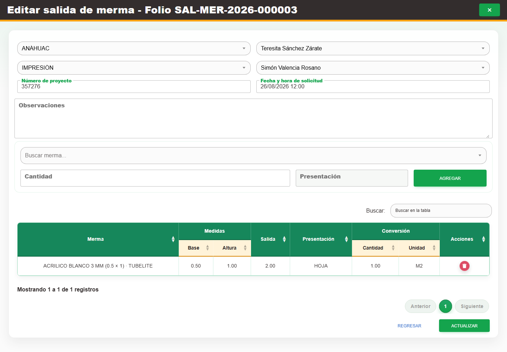

# 10. CAP-SAL-WAS-03-EDIT — Editar encabezado

**Casos de uso:** `CU-SAL-10` — Editar encabezado de salida de merma; `CU-SAL-11` — Editar detalles de merma de una salida.

**Antes de empezar:** Vamos a actualizar un salida existente. Tenga identificado el registro correcto y los datos que necesita corregir.

**Errores posibles:** [Validación de formularios](../../error-messages.md#errores-validacion), [Salidas de merma](../../error-messages.md#errores-salidas-merma).

**Controles que debe usar:** Acción **Editar registro**; selectores **Buscar cliente...**, **Buscar asesor...**, **Buscar área...** y **Buscar solicitante...**; campos **Número de proyecto**, **Fecha y hora de solicitud** y **Observaciones**; cuando el estado lo permita, selector **Buscar merma...**, campo **Cantidad** y botón **Agregar**; botones **Actualizar** y **Regresar**.

1. En la fila de la salida, seleccione **Editar registro**. Observe los controles que va a usar:

   

2. Modifique los selectores y campos indicados. Mientras la salida esté pendiente, para incorporar
   un detalle elija una opción en **Buscar merma...**, complete **Cantidad**, seleccione **Agregar** y
   compruebe que el renglón aparezca en la tabla; repita la operación cuando necesite más detalles.
   Después del primer surtido, los detalles quedan deshabilitados.
3. Revise la tabla y seleccione **Actualizar** para guardar o **Regresar** para salir sin confirmar.

**Compruebe el resultado:** Vuelva a abrir el registro y compruebe los cambios confirmados.
