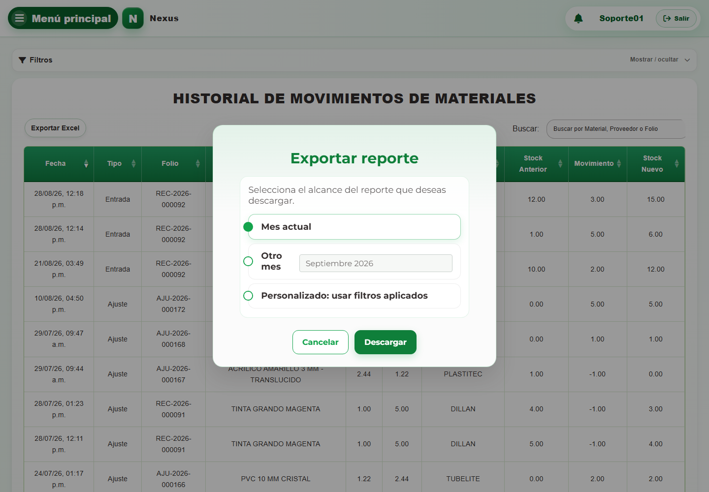

# 2. CAP-REP-MOV-MAT-02-EXPORT — Exportar reporte

**Casos de uso:** `CU-ALM-08` — Generar reporte de movimientos de materiales.

**Antes de empezar:** Vamos a obtener un reporte. Defina qué información y período necesita antes de elegir el alcance de la descarga.

**Errores posibles:** [Reportes](../../error-messages.md#errores-reportes).

**Controles que debe usar:** Botón **Exportar Excel**; opciones **Mes actual**, **Otro mes** o **Personalizado: usar filtros aplicados**; campo **Mes del reporte** y botón **Descargar**.

1. Seleccione **Exportar Excel** para abrir el modal **Exportar reporte**. Observe los controles que va a usar:

   

2. Elija **Mes actual**, **Otro mes** o **Personalizado: usar filtros aplicados** y complete **Mes del reporte** cuando corresponda.
3. Seleccione **Descargar** para generar el archivo.

**Compruebe el resultado:** Abra el archivo descargado y compruebe su módulo y alcance. Exportar no cambia existencias.
