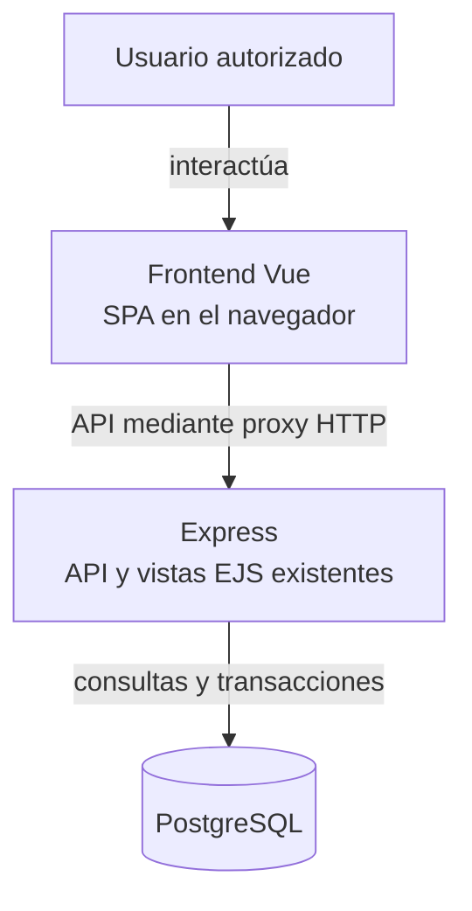
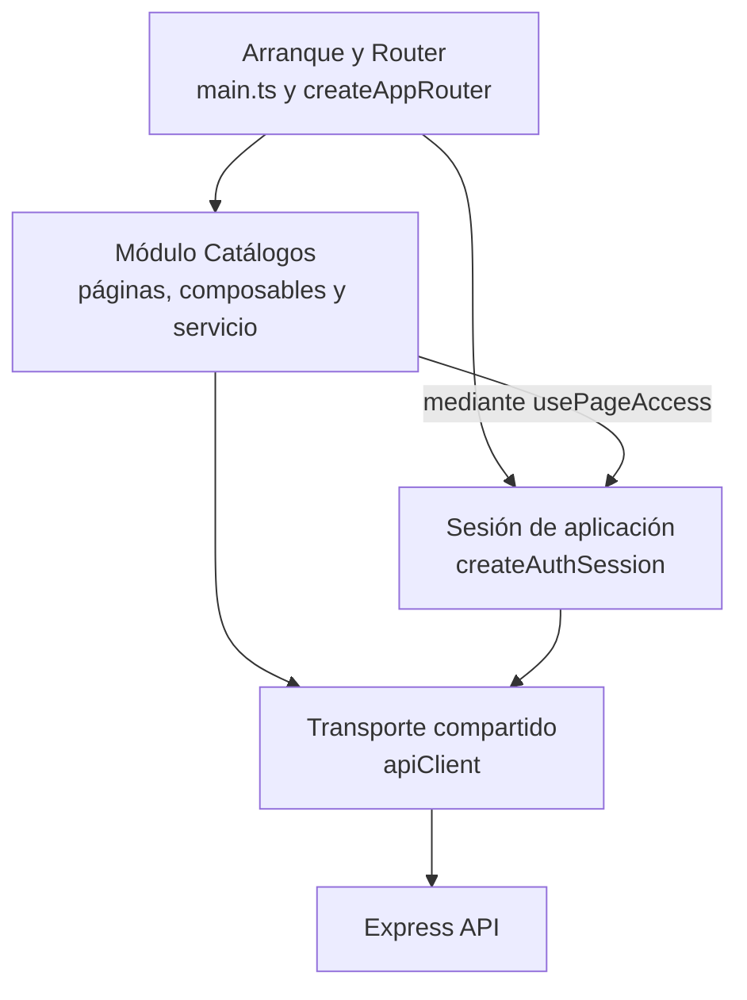

# 2. Modelo para documentar la arquitectura web de Vue

## Pregunta y decisión

Para este proyecto conviene usar **C4 de forma selectiva dentro de la organización
4+1 ya adoptada por Nexus**. C4 permite explicar límites y dependencias del cliente;
los patrones Vue y las secuencias describen sus colaboraciones concretas. No hace
falta sustituir toda la documentación por otra plantilla.

La arquitectura implementada es una **SPA cliente-servidor**, organizada en módulos
y composición de componentes/composables. C4 es un modelo para documentarla;
no es otra arquitectura que se instala en Vue. `arc42` es una estructura posible
de documentación, y UML aporta notaciones para preguntas específicas.

## Qué aporta cada alternativa

| Referencia o concepto | Aplicación a este proyecto | Decisión |
| --- | --- | --- |
| SPA y cliente-servidor | Vue Router cambia la vista del cliente y Express atiende la API. | Describir como arquitectura de ejecución actual, sin confundirla con un modelo documental. |
| Arquitectura de información | Organiza secciones, nombres, jerarquía del menú y recorridos entre páginas. | Aplica a la navegación web: [app/navigation.ts](../../src/app/navigation.ts), Router y guías de módulos son sus fuentes. Complementa la arquitectura del software, sin sustituir componentes o contratos HTTP. |
| C4 | Contexto, contenedores lógicos y componentes, con responsabilidades y relaciones. | Usar los niveles que respondan una pregunta. El contexto del producto sigue en la arquitectura general; aquí se amplía la ejecución de Vue y un corte de componentes. |
| 4+1 | Organiza escenarios, estructura, comportamiento, desarrollo y despliegue. | Conservar la [adaptación de Nexus](../../../back/docs/architecture/views/index.md). Las guías Vue se enlazan a esas preocupaciones sin copiar todas las vistas del servidor. |
| arc42 | Ofrece una estructura de contenidos para contexto, solución, vistas, decisiones y riesgos, entre otros temas. | Útil como lista de revisión; no adoptar paralelamente otra colección completa que duplique la organización existente. |
| UML | Secuencias o estados cuando importe orden, rechazo o transición. | Mantener las [secuencias aplicadas](../patterns/08-document-responsibilities.md#secuencia-de-guardado-confirmado). Las dependencias entre módulos no se presentan como clases UML. |
| MVC / MVVM | Pueden servir como vocabulario conceptual de presentación y estado. | No afirmar una implementación estricta: el código usa Composition API, props/eventos y composables; no declara una capa `ViewModel` por página ni copia controllers/repositories de Express. |

C4 no requiere cuatro dibujos para cada página. El nivel de código sólo se usa
si aporta algo que no expliquen ya contratos, referencias y diagramas aplicados.
Las normas 42010/1016 orientan contenido y relaciones; no obligan a elegir C4,
4+1, arc42, Mermaid o una arquitectura MVC.

## Vista lógica de ejecución del cliente

**Identificador:** `DIA-VUE-ARQ-001`. **Pregunta:** ¿dónde se ejecuta Vue y qué
relación tiene con Express y PostgreSQL? **Fuente:** `main.ts`, Router,
`apiClient`, `vite.config.ts`, Dockerfiles y `back/src/lib/prisma.js`.
Vista inspirada en el nivel de contenedores C4 con cajas Mermaid: es una
aproximación, no notación C4 completa ni prueba de un proveedor desplegado.
Las flechas representan interacción o comunicación, no orden de arranque.

La SPA y la API son unidades de software con responsabilidades distintas. Un
«contenedor» C4 no equivale necesariamente a un contenedor Docker: Vue se ejecuta
en el navegador; Nginx u otro alojamiento entrega sus archivos estáticos.
El [Dockerfile frontend](../../Dockerfile) compila `dist` y lo entrega con Nginx;
el [Dockerfile raíz](../../../Dockerfile) prepara Express. No se necesita ejecutar
ambas aplicaciones en una misma imagen.

En desarrollo Vite sirve el cliente y deriva la API. En la imagen frontend,
[nginx.conf](../../nginx.conf) configura el destino mediante `BACKEND_UPSTREAM`.
Las variantes de proveedor requieren su configuración de proxy/fallback y cookies;
el repositorio no acredita por sí solo cuál está desplegada. El navegador no
accede a Prisma, credenciales de PostgreSQL ni archivos privados del servidor.

## Vista de componentes: navegación y acceso a Catálogos

**Identificador:** `DIA-VUE-ARQ-002`. **Pregunta:** ¿qué componentes lógicos enlazan
navegación, sesión, módulo y transporte? **Fuente:** `main.ts`, `createAppRouter`,
`createAuthSession`, `usePageAccess`, `CatalogPage` y `catalogService`.
Corte de componentes inspirado en C4, representado con Mermaid; flechas = consumo
de un colaborador. No enumera todos los módulos ni representa unidades Docker.

La tabla de [fuentes propietarias](../index.md#estructura-y-fuentes-propietarias)
ubica los componentes. El [patrón contenedor/presentación](../patterns/02-container-and-presentation.md)
y los [composables configurados](../patterns/03-composables-and-callbacks.md)
amplían el interior del módulo; la [provisión de sesión](../patterns/06-session-provision.md)
explica que Router y páginas usan la misma instancia. Se evita repetir todo el
código de cada página en el diagrama arquitectónico.

## Cómo documentar una página o flujo web

C4 explica la estructura; una página necesita además su contrato de interacción.
Las guías de módulos mantienen esta información con el nivel de detalle útil:

| Información | Fuente o forma de comprobarla |
| --- | --- |
| Propósito y objetivo del usuario | Caso `CU-*` de la SRS, enlazado desde el módulo. |
| Ruta, contenedor y permiso de navegación | [Router](../../src/app/router/index.ts) y configuración del recurso. No mantener otro catálogo manual exhaustivo que pueda divergir. |
| Estado y operaciones | Composable propietario y contrato de props/eventos; explicar carga, vacío, error, captura y confirmación cuando correspondan. |
| Entradas, salidas y errores | Esquema público, mapper y servicio del recurso; OpenAPI conserva el contrato HTTP normativo. |
| Reutilización y decisiones | Enlazar el patrón y su aplicación; justificar las variantes del módulo. |
| Evidencia y límites | Unitarias/componentes y recorrido Playwright representativo; distinguir API simulada de persistencia real. |

La estructura no exige una ficha ni todos los tipos de diagrama por cada ruta.
Por ejemplo, [Salidas](../modules/07-issues.md) documenta modos y efectos visibles, mientras
[responsabilidades de documentos](../patterns/08-document-responsibilities.md) documenta la
colaboración interna. La [guía de inicio](../development/01-getting-started.md) conserva el proceso
de preparación; una vista arquitectónica no sustituye instrucciones ejecutables.

## Referencias de los modelos

- [Modelo C4](https://c4model.com/diagrams): contexto, contenedores y componentes.
- [Documentación de arc42](https://docs.arc42.org/): estructura y preguntas de revisión.
- [Vistas arquitectónicas de Nexus](../../../back/docs/architecture/views/index.md):
  organización vigente y semántica de las notaciones.
- [Criterios documentales del frontend](../index.md#criterios-documentales-adaptados-a-vue):
  adopción selectiva y límites de las normas.
