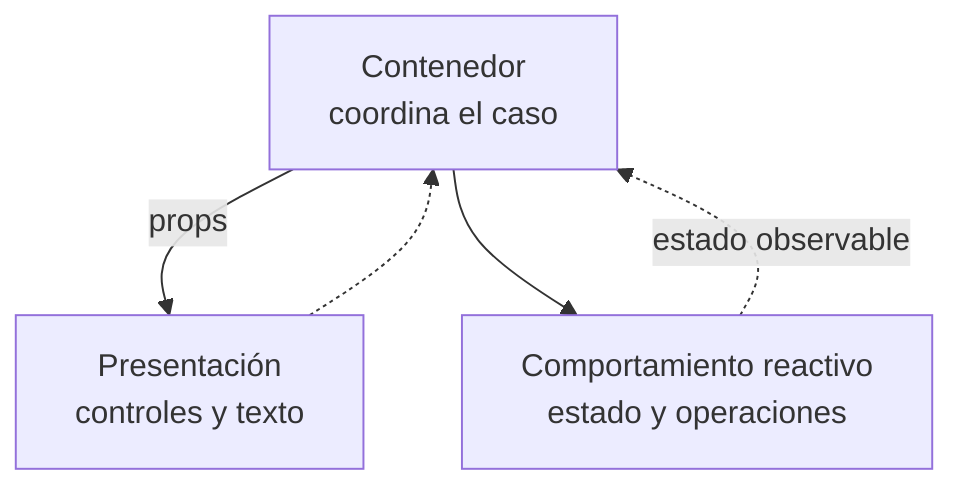
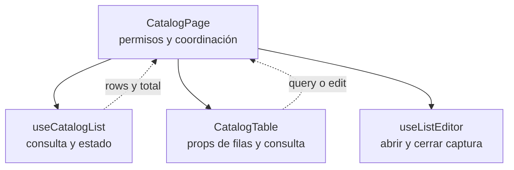

# 2. Contenedor y presentación

## Propósito y funcionamiento

Un componente que consulta la API, decide permisos y dibuja controles cambia por
motivos distintos. El contenedor coordina el caso; la presentación recibe props
y emite intenciones. En Vue esta separación se implementa con componentes y
composables, que conservan el estado y coordinan las operaciones de la página.

## Modelo general de contenedor y presentación

**Identificador:** `DIA-VUE-GEN-001`. **Pregunta:** ¿quién posee el estado y quién
presenta la interacción? **Fuente:** contratos de props/eventos de Vue y sus
consumidores actuales. Modelo conceptual; flechas continuas = consumo o datos
entregados, discontinuas = intenciones emitidas.

**Lectura visual:** [formas, límites y flechas del mapa](../../diagram-reading.md#mapas-y-actividades).

## Aplicación en la página de Catálogos

**Identificador:** `DIA-VUE-APL-001`. **Pregunta:** ¿quién carga, presenta y abre la
edición de un catálogo? **Fuente:** `CatalogPage`, `useCatalogList`, `CatalogTable`
y `useListEditor`. Flechas continuas = composición; discontinuas = datos o eventos.

## Código, contrato y límites

[CatalogPage](../../../../../src/modules/catalogs/pages/CatalogPage.vue) compone los
colaboradores, pasa filas/consulta y conecta `query` a `list.applyQuery`; `edit`
abre el editor con la fila seleccionada.
[CatalogTable](../../../../../src/modules/catalogs/components/CatalogTable.vue) define
columnas y emite eventos; no solicita HTTP ni consulta la sesión.
[useListEditor](../../../../../src/shared/composables/useListEditor.ts) conserva el ciclo
de apertura y recarga, sin definir las reglas del catálogo.

La presentación puede tener estado visual local o valores calculados. Una page
también puede contener un diálogo: la carpeta `pages` identifica su coordinación,
mientras el Router determina cuáles de esas páginas tienen una URL.

[catalogs.spec.ts](../../../../../tests/e2e/catalogs.spec.ts) comprueba el flujo con API
simulada; las [pruebas del editor](../../../../../tests/unit/modules/catalogs/catalogEditorTest.ts)
observan captura, errores y confirmación. No acreditan autorización en el backend.
Referencia: [props](https://vuejs.org/guide/components/props.html) y
[eventos de Vue](https://vuejs.org/guide/components/events.html).
