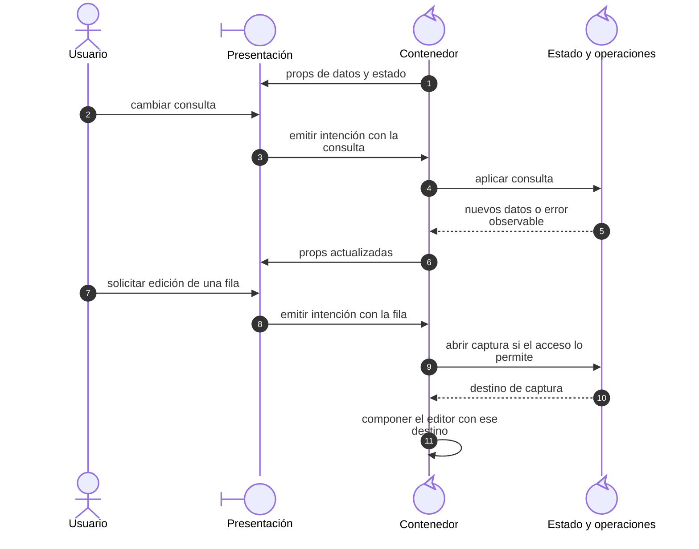
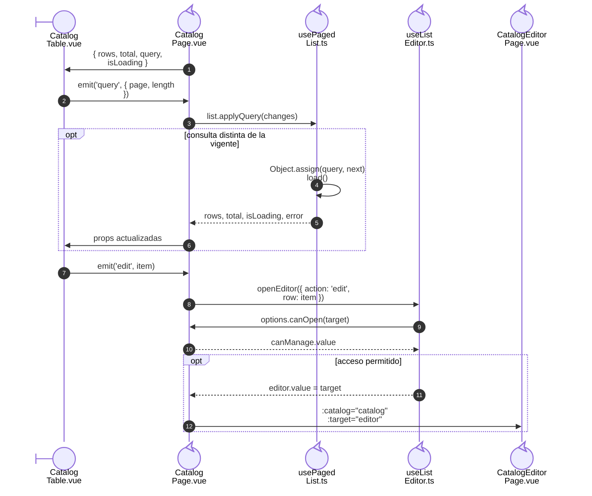

# 2. Contenedor y presentación

## Propósito y funcionamiento

Un componente que consulta la API, decide permisos y dibuja controles cambia por
motivos distintos. El contenedor coordina el caso; la presentación recibe props
y emite intenciones. En Vue esta separación se implementa con componentes y
composables, que conservan el estado y coordinan las operaciones de la página.

## Modelo general de contenedor y presentación

**Identificador:** `DIA-VUE-GEN-001`. **Pregunta:** ¿cómo vuelve una intención del
usuario al propietario del estado? **Fuente:** contratos de props/eventos de Vue
y sus consumidores actuales. Secuencia conceptual de consulta y apertura de captura.

**Lectura visual:** [mensajes, retornos y alternativas de secuencia](../../diagram-reading.md#secuencias).

## Aplicación en la página de Catálogos

**Identificador:** `DIA-VUE-APL-001`. **Pregunta:** ¿cómo se aplican las intenciones
de `CatalogTable`? **Fuente:** `CatalogPage`, `CatalogTable`, `useCatalogList`,
`usePagedList` y `useListEditor`. Secuencia sobre las instancias ya creadas;
el callback de consulta se desarrolla en `DIA-VUE-PAT-001`.

## Código, contrato y límites

[CatalogPage](../../../../../src/modules/catalogs/pages/CatalogPage.vue) compone los
colaboradores, pasa filas/consulta y conecta `query` a `list.applyQuery`; `edit`
abre el editor con la fila seleccionada.
[CatalogTable](../../../../../src/modules/catalogs/components/CatalogTable.vue) define
columnas y emite eventos; no solicita HTTP ni consulta la sesión.
[useListEditor](../../../../../src/shared/composables/useListEditor.ts) conserva el ciclo
de apertura y recarga, sin definir las reglas del catálogo.

Los eventos de componente llegan al padre directo; un contenedor intermedio los
reenvía explícitamente. La presentación puede tener estado visual local o valores calculados. Una page
también puede contener un diálogo: la carpeta `pages` identifica su coordinación,
mientras el Router determina cuáles de esas páginas tienen una URL.

[catalogs.spec.ts](../../../../../tests/e2e/catalogs.spec.ts) comprueba el flujo con API
simulada; las [pruebas del editor](../../../../../tests/unit/modules/catalogs/catalogEditorTest.ts)
observan captura, errores y confirmación.
