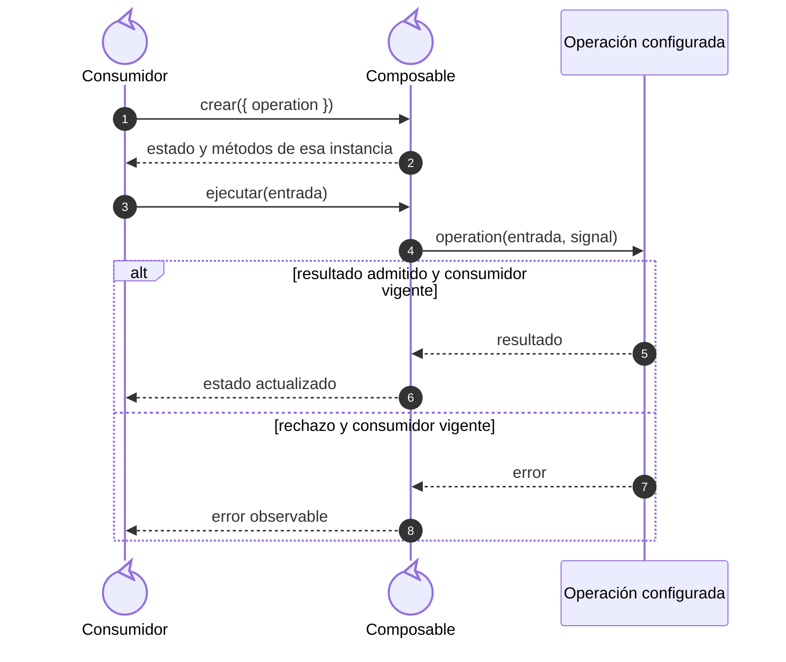
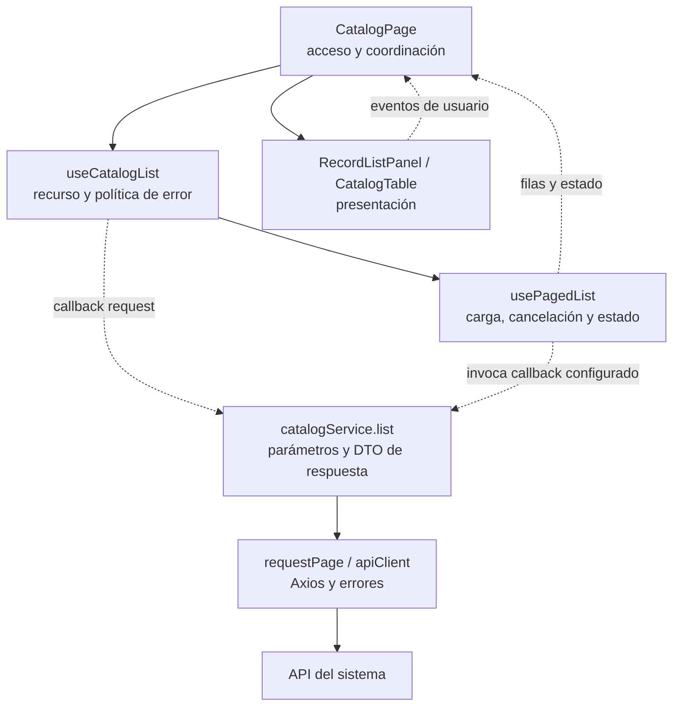
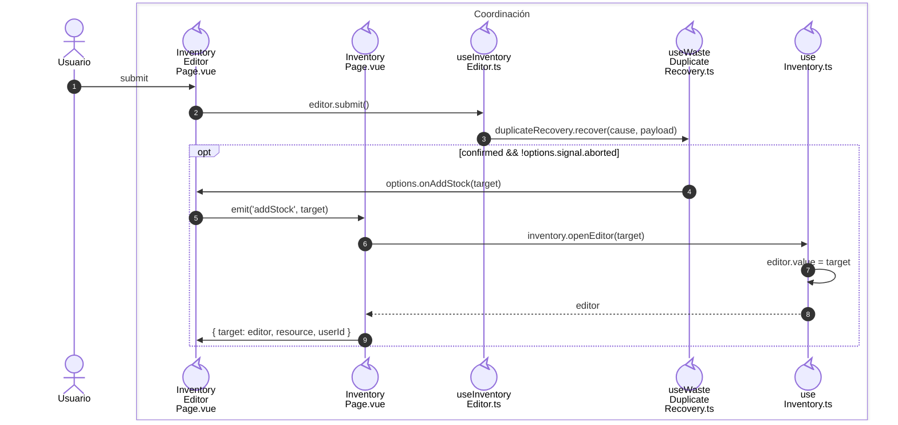
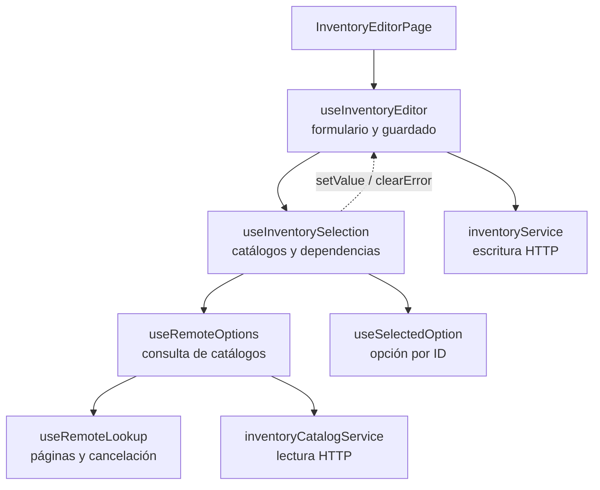

# 3. Composables y operaciones por callback

## Propósito y funcionamiento

Un composable crea el estado reactivo de una interacción y expone sus operaciones.
En los listados administra carga, error, cancelación y paginación. El consumidor
aporta la consulta como callback: así el mismo mecanismo trabaja con recursos
distintos y cada pantalla conserva su propia instancia.

## Modelo general de composición por callback

**Identificador:** `DIA-VUE-GEN-002`. **Pregunta:** ¿cómo varía la operación sin
acoplar el núcleo al dominio? **Fuente:** contratos de `usePagedList`,
`useRemoteLookup` y `useRecordSave`. **Notación:** secuencia UML de roles genéricos;
flechas continuas = llamada, discontinuas = retorno o estado expuesto. Los nombres
ilustran el mecanismo; las funciones concretas se identifican en los casos aplicados.

**Lectura visual:** [líneas de vida, números y mensajes](../../diagram-reading.md#secuencias); [formas, límites y flechas del mapa](../../diagram-reading.md#mapas-y-actividades).

## Dependencias y composición de un listado

**Identificador:** `DIA-VUE-PAT-001`. **Pregunta:** ¿cómo reutilizar el listado sin
acoplar presentación y HTTP? **Fuente:** `CatalogPage`, `useCatalogList`,
`usePagedList`, `catalogService`, `RecordListPanel` y `CatalogTable`. Flechas
continuas = composición/llamada; discontinuas = datos, eventos o callbacks.

## Código, contrato y límites

[useCatalogList](../../../../../src/modules/catalogs/composables/useCatalogList.ts)
configura `request(query, signal)` y traduce 401/403 mediante `onDenied`.
El [ciclo de lectura](../../logical/states/04-state-ownership-and-save.md#consulta-y-actualización)
define cancelación y respuestas tardías; el
[contrato de callbacks](../../../contracts/form-and-event-contracts.md#callbacks-de-composición),
los intercambios del lector y guardado.

El callback debe conservar resultados, errores y `AbortSignal`; una firma válida
de TypeScript no demuestra sustitución de comportamiento.
[catalogListTest](../../../../../tests/unit/modules/catalogs/catalogListTest.ts) y
[remoteLookupTest](../../../../../tests/unit/shared/composables/remoteLookupTest.ts)
comprueban estado, paginación y respuestas tardías según sus contratos.

## Coordinación de la alternativa de merma duplicada

[useWasteDuplicateRecovery](../../../../../src/modules/warehouse/composables/useWasteDuplicateRecovery.ts)
decide si puede ofrecer la transición: permiso, rechazo definitivo, identidad
recibida y confirmación. [mapWasteStockAddition](../../../../../src/modules/warehouse/mappers/wasteStockAdditionMapper.ts)
adapta el contexto reducido del error a `StockAdditionTarget`; no fabrica la versión
que necesitarían Editar o Ajustar. `useInventoryEditor` conserva validación, captura
e idempotencia; la página propietaria sustituye el editor mediante el evento tipado
`addStock`. La presentación no navega ni escribe por su cuenta.

**Identificador:** `DIA-VUE-PAT-002`. **Pregunta:** ¿cómo realiza Vue `CU-ALM-10` A2
sin acoplar dos modales ni escribir al aceptar el aviso? **Fuente:** `useInventoryEditor`,
`useWasteDuplicateRecovery`, `InventoryEditorPage`, `InventoryPage` y `useInventory`.
Secuencia del camino de confirmación; los participantes representan roles de
interacción y módulos funcionales, no clases. Cancelar conserva el alta;
un desmontaje impide la transición tardía.

Las pruebas de [recuperación](../../../../../tests/unit/modules/warehouse/wasteDuplicateRecoveryTest.ts)
y [navegador](../../../../../tests/e2e/warehouse.spec.ts) protegen cancelación, cero/positivo,
permiso, incertidumbre y confirmación separada de la escritura.

## Selección dependiente de inventario

El [modelo general de composición por callback](#modelo-general-de-composición-por-callback)
se aplica a la selección del formulario sin trasladar a ese colaborador el guardado.
[useInventoryEditor](../../../../../src/modules/warehouse/composables/useInventoryEditor.ts)
es propietario de VeeValidate, validación, envío versionado y captura pendiente de
merma. [useInventorySelection](../../../../../src/modules/warehouse/composables/useInventorySelection.ts)
compone las consultas y opciones elegidas; los cambios de unidad, proveedor o
plantilla actualizan sólo sus campos dependientes mediante callbacks del editor.
Esos cambios programáticos no se confunden con interacción del usuario ni disparan
validación al abrir el modal.

**Identificador:** `DIA-VUE-PAT-004`. **Pregunta:** ¿cómo separar selección y guardado
conservando un único propietario de la captura? **Fuente:** `InventoryEditorPage`,
`useInventoryEditor`, `useInventorySelection`, `useRemoteOptions`, `useRemoteLookup`,
`useSelectedOption`, `inventoryService` e `inventoryCatalogService`.
Flechas continuas = composición o consulta; discontinuas = callbacks sobre la captura.

`useSelectedOption` admite una precarga que debe coincidir con el ID vigente.
La opción remota actualiza datos; después se conserva aunque cambie la página.
Limpiar o cambiar el ID invalida la selección anterior. Compras y Salidas usan el
mismo núcleo para altas recientes y documentos cargados; sus composables conservan
reglas de inactivos, permisos, captura y renovación del catálogo.

[selectedOptionTest](../../../../../tests/unit/shared/composables/selectedOptionTest.ts)
comprueba precarga, actualización remota, limpieza e independencia de instancias.
Las pruebas de Inventario, Compras y Salidas observan captura, payloads,
dependencias y recuperación del consumidor.

## Fuentes de los participantes

[InventoryEditorPage.vue](../../../../../src/modules/warehouse/pages/InventoryEditorPage.vue),
[InventoryPage.vue](../../../../../src/modules/warehouse/pages/InventoryPage.vue),
[useInventoryEditor.ts](../../../../../src/modules/warehouse/composables/useInventoryEditor.ts),
[useWasteDuplicateRecovery.ts](../../../../../src/modules/warehouse/composables/useWasteDuplicateRecovery.ts),
[useInventory.ts](../../../../../src/modules/warehouse/composables/useInventory.ts).
