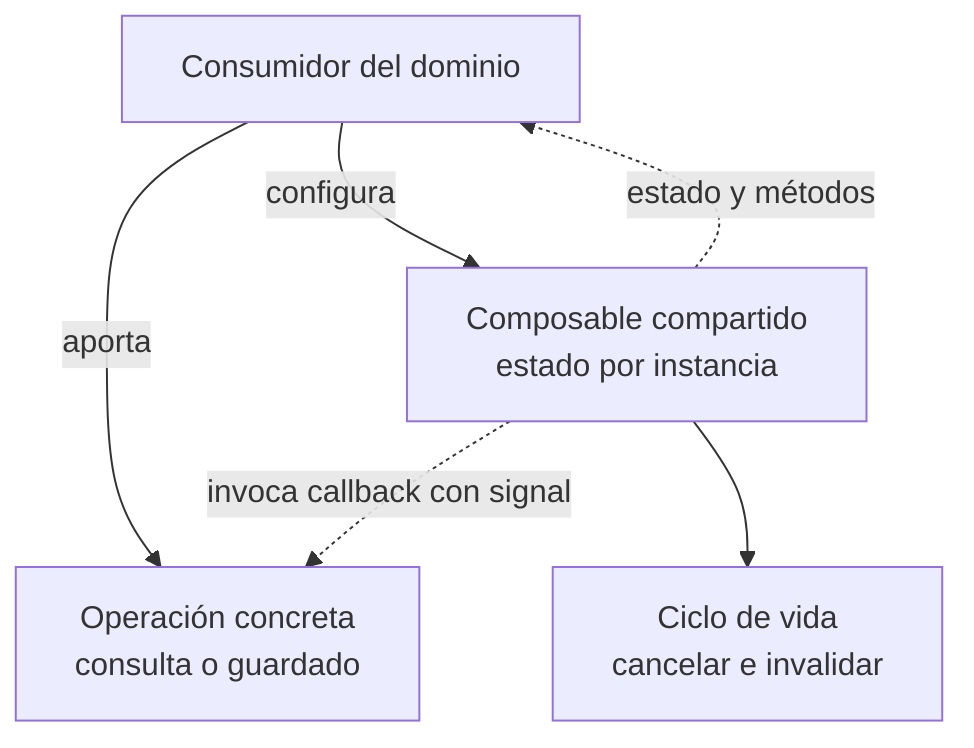
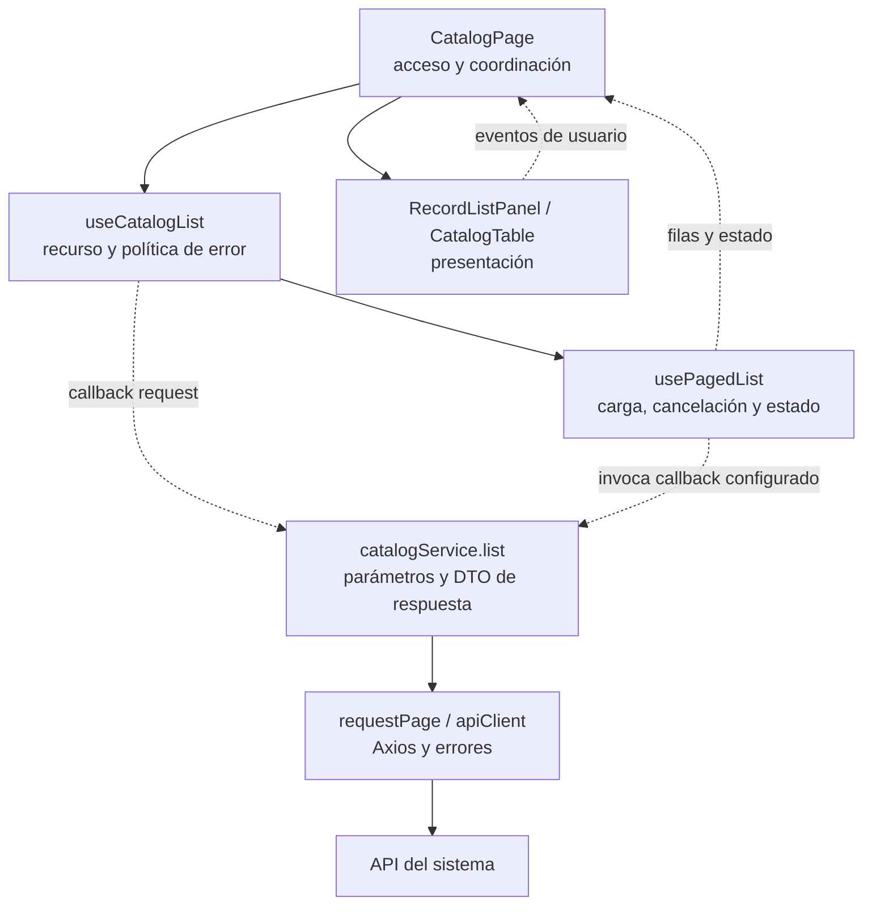
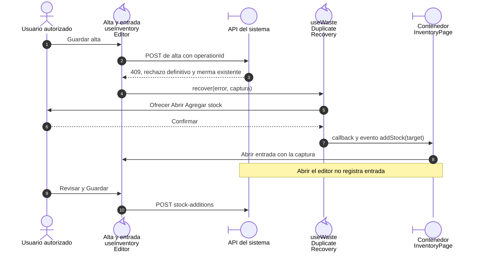
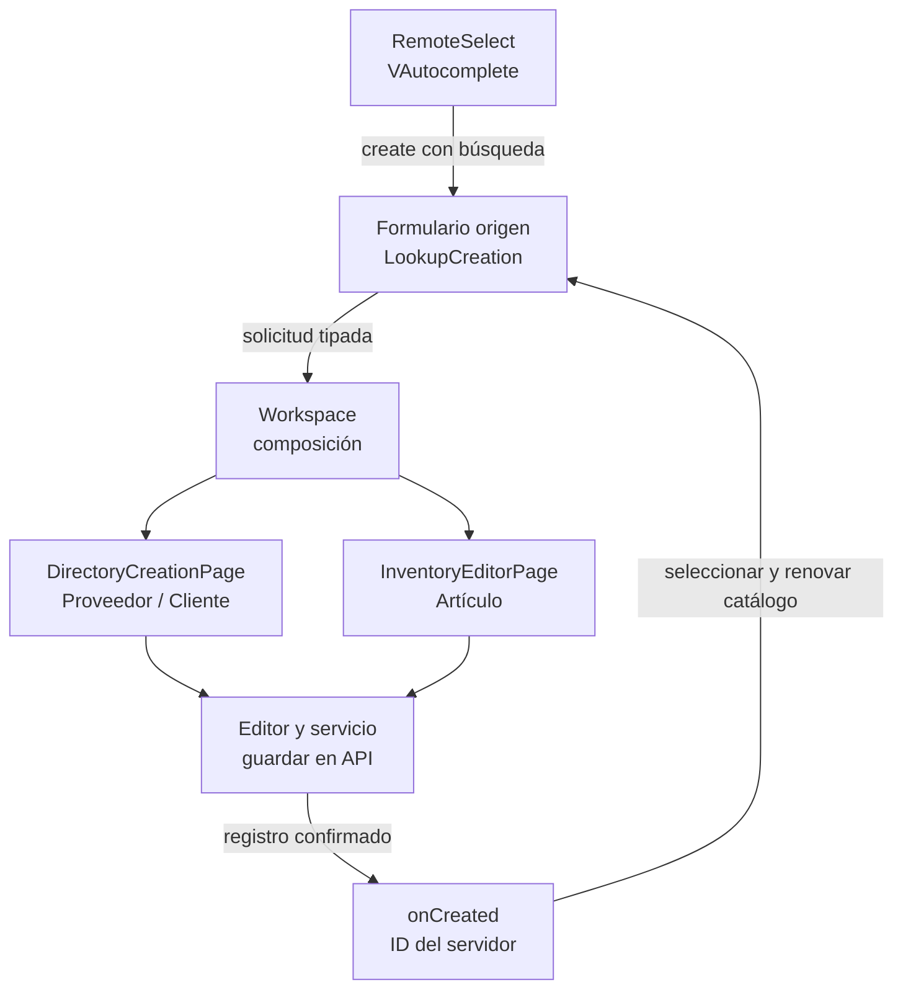
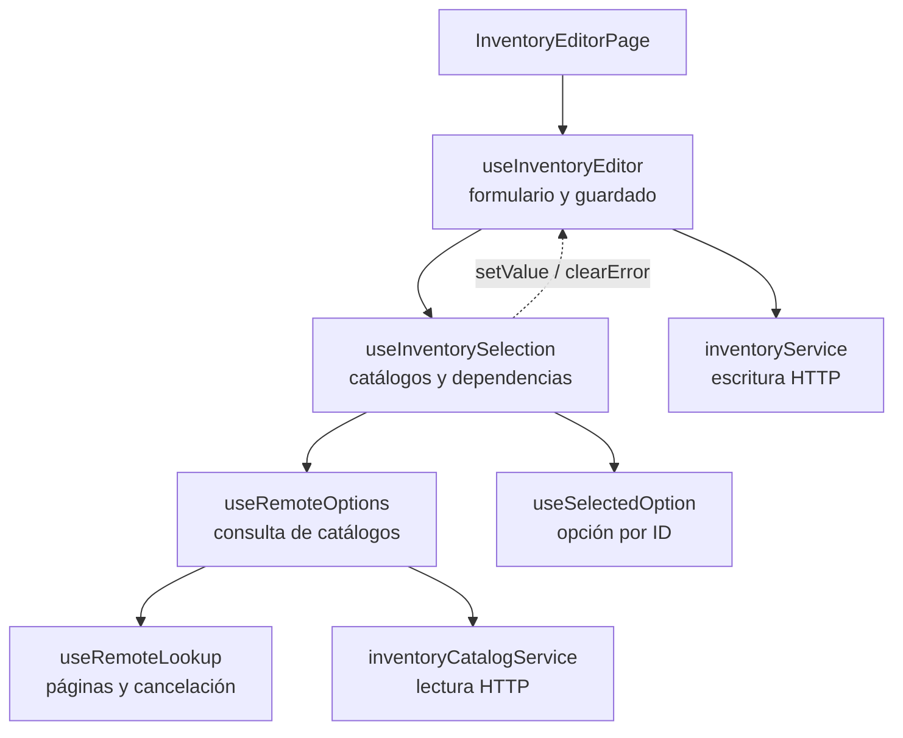

# 3. Composables y operaciones por callback

## Problema y decisión

Los listados comparten carga, error, cancelación y paginación, pero consultan
recursos distintos. Un composable concentra el comportamiento reactivo común
y recibe la operación variable como función. Es composición y estrategia
funcional; no se declaran clases Strategy ni se comparte el estado de todas las
pantallas en una única instancia.

## Modelo general de composición por callback

**Identificador:** `DIA-VUE-GEN-002`. **Pregunta:** ¿cómo varía la operación sin
acoplar el núcleo al dominio? **Fuente:** contratos de `usePagedList`,
`useRemoteLookup` y `useRecordSave`. Flechas continuas = configuración/consumo;
discontinuas = invocación configurada o resultado observable.

**Lectura visual:** [líneas de vida, números y mensajes](../../diagram-reading.md#secuencias); [formas, límites y flechas del mapa](../../diagram-reading.md#mapas-y-actividades).

## Dependencias y composición de un listado

**Identificador:** `DIA-VUE-PAT-001`. **Pregunta:** ¿cómo reutilizar el listado sin
acoplar presentación y HTTP? **Fuente:** `CatalogPage`, `useCatalogList`,
`usePagedList`, `catalogService`, `RecordListPanel` y `CatalogTable`. Flechas
continuas = composición/llamada; discontinuas = datos, eventos o callbacks.

## Código, contrato y límites

[useCatalogList](../../../../../src/modules/catalogs/composables/useCatalogList.ts)
configura `request(query, signal)` y traduce rechazos 401/403 mediante `onDenied`.
[usePagedList](../../../../../src/shared/composables/usePagedList.ts) conserva la consulta,
las filas y el error, aborta la solicitud anterior e invalida respuestas antiguas
con una secuencia; al desmontar cancela el trabajo. No importa `catalogService`.

[useDocumentRead](../../../../../src/shared/composables/useDocumentRead.ts) y
[useRecordSave](../../../../../src/shared/composables/useRecordSave.ts) aplican el mismo
criterio a contratos distintos. No se fusionan sólo porque todos tengan una
promesa. Cancelar en el navegador no revierte una escritura ya confirmada.

El callback debe conservar resultados, errores y `AbortSignal`; una firma válida
de TypeScript no demuestra sustitución de comportamiento.
[catalogListTest](../../../../../tests/unit/modules/catalogs/catalogListTest.ts) y
[remoteLookupTest](../../../../../tests/unit/shared/composables/remoteLookupTest.ts)
comprueban estado, paginación y respuestas tardías según sus contratos.
Referencia: [composables de Vue](https://vuejs.org/guide/reusability/composables.html).

## Coordinación de la alternativa de merma duplicada

[useWasteDuplicateRecovery](../../../../../src/modules/warehouse/composables/useWasteDuplicateRecovery.ts)
decide si puede ofrecer la transición: permiso, rechazo definitivo, identidad
recibida y confirmación. [mapWasteStockAddition](../../../../../src/modules/warehouse/mappers/wasteStockAdditionMapper.ts)
adapta el contexto reducido del error a `StockAdditionTarget`; no fabrica la versión
que necesitarían Editar o Ajustar. `useInventoryEditor` conserva validación, captura
e idempotencia; la página propietaria sustituye el editor mediante el evento tipado
`addStock`. La presentación no navega ni escribe por su cuenta.

**Identificador:** `DIA-VUE-PAT-002`. **Pregunta:** ¿cómo realiza Vue `CU-ALM-10` A2
sin acoplar dos modales ni escribir al aceptar el aviso? **Fuente:** `useInventoryEditor`,
`useWasteDuplicateRecovery`, `InventoryEditorPage`, `InventoryPage` y `useInventory`.
Secuencia del camino de confirmación; los participantes representan roles de
interacción y módulos funcionales, no clases. Cancelar conserva el alta;
un desmontaje impide la transición tardía.

Se aplican los patrones ya adoptados: contenedor/presentación, composición por
callback y adaptador de datos. La transición es un flujo local con una unión
discriminada de TypeScript; no constituye State de GoF ni requiere un almacén global.
Las pruebas de [recuperación](../../../../../tests/unit/modules/warehouse/wasteDuplicateRecoveryTest.ts)
y [navegador](../../../../../tests/e2e/warehouse.spec.ts) protegen cancelación, cero/positivo,
permiso, incertidumbre y confirmación separada de la escritura.

## Altas contextuales mediante eventos y callbacks

**Identificador:** `DIA-VUE-PAT-003`. **Pregunta:** ¿cómo abre un selector el
formulario de otro módulo sin consultar su API ni perder la captura de origen?
**Fuente:** `RemoteSelect`, `LookupCreation`, `InventoryWorkspace`, `PurchaseWorkspace`,
`IssueWorkspace`, `DirectoryCreationPage` e `InventoryEditorPage`.
Flujo de composición del cliente: las flechas representan eventos/callbacks y
responsabilidades; no son relaciones de clases ni una transacción de base de datos.

Se reutiliza contenedor/presentación y composición por callbacks. `RemoteSelect`
no importa módulos de negocio; cada Workspace importa los contenedores necesarios.
No se implementa un bus de eventos global ni un store para estas capturas locales.
Cancelar no invoca `onCreated`; los formularios vivos admiten sólo la selección
compatible con su modo y disponibilidad. El alta desde Compras conserva el proveedor
fijado y su contrato de artículo sin existencia inicial capturada.

La [comparación de bibliotecas y flujos Vue](../../logical/ui-and-http.md#alta-contextual-desde-un-selector)
justifica extender el control Vuetify instalado. Las pruebas de
[navegador](../../../../../tests/e2e/selectCreation.spec.ts) y
[captura de inventario](../../../../../tests/unit/modules/warehouse/inventoryFormTest.ts)
comprueban los efectos observables, no las llamadas privadas entre componentes.

## Selección dependiente de inventario

El [modelo general de composición por callback](#modelo-general-de-composición-por-callback)
se aplica a la selección del formulario sin trasladar a ese colaborador el guardado.
[useInventoryEditor](../../../../../src/modules/warehouse/composables/useInventoryEditor.ts)
es propietario de VeeValidate, validación, envío versionado y captura pendiente de
merma. [useInventorySelection](../../../../../src/modules/warehouse/composables/useInventorySelection.ts)
compone las consultas y opciones elegidas; los cambios de unidad, proveedor o
plantilla actualizan sólo sus campos dependientes mediante callbacks del editor.
Esos cambios programáticos no se confunden con interacción del usuario ni disparan
validación al abrir el modal.

**Identificador:** `DIA-VUE-PAT-004`. **Pregunta:** ¿cómo separar selección y guardado
conservando un único propietario de la captura? **Fuente:** `InventoryEditorPage`,
`useInventoryEditor`, `useInventorySelection`, `useRemoteOptions`, `useRemoteLookup`,
`useSelectedOption`, `inventoryService` e `inventoryCatalogService`.
Flechas continuas = composición o consulta; discontinuas = callbacks sobre la captura.

`useSelectedOption` admite una precarga que debe coincidir con el ID vigente.
La opción remota actualiza datos; después se conserva aunque cambie la página.
Limpiar o cambiar el ID invalida la selección anterior. Compras y Salidas usan el
mismo núcleo para altas recientes y documentos cargados; sus composables conservan
reglas de inactivos, permisos, captura y renovación del catálogo.

[selectedOptionTest](../../../../../tests/unit/shared/composables/selectedOptionTest.ts)
comprueba precarga, actualización remota, limpieza e independencia de instancias.
Las pruebas existentes de Inventario, Compras y Salidas mantienen sus oráculos de
captura, payloads, dependencias y recuperación; no se sustituyen por aserciones
sobre el nuevo reparto de archivos.
