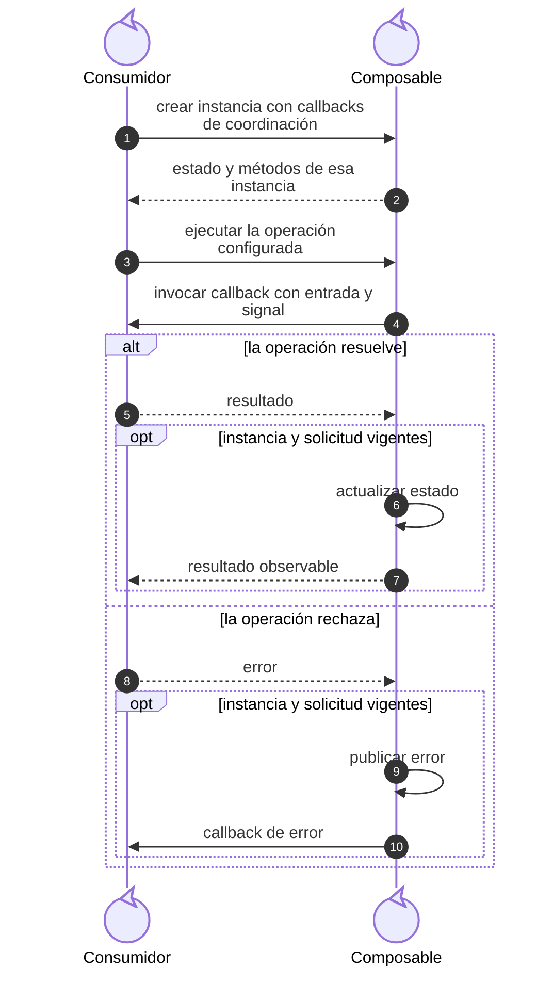
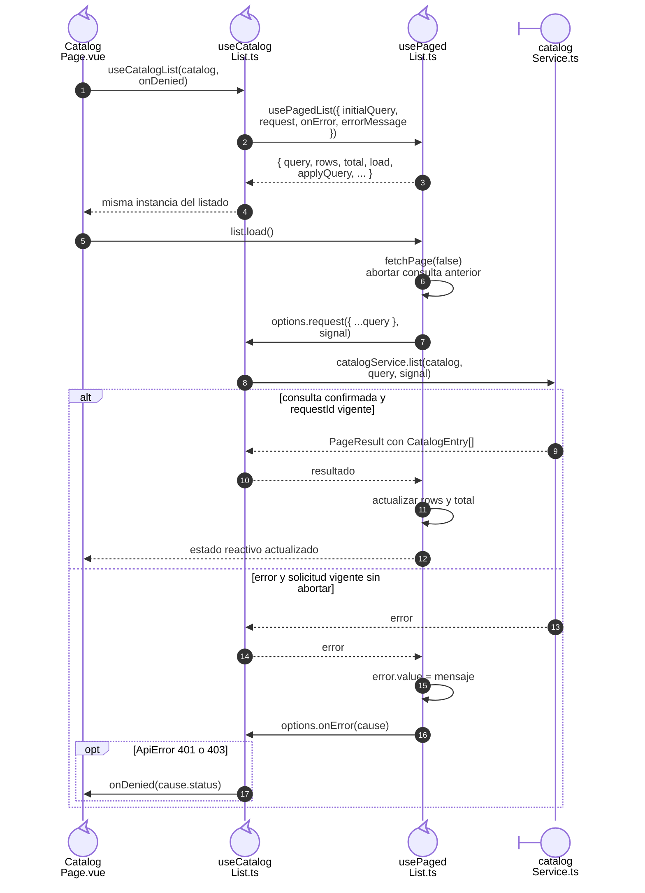
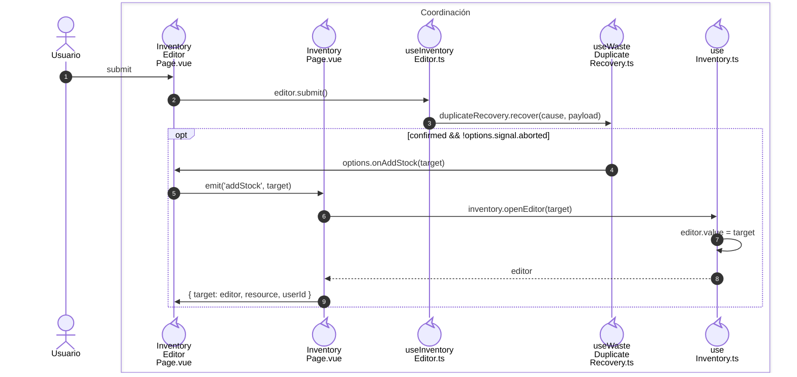
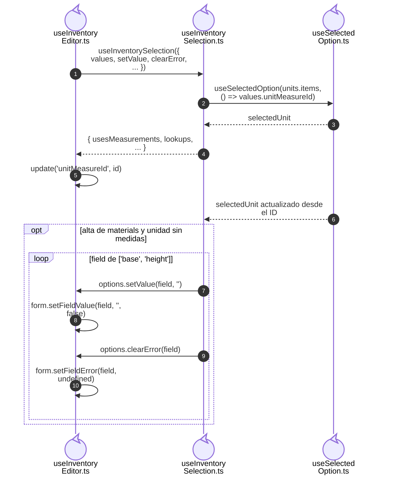

# 3. Composables y operaciones por callback

## Propósito y funcionamiento

Un composable crea el estado reactivo de una interacción y expone sus operaciones.
En los listados administra carga, error, cancelación y paginación. El consumidor
aporta la consulta como callback: así el mismo mecanismo trabaja con recursos
distintos y cada pantalla conserva su propia instancia.

## Modelo general de composición por callback

**Identificador:** `DIA-VUE-GEN-002`. **Pregunta:** ¿cómo varía la operación sin
acoplar el núcleo al dominio? **Fuente:** contratos de `usePagedList`,
`useRemoteLookup` y `useRecordSave`. **Notación:** secuencia UML de roles genéricos;
el callback pertenece al consumidor y el coordinador lo ejecuta. Los nombres
ilustran el mecanismo; las funciones concretas se identifican en los casos aplicados.

**Lectura visual:** [líneas de vida, números y mensajes](../../diagram-reading.md#secuencias); [formas, límites y flechas del mapa](../../diagram-reading.md#mapas-y-actividades).

## Dependencias y composición de un listado

**Identificador:** `DIA-VUE-PAT-001`. **Pregunta:** ¿quién configura y quién ejecuta
la consulta del listado? **Fuente:** `CatalogPage`, `useCatalogList`, `usePagedList`
y `catalogService`. Secuencia de configuración y de una carga; el transporte
interno del servicio queda fuera de este corte.

## Código, contrato y límites

[useCatalogList](../../../../../src/modules/catalogs/composables/useCatalogList.ts)
configura `request(query, signal)` y traduce 401/403 mediante `onDenied`.
El [ciclo de lectura](../../logical/states/04-state-ownership-and-save.md#consulta-y-actualización)
define cancelación y respuestas tardías; el
[contrato de callbacks](../../../contracts/form-and-event-contracts.md#callbacks-de-composición),
los intercambios del lector y guardado.

Los lectores reciben la consulta al crearse; el guardado recibe la operación en
`execute(operation)`. Las pruebas de [listados](../../../../../tests/unit/modules/catalogs/catalogListTest.ts)
y [búsqueda remota](../../../../../tests/unit/shared/composables/remoteLookupTest.ts)
comprueban sus resultados y respuestas tardías.

## Coordinación de la alternativa de merma duplicada

[useWasteDuplicateRecovery](../../../../../src/modules/warehouse/composables/useWasteDuplicateRecovery.ts)
decide si puede ofrecer la transición: permiso, rechazo definitivo, identidad
recibida y confirmación. [mapWasteStockAddition](../../../../../src/modules/warehouse/mappers/wasteStockAdditionMapper.ts)
adapta el contexto reducido del error a `StockAdditionTarget`; no fabrica la versión
que necesitarían Editar o Ajustar. `useInventoryEditor` conserva validación, captura
e idempotencia; la página propietaria sustituye el editor mediante el evento tipado
`addStock`. La presentación no navega ni escribe por su cuenta.

**Identificador:** `DIA-VUE-PAT-002`. **Pregunta:** ¿cómo realiza Vue `CU-ALM-10` A2
sin acoplar dos modales ni escribir al aceptar el aviso? **Fuente:** `useInventoryEditor`,
`useWasteDuplicateRecovery`, `InventoryEditorPage`, `InventoryPage` y `useInventory`.
Secuencia del camino de confirmación; los participantes representan roles de
interacción y módulos funcionales, no clases. Cancelar conserva el alta;
un desmontaje impide la transición tardía.

Las pruebas de [recuperación](../../../../../tests/unit/modules/warehouse/wasteDuplicateRecoveryTest.ts)
y [navegador](../../../../../tests/e2e/warehouse.spec.ts) protegen cancelación, cero/positivo,
permiso, incertidumbre y confirmación separada de la escritura.

## Selección dependiente de inventario

[useInventoryEditor](../../../../../src/modules/warehouse/composables/useInventoryEditor.ts)
conserva la captura y el guardado.
[useInventorySelection](../../../../../src/modules/warehouse/composables/useInventorySelection.ts)
coordina las opciones y actualiza campos dependientes mediante callbacks del editor.

**Identificador:** `DIA-VUE-PAT-004`. **Pregunta:** ¿cómo separar selección y guardado
conservando un único propietario de la captura? **Fuente:** `useInventoryEditor`,
`useInventorySelection`, `useSelectedOption` y los callbacks del editor.
Secuencia del cambio a una unidad sin medidas en un alta de Materiales. Los callbacks
`setValue` y `clearError` se declaran en el editor; la selección no posee el formulario.

El [contrato de selección](../../../contracts/form-and-event-contracts.md#props-y-propiedad-de-los-datos)
define los datos compartidos. Las pruebas de
[selección por ID](../../../../../tests/unit/shared/composables/selectedOptionTest.ts)
y los consumidores de Inventario, Compras y Salidas comprueban sus cambios y recuperación.

## Fuentes de los participantes

[InventoryEditorPage.vue](../../../../../src/modules/warehouse/pages/InventoryEditorPage.vue),
[InventoryPage.vue](../../../../../src/modules/warehouse/pages/InventoryPage.vue),
[useInventoryEditor.ts](../../../../../src/modules/warehouse/composables/useInventoryEditor.ts),
[useWasteDuplicateRecovery.ts](../../../../../src/modules/warehouse/composables/useWasteDuplicateRecovery.ts),
[useInventory.ts](../../../../../src/modules/warehouse/composables/useInventory.ts).
