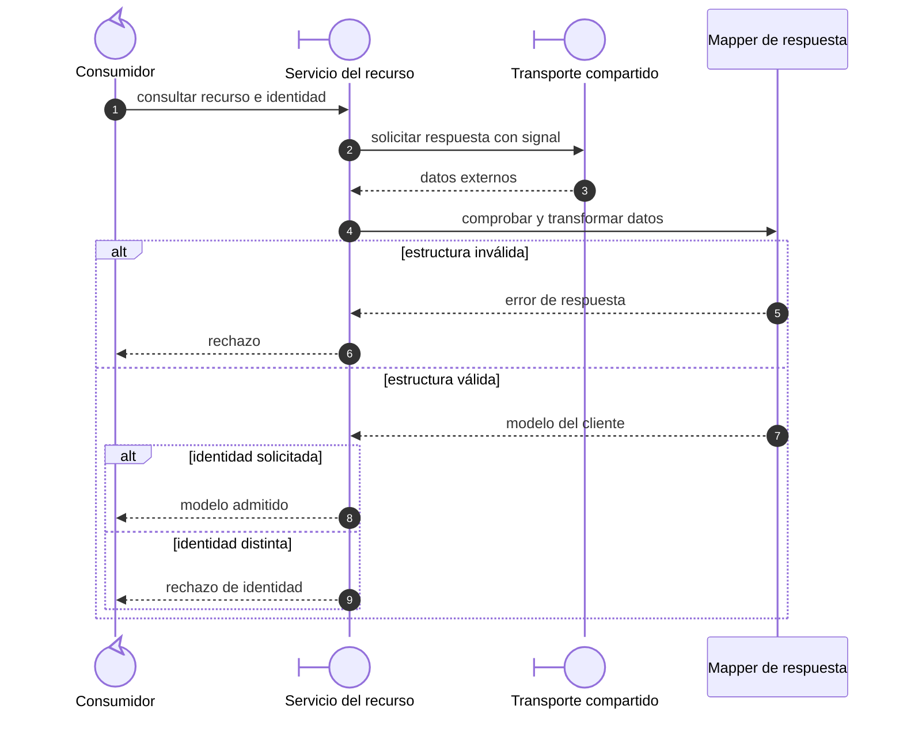
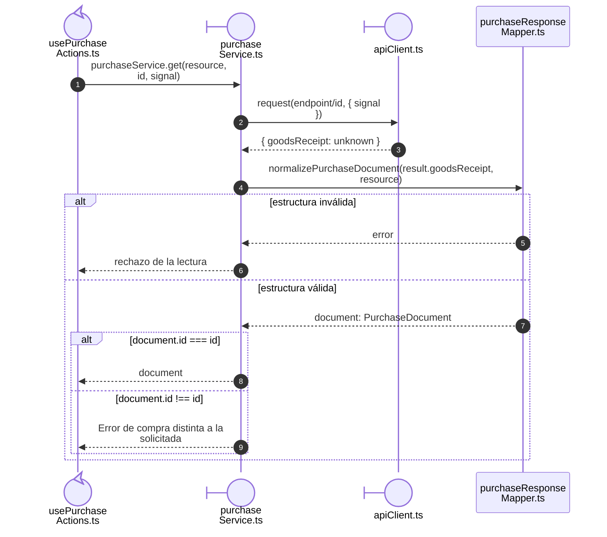

# 4. Adaptadores HTTP y de datos

## Propósito y funcionamiento

El servicio prepara la solicitud y valida la respuesta; el mapper transforma el JSON al
modelo de tabla o formulario. `apiClient` transporta HTTP y recupera la sesión. Cada
responsabilidad tiene un propietario.

| Colaborador compartido | Responsabilidad |
| --- | --- |
| `API_PATHS` | Rutas de recursos y reportes. Las mismas direcciones sirven a listados, formularios y selectores. |
| `pageParams`, `lookupParams`, `recordParams` | Paginación, búsqueda y orden; el servicio añade los filtros de su operación. |
| `apiClient` | Única instancia Axios, timeout, cancelación, recuperación de conexión, renovación y normalización de errores. |
| `requestPage`, `requestExcel` | Validar el sobre paginado o el archivo descargado antes de entregarlo al servicio. |

Los métodos, payloads y mappers siguen en su dominio: una devolución y una edición
de compra tienen contratos distintos. La API de Express/OpenAPI define esos contratos;
el catálogo de rutas sólo localiza lo que consume Vue.

## Modelo general de adaptación de una lectura

**Identificador:** `DIA-VUE-GEN-003`. **Pregunta:** ¿cómo convertir una respuesta
externa en un modelo del cliente? **Fuente:** servicios, mappers y transporte
existentes. Secuencia conceptual de lectura, transformación y aceptación.

**Lectura visual:** [llamadas, retornos y alternativas](../../diagram-reading.md#secuencias).

## Aplicación al consultar una compra

**Identificador:** `DIA-VUE-APL-003`. **Pregunta:** ¿quién garantiza que se presenta
la compra solicitada? **Fuente:** `usePurchaseActions`, `purchaseService.get`,
`apiClient` y `normalizePurchaseDocument`. Secuencia del callback de lectura y sus
condiciones de aceptación. La renovación de sesión pertenece al transporte.

## Código, contrato y límites

Las [condiciones de aceptación HTTP](../../../contracts/client-contracts.md#escrituras-y-confirmación)
se definen en el contrato del cliente. La
[composición de documentos](08-document-responsibilities.md#propietarios-del-código)
ubica los adaptadores de lectura y escritura.

[purchaseTest](../../../../../tests/unit/modules/purchases/purchaseTest.ts) comprueba modelos
y solicitudes; [apiClientTest](../../../../../tests/unit/shared/http/apiClientTest.ts)
comprueba transporte/sesión.
