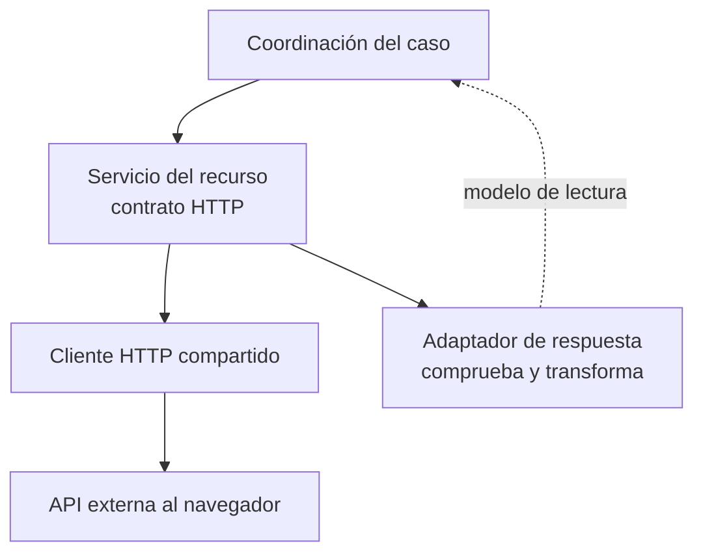
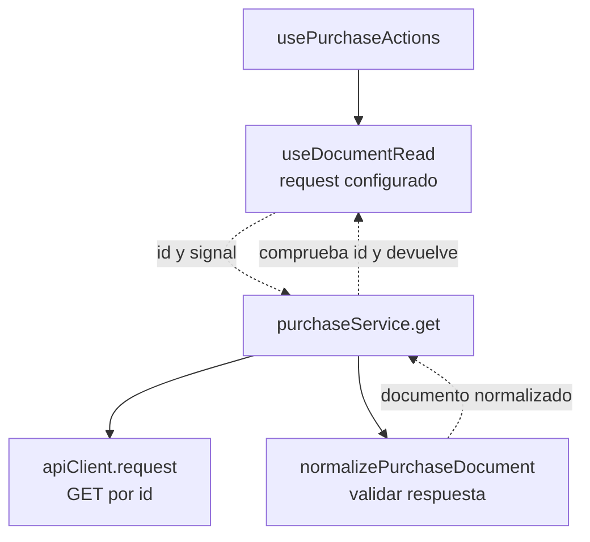

# 4. Adaptadores HTTP y de datos

## Problema y decisión

La representación HTTP puede cambiar sin que una tabla cambie su responsabilidad.
El servicio adapta rutas/verbos y el mapper adapta datos. El cliente HTTP compartido
gestiona transporte y sesión. Son adaptadores funcionales en fronteras concretas;
su presencia no convierte el proyecto en una arquitectura hexagonal completa.

## Modelo general de adaptación de una lectura

**Identificador:** `DIA-VUE-GEN-003`. **Pregunta:** ¿cómo convertir una respuesta
externa en un modelo del cliente? **Fuente:** servicios, mappers y transporte
existentes. Flechas continuas = llamada; discontinuas = datos adaptados.

## Aplicación al consultar una compra

**Identificador:** `DIA-VUE-APL-003`. **Pregunta:** ¿quién garantiza que se presenta
la compra solicitada? **Fuente:** `usePurchaseActions`, `useDocumentRead`,
`purchaseService.get`, `apiClient` y `normalizePurchaseDocument`.
Flechas continuas = consumo; discontinuas = resultado del callback configurado.

## Código, contrato y límites

[purchaseService](../../../../../src/modules/purchases/services/purchaseService.ts)
extrae `goodsReceipt`, invoca
[purchaseResponseMapper](../../../../../src/modules/purchases/mappers/purchaseResponseMapper.ts)
y rechaza un documento cuyo id difiere del solicitado.
[usePurchaseActions](../../../../../src/modules/purchases/composables/usePurchaseActions.ts)
aporta la operación al lector y coordina el modo del editor después de leer.

En escritura, [usePurchaseEditor](../../../../../src/modules/purchases/composables/usePurchaseEditor.ts)
construye el cuerpo mediante
[purchaseRequestMapper](../../../../../src/modules/purchases/mappers/purchaseRequestMapper.ts)
antes de llamar al servicio. El mapper selecciona campos, sin enviar HTTP.
`confirmMutation` comprueba el código de la respuesta, sin generar identificadores
ni sustituir una transacción. El recorrido temporal se conserva en la
[secuencia de guardado](08-document-responsibilities.md#secuencia-de-guardado-confirmado).

[purchaseTest](../../../../../tests/unit/modules/purchases/purchaseTest.ts) comprueba modelos
y solicitudes; [apiClientTest](../../../../../tests/unit/shared/http/apiClientTest.ts)
comprueba transporte/sesión. Los tipos estáticos no validan por sí solos JSON.
