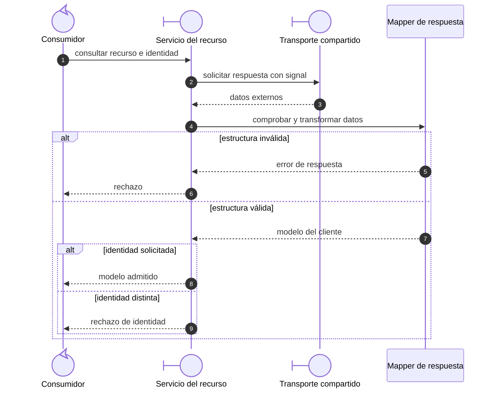
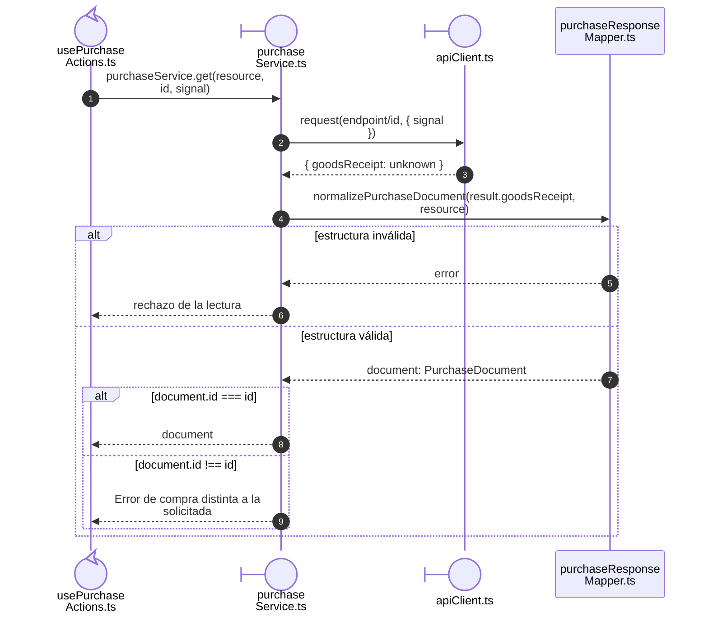

# 4. Adaptadores HTTP y de datos

## Propósito y funcionamiento

El servicio del recurso prepara la solicitud HTTP y comprueba la respuesta de su
operación. Un mapper transforma el JSON recibido en un modelo que el editor o la
tabla pueden utilizar. `apiClient` aporta el transporte y la recuperación de sesión.
Estas tres responsabilidades permiten localizar un error de comunicación, un dato
inválido o una incompatibilidad de formato en su propietario.

## Modelo general de adaptación de una lectura

**Identificador:** `DIA-VUE-GEN-003`. **Pregunta:** ¿cómo convertir una respuesta
externa en un modelo del cliente? **Fuente:** servicios, mappers y transporte
existentes. Secuencia conceptual de lectura, transformación y aceptación.

**Lectura visual:** [llamadas, retornos y alternativas](../../diagram-reading.md#secuencias).

## Aplicación al consultar una compra

**Identificador:** `DIA-VUE-APL-003`. **Pregunta:** ¿quién garantiza que se presenta
la compra solicitada? **Fuente:** `usePurchaseActions`, `purchaseService.get`,
`apiClient` y `normalizePurchaseDocument`. Secuencia del callback de lectura y sus
condiciones de aceptación. La renovación de sesión pertenece al transporte.

## Código, contrato y límites

Las [condiciones de aceptación HTTP](../../../contracts/client-contracts.md#escrituras-y-confirmación)
se definen en el contrato del cliente. La
[composición de documentos](08-document-responsibilities.md#propietarios-del-código)
ubica los adaptadores de lectura y escritura.

[purchaseTest](../../../../../tests/unit/modules/purchases/purchaseTest.ts) comprueba modelos
y solicitudes; [apiClientTest](../../../../../tests/unit/shared/http/apiClientTest.ts)
comprueba transporte/sesión.
