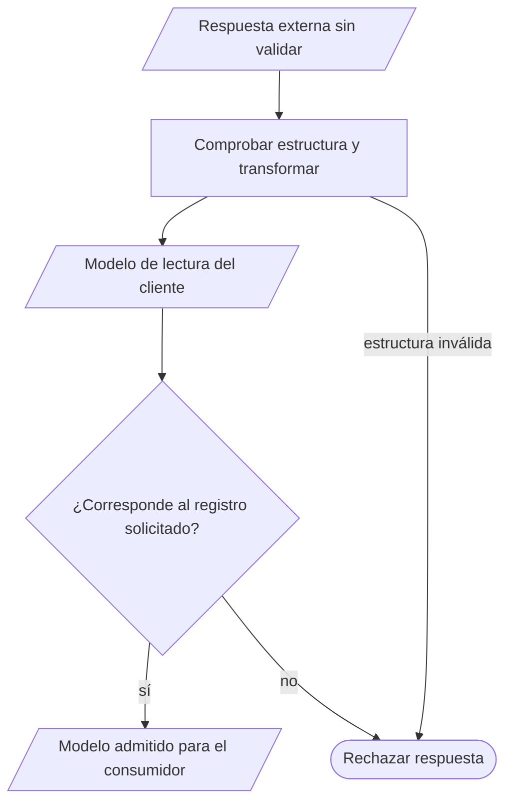
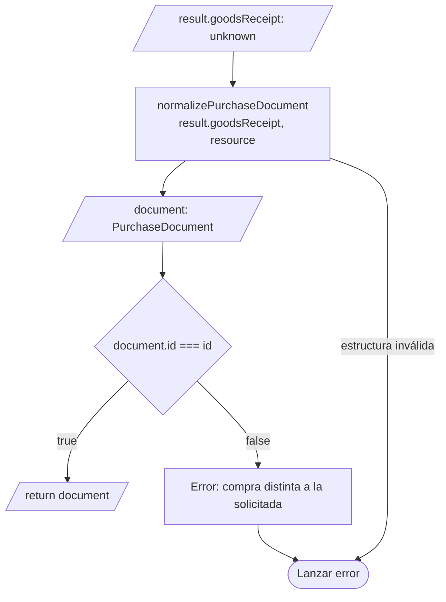

# 4. Adaptadores HTTP y de datos

## Propósito y funcionamiento

El servicio del recurso prepara la solicitud HTTP y comprueba la respuesta de su
operación. Un mapper transforma el JSON recibido en un modelo que el editor o la
tabla pueden utilizar. `apiClient` aporta el transporte y la recuperación de sesión.
Estas tres responsabilidades permiten localizar un error de comunicación, un dato
inválido o una incompatibilidad de formato en su propietario.

## Modelo general de adaptación de una lectura

**Identificador:** `DIA-VUE-GEN-003`. **Pregunta:** ¿cómo convertir una respuesta
externa en un modelo del cliente? **Fuente:** servicios, mappers y transporte
existentes. **Notación:** flujo de datos y decisiones; paralelogramos = datos,
rectángulos = transformación y rombo = condición de aceptación.

**Lectura visual:** [formas, límites y flechas del mapa](../../diagram-reading.md#mapas-y-actividades).

## Aplicación al consultar una compra

**Identificador:** `DIA-VUE-APL-003`. **Pregunta:** ¿quién garantiza que se presenta
la compra solicitada? **Fuente:** `purchaseService.get` y `normalizePurchaseDocument`.
**Notación:** flujo de datos dentro de `purchaseService.get`, después de recibir
la respuesta HTTP. Las flechas siguen transformación, aceptación o rechazo.

## Código, contrato y límites

Las [condiciones de aceptación HTTP](../../../contracts/client-contracts.md#escrituras-y-confirmación)
se definen en el contrato del cliente. La
[composición de documentos](08-document-responsibilities.md#propietarios-del-código)
ubica los adaptadores de lectura y escritura.

[purchaseTest](../../../../../tests/unit/modules/purchases/purchaseTest.ts) comprueba modelos
y solicitudes; [apiClientTest](../../../../../tests/unit/shared/http/apiClientTest.ts)
comprueba transporte/sesión.
