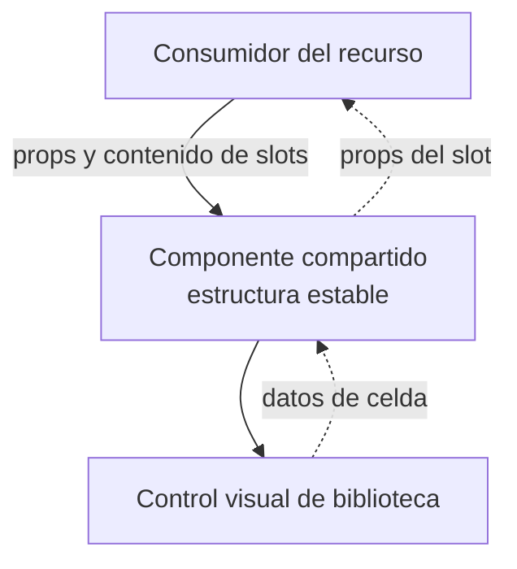
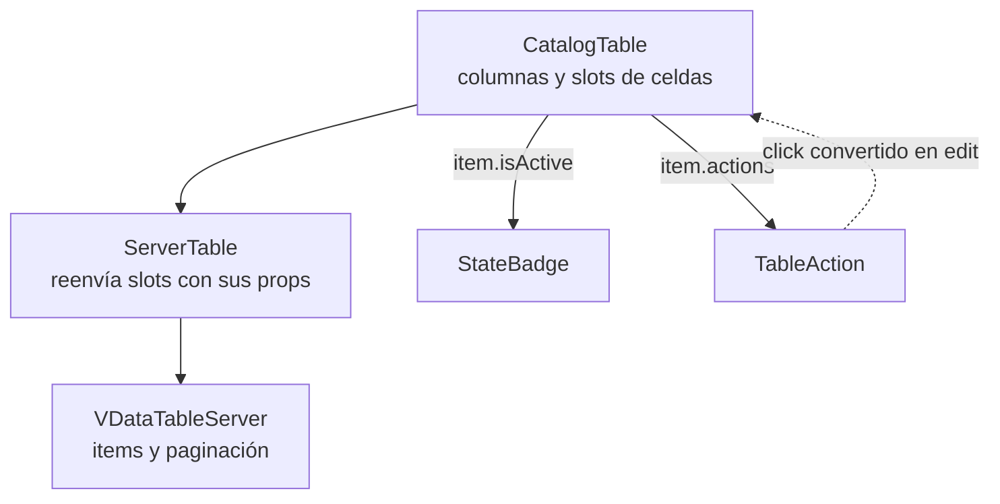

# 5. Slots y composición visual

## Problema y decisión

Las tablas comparten marco y paginación, pero sus celdas y acciones pertenecen al
recurso. Los slots permiten insertar presentación específica mediante un contrato
visual. Es un mecanismo de Vue para composición; no se modela como herencia de
componentes ni como un generador universal de CRUD.

## Modelo general de composición por slots

**Identificador:** `DIA-VUE-GEN-004`. **Pregunta:** ¿qué estructura conserva el
componente común y qué contenido aporta el consumidor? **Fuente:** contratos de
slots de Vue y componentes actuales. Flechas continuas = composición/consumo;
discontinuas = datos de un slot con alcance.

**Lectura visual:** [formas, límites y flechas del mapa](../../diagram-reading.md#mapas-y-actividades).

## Aplicación a las celdas de Catálogos

**Identificador:** `DIA-VUE-APL-004`. **Pregunta:** ¿cómo se comparten controles de
tabla conservando las celdas específicas? **Fuente:** `CatalogTable`, `ServerTable`,
`VDataTableServer`, `StateBadge` y `TableAction`. Flechas continuas = composición;
discontinuas = intención de edición. No describe una secuencia HTTP.

## Código, contrato y límites

[CatalogTable](../../../../../src/modules/catalogs/components/CatalogTable.vue) define
`item.isActive` y `item.actions` usando el `item` recibido.
[ServerTable](../../../../../src/shared/components/ServerTable.vue) reenvía los slots a
Vuetify y emite `options`; no consulta filas ni asigna permisos.
El evento `edit` termina en la página contenedora.

Otra aplicación es [RecordListPanel](../../../../../src/shared/components/RecordListPanel.vue):
conserva estructura, carga y errores; `CatalogPage` aporta el botón en `actions`
y la tabla en el slot predeterminado. Los slots no deben introducir persistencia
en un componente de presentación. Se crea un contrato común cuando hay
consumidores reales, no una opción por cada excepción de un módulo.

[catalogs.spec.ts](../../../../../tests/e2e/catalogs.spec.ts) observa tabla y apertura del
editor; el contrato visual no se comprueba contando llamadas internas de slots.
Referencia: [slots de Vue](https://vuejs.org/guide/components/slots.html).
