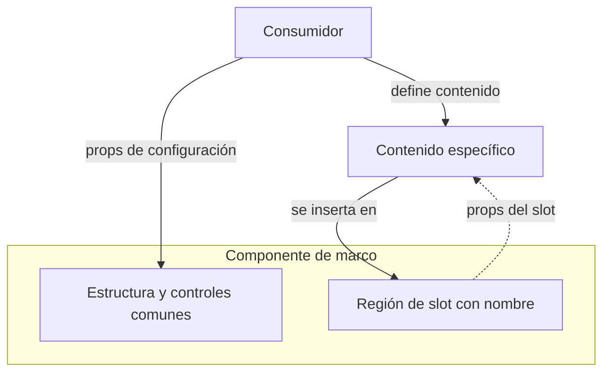
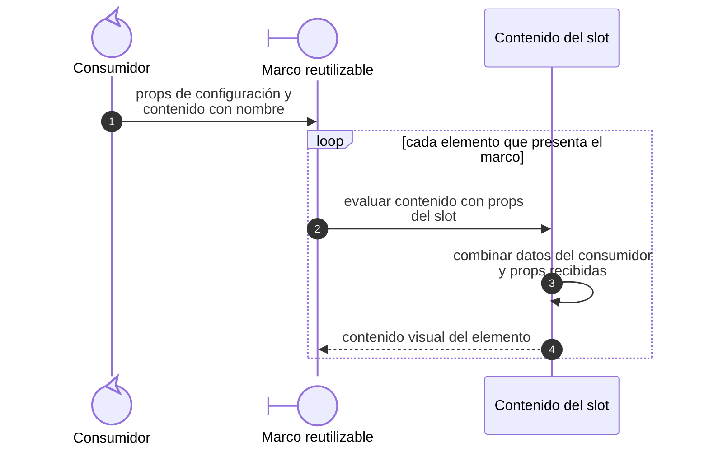
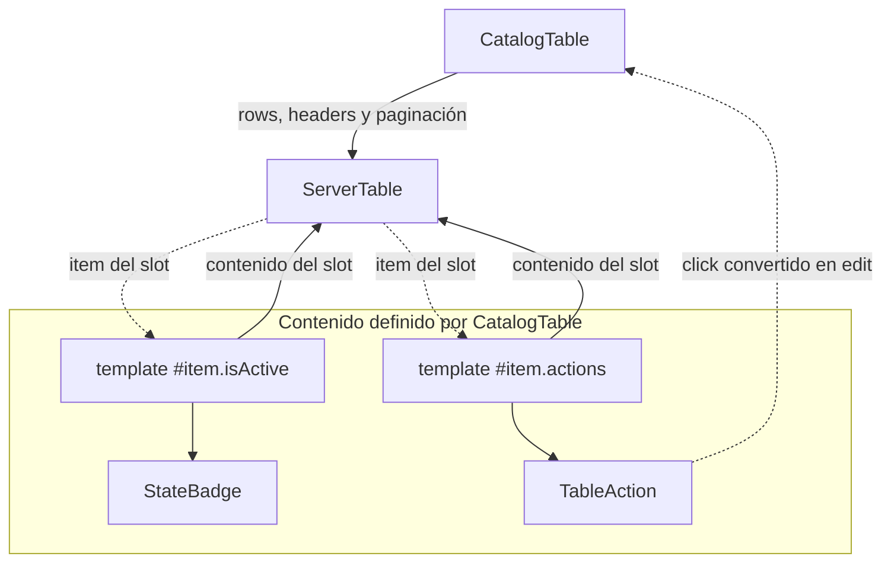
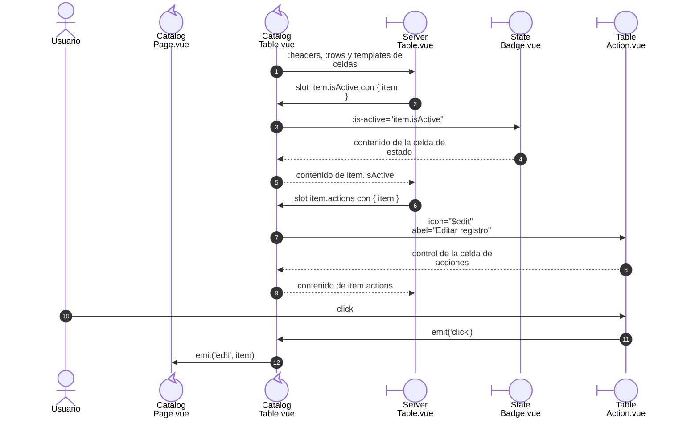

# 5. Slots y composición visual

## Propósito y funcionamiento

Un slot es una región que un componente deja disponible para que su consumidor
aporte contenido. Un slot con alcance también entrega datos a ese contenido.
`ServerTable` reutiliza el marco y la paginación de la tabla, mientras cada recurso
define cómo presentar sus celdas y acciones.

## Modelo general de composición por slots

**Identificador:** `DIA-VUE-GEN-004`. **Pregunta:** ¿qué estructura conserva el
componente común y qué contenido aporta el consumidor? **Fuente:** contratos de
slots de Vue y componentes actuales. **Notación:** árbol de composición con regiones
de contenido; el marco agrupa la estructura común y las flechas distinguen inserción
de contenido de props devueltas al consumidor.

**Lectura visual:** [formas, límites y flechas del mapa](../../diagram-reading.md#mapas-y-actividades).

## Evaluación general de un slot con alcance

**Identificador:** `DIA-VUE-GEN-008`. **Pregunta:** ¿cómo llega el dato del marco
al contenido definido por su consumidor? **Fuente:** contratos de slots y
`ServerTable`. Secuencia conceptual de renderizado;
las regiones del modelo anterior no son componentes adicionales.

## Aplicación a las celdas de Catálogos

**Identificador:** `DIA-VUE-APL-004`. **Pregunta:** ¿cómo se comparten controles de
tabla conservando las celdas específicas? **Fuente:** `CatalogTable`, `ServerTable`,
`StateBadge` y `TableAction`. **Notación:** composición de contenido propio;
flechas continuas = configuración/inserción, discontinuas = props de slot o evento.
Vuetify aporta el control de tabla y se identifica en el texto.

## Evaluación de una celda de Catálogos

**Identificador:** `DIA-VUE-APL-011`. **Pregunta:** ¿cómo se utiliza `item` y de
dónde sale el evento `edit`? **Fuente:** templates de `CatalogTable`, reenvío de
slots de `ServerTable`, `StateBadge` y `TableAction`. Secuencia de renderizado e
interacción; las etiquetas de props y slots son expresiones de template, no métodos.
El control de Vuetify ejecuta los slots que `ServerTable` reenvía.

## Código, contrato y límites

[CatalogTable](../../../../../src/modules/catalogs/components/CatalogTable.vue) define
`item.isActive` y `item.actions` usando el `item` recibido.
[ServerTable](../../../../../src/shared/components/ServerTable.vue) reenvía los slots a
Vuetify y emite `options`; no consulta filas ni asigna permisos.
El contenido del slot conserva el ámbito de `CatalogTable`; accede a la fila
mediante el `item` recibido. `edit` se emite desde ese consumidor hacia la página.

Otra aplicación es [RecordListPanel](../../../../../src/shared/components/RecordListPanel.vue):
conserva estructura, carga y errores; `CatalogPage` aporta el botón en `actions`
y la tabla en el slot predeterminado. El contenido y sus eventos siguen conectados
al consumidor que los define; las escrituras permanecen en sus servicios.

[catalogs.spec.ts](../../../../../tests/e2e/catalogs.spec.ts) observa tabla y apertura del
editor.
