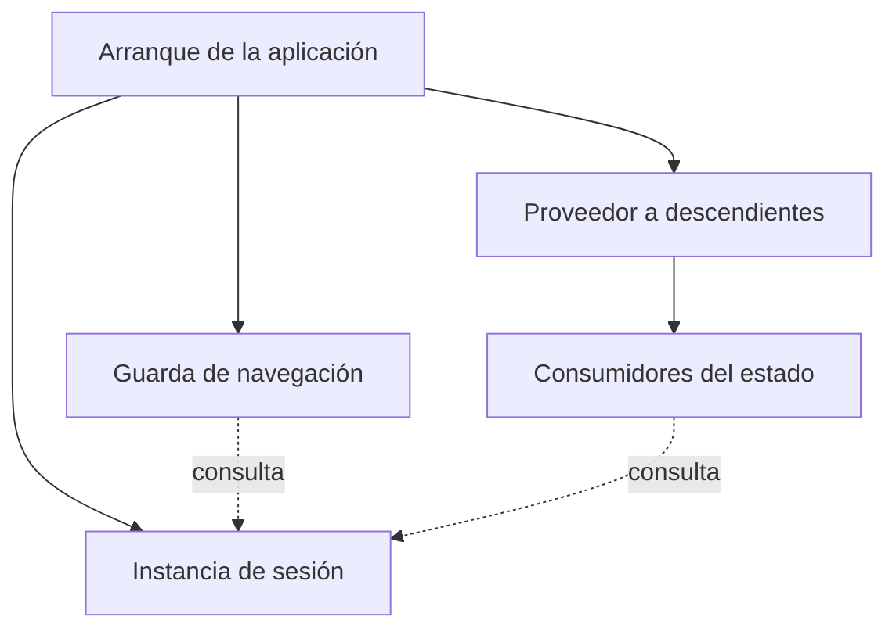
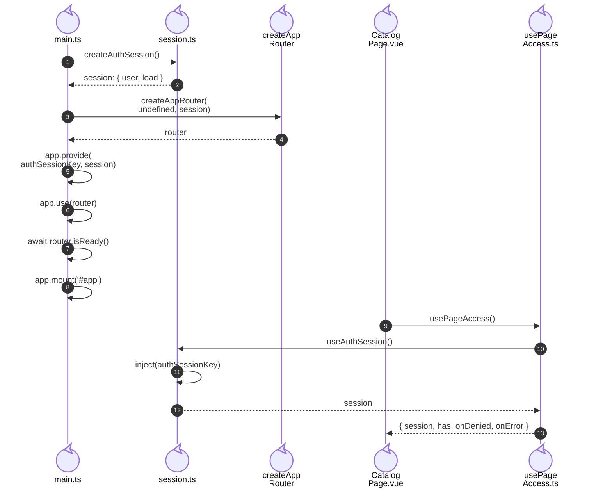

# 6. Provisión de sesión e inyección

## Propósito y funcionamiento

La navegación y las páginas deben observar la misma sesión sin pasarla por cada
componente visual. El arranque crea una instancia, configura el Router con ella
y la proporciona a los descendientes mediante `provide/inject`. Un componente
descendiente recupera esa instancia por la clave `authSessionKey`.

## Modelo general de provisión de estado de aplicación

**Identificador:** `DIA-VUE-GEN-005`. **Pregunta:** ¿cómo comparten un estado la
navegación y sus consumidores? **Fuente:** composición del arranque e inyección
de Vue. Flechas continuas = configuración; discontinuas = uso de la misma instancia.

**Lectura visual:** [formas, límites y flechas del mapa](../../diagram-reading.md#mapas-y-actividades).

## Aplicación en el arranque de Vue

**Identificador:** `DIA-VUE-APL-005`. **Pregunta:** ¿dónde se comparte realmente
la sesión? **Fuente:** `main.bootstrap`, `createAuthSession`, `authSessionKey`,
`createAppRouter`, `useAuthSession` y `usePageAccess`.
**Notación:** secuencia UML de creación y recuperación de la misma instancia.
Los participantes son archivos/funciones propios; las llamadas a Vue permanecen
en la línea de vida del código que las realiza.

## Código, contrato y límites

[main.ts](../../../../../src/main.ts) crea la sesión y pasa **esa misma instancia** al
[Router](../../../../../src/app/router/index.ts) y al proveedor de descendientes.
[session.ts](../../../../../src/modules/auth/session.ts) define la clave, la inyección y
la lectura de `/api/auth/me`; agrupa lecturas simultáneas con `loading`.
[usePageAccess](../../../../../src/app/composables/usePageAccess.ts) observa permisos y
traduce 401/403 a navegación. No expone un método para que un botón conceda permisos.
En el ejemplo, [CatalogPage](../../../../../src/modules/catalogs/pages/CatalogPage.vue)
obtiene por ese composable la misma sesión proporcionada durante el arranque.

La renovación de tokens pertenece a [apiClient](../../../../../src/shared/http/apiClient.ts),
no al mecanismo de inyección. Las credenciales viajan en cookies; los permisos de
la interfaz no sustituyen la autorización en el backend. La agrupación de promesas
de sesión y la renovación coordinada son mecanismos diferentes.

[routerTest](../../../../../tests/unit/app/routerTest.ts),
[pageAccessTest](../../../../../tests/unit/app/pageAccessTest.ts) y
[sessionRecovery.spec.ts](../../../../../tests/e2e/sessionRecovery.spec.ts) ejercitan estos
consumidores. La API del navegador se simula; no se acredita la firma real de JWT.
Referencia: [provide/inject](https://vuejs.org/guide/components/provide-inject.html).

## Alcance del estado compartido

La sesión pertenece a la aplicación. Listados, filtros y capturas pertenecen a cada
pantalla. El [inventario de propietarios](../../logical/states/04-state-ownership-and-save.md#inventario-de-propietarios)
identifica su vida útil y la [decisión de estado compartido](../../logical/states/04-state-ownership-and-save.md#decisión-de-estado-compartido)
explica el alcance de la provisión actual.
