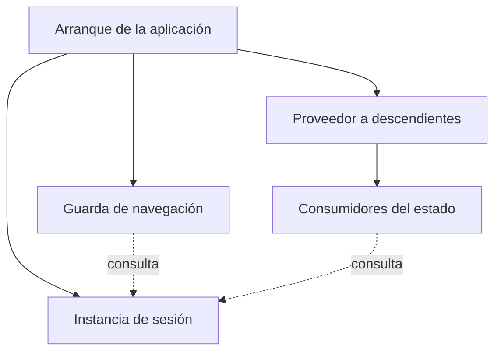
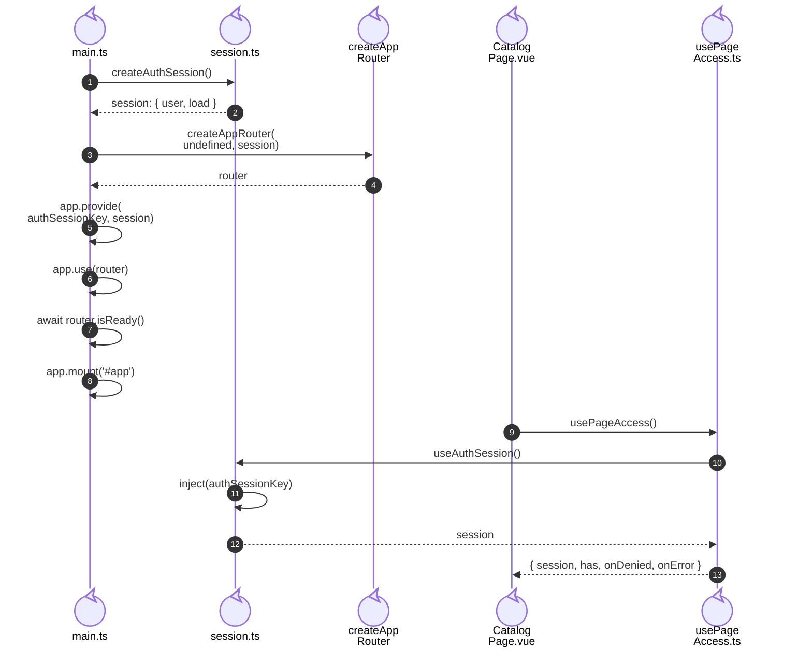

# 6. Provisión de sesión e inyección

## Propósito y funcionamiento

La navegación y las páginas deben observar la misma sesión sin pasarla por cada
componente visual. El arranque crea una instancia, configura el Router con ella
y la proporciona a los descendientes mediante `provide/inject`. Un componente
descendiente recupera esa instancia por la clave `authSessionKey`.

## Modelo general de provisión de estado de aplicación

**Identificador:** `DIA-VUE-GEN-005`. **Pregunta:** ¿cómo comparten un estado la
navegación y sus consumidores? **Fuente:** composición del arranque e inyección
de Vue. Flechas continuas = configuración; discontinuas = uso de la misma instancia.

**Lectura visual:** [formas, límites y flechas del mapa](../../diagram-reading.md#mapas-y-actividades).

## Aplicación en el arranque de Vue

**Identificador:** `DIA-VUE-APL-005`. **Pregunta:** ¿dónde se comparte realmente
la sesión? **Fuente:** `main.bootstrap`, `createAuthSession`, `authSessionKey`,
`createAppRouter`, `useAuthSession` y `usePageAccess`.
**Notación:** secuencia UML de creación y recuperación de la misma instancia.
Los participantes son archivos/funciones propios; las llamadas a Vue permanecen
en la línea de vida del código que las realiza.

## Código, contrato y límites

Si no existe el proveedor, `useAuthSession` lanza «La sesión no se ha configurado».
La inyección debe prepararse antes de montar sus consumidores.
La [renovación HTTP](../../processes/01-session/04-concurrent-renewal.md) es una
colaboración distinta de la provisión de esta instancia.

[routerTest](../../../../../tests/unit/app/routerTest.ts),
[pageAccessTest](../../../../../tests/unit/app/pageAccessTest.ts) y
[sessionRecovery.spec.ts](../../../../../tests/e2e/sessionRecovery.spec.ts) ejercitan estos
consumidores.

## Alcance del estado compartido

El [inventario de propietarios](../../logical/states/04-state-ownership-and-save.md#inventario-de-propietarios)
identifica el estado único de aplicación y los datos que pertenecen a cada pantalla.
