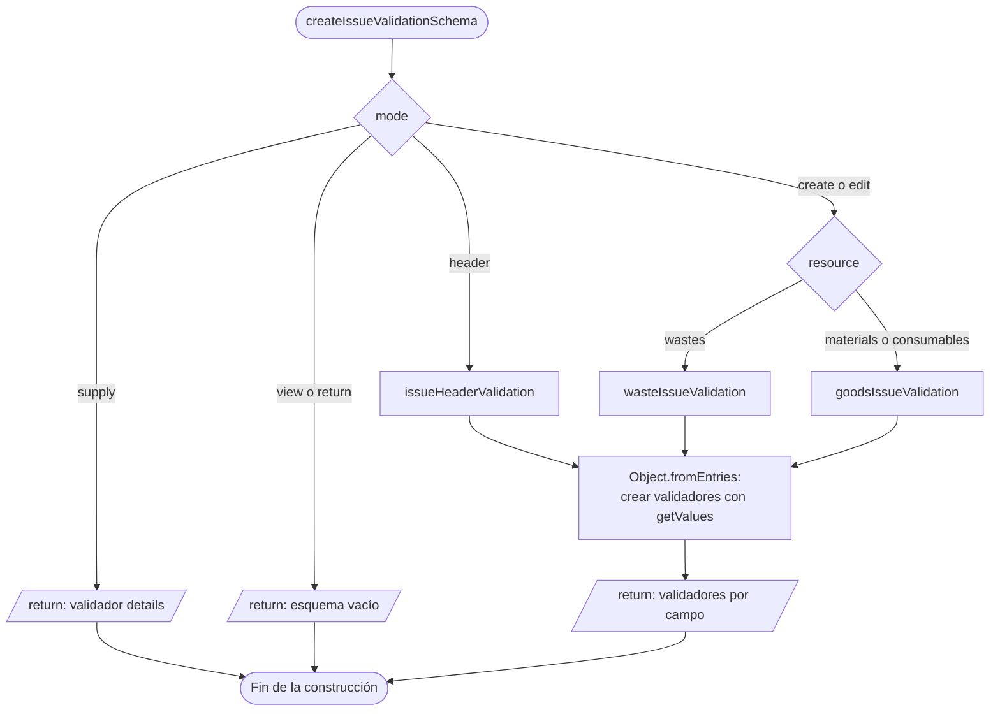

# 7. Fábricas funcionales de esquemas

## Propósito y funcionamiento

La fábrica es una función que devuelve las reglas del formulario según recurso
y modo. El esquema resultante contiene validadores por campo. Estos validadores
consultan los valores actuales mediante `getValues` cuando se ejecutan; construir
el esquema todavía no valida la captura.

## Modelo general de construcción de un esquema

**Identificador:** `DIA-VUE-GEN-006`. **Pregunta:** ¿cómo variar validación sin
copiar reglas en cada componente? **Fuente:** factories actuales de formularios.
**Notación:** actividad con notación de flujo; terminales = inicio/retorno,
rombos = decisiones, rectángulos = construcción y paralelogramos = datos/producto.

**Lectura visual:** [formas, límites y flechas del mapa](../../diagram-reading.md#mapas-y-actividades).

## Aplicación al esquema del editor de Salidas

**Identificador:** `DIA-VUE-APL-006`. **Pregunta:** ¿quién elige las reglas y quién
las ejecuta sobre la captura actual? **Fuente:** `createIssueValidationSchema`,
`useIssueEditor` y `@nexus/form-validation`. **Notación:** actividad de construcción
con las ramas del código. VeeValidate recibe el producto en `useIssueEditor` y
ejecuta después sus funciones cuando valida la captura.

## Código, contrato y límites

[issueForm](../../../../../src/modules/issues/issueForm.ts) adapta las reglas; el esquema
de `view`/`return` es vacío en el editor principal. `supply` comprueba detalles
pendientes seleccionados y cantidad de proyecto. `header` valida encabezado;
`create`/`edit` usan las reglas del recurso. Devolución tiene captura y validación
propias. [useIssueEditor](../../../../../src/modules/issues/composables/useIssueEditor.ts)
conecta el esquema a `useForm`, sin validar al montar.

[purchaseForm](../../../../../src/modules/purchases/purchaseForm.ts) aplica la misma decisión
para alta/edición. La adaptación `mensaje || true` pertenece a VeeValidate;
los predicados públicos devuelven mensaje o `null`. `getValues` evita validar una
instantánea anterior. Los tipos discriminados de `issue.ts`/`purchase.ts` expresan
operaciones admitidas en TypeScript; la validación definitiva de cada petición HTTP corresponde a la API.

[issueTest](../../../../../tests/unit/modules/issues/issueTest.ts),
[purchaseTest](../../../../../tests/unit/modules/purchases/purchaseTest.ts) y las
[pruebas de paridad](../../../../../../back/tests/unit/validators/formValidationParityTest.js)
protegen captura y solicitudes. No se trasladan reglas privadas ni comprobaciones
de existencias/estado al esquema del navegador.
