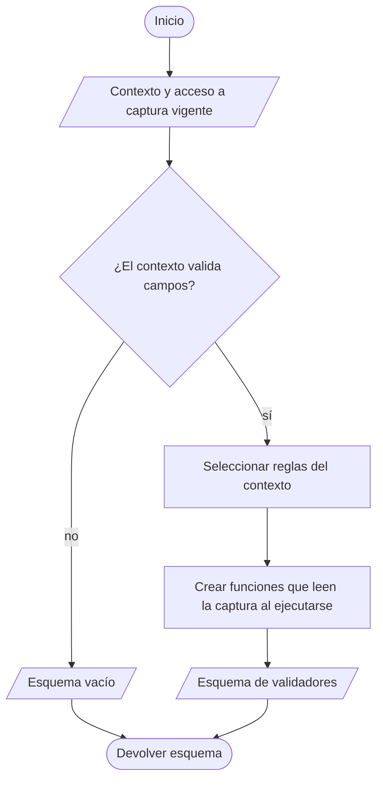

# 7. Fábricas funcionales de esquemas

## Propósito y funcionamiento

La fábrica es una función que devuelve las reglas del formulario según recurso
y modo. El esquema resultante contiene validadores por campo. Estos validadores
consultan los valores actuales mediante `getValues` cuando se ejecutan; construir
el esquema todavía no valida la captura.

## Modelo general de construcción de un esquema

**Identificador:** `DIA-VUE-GEN-006`. **Pregunta:** ¿cómo variar validación sin
copiar reglas en cada componente? **Fuente:** factories actuales de formularios.
**Notación:** actividad con notación de flujo; terminales = inicio/retorno,
rombos = decisiones, rectángulos = construcción y paralelogramos = datos/producto.

**Lectura visual:** [formas, límites y flechas del mapa](../../diagram-reading.md#mapas-y-actividades).

## Aplicación al esquema del editor de Salidas

**Identificador:** `DIA-VUE-APL-006`. **Pregunta:** ¿quién elige las reglas y quién
las ejecuta sobre la captura actual? **Fuente:** `createIssueValidationSchema`,
`useIssueEditor` y `@nexus/form-validation`. **Notación:** actividad de construcción
con las ramas del código. VeeValidate recibe el producto en `useIssueEditor` y
ejecuta después sus funciones cuando valida la captura.

## Código, contrato y límites

| Condición | Precisión que complementa el flujo |
| --- | --- |
| Esquema principal vacío para `return` | Devolución tiene formulario y validación propios; el esquema vacío no omite su validación. |
| Esquema de surtido | Comprueba detalles pendientes seleccionados y su cantidad de proyecto. |
| Resultado de una regla pública | Mensaje o `null`; la adaptación `mensaje || true` corresponde a VeeValidate. |

La [integración de reglas públicas](../input-handling.md#adaptación-en-formularios-y-payloads)
explica su adaptación; el [estándar de formularios](../../../interface-standards.md#formularios),
cuándo se presentan los errores.

[issueTest](../../../../../tests/unit/modules/issues/issueTest.ts),
[purchaseTest](../../../../../tests/unit/modules/purchases/purchaseTest.ts) y las
[pruebas de paridad](../../../../../../back/tests/unit/validators/formValidationParityTest.js)
protegen captura y solicitudes.
