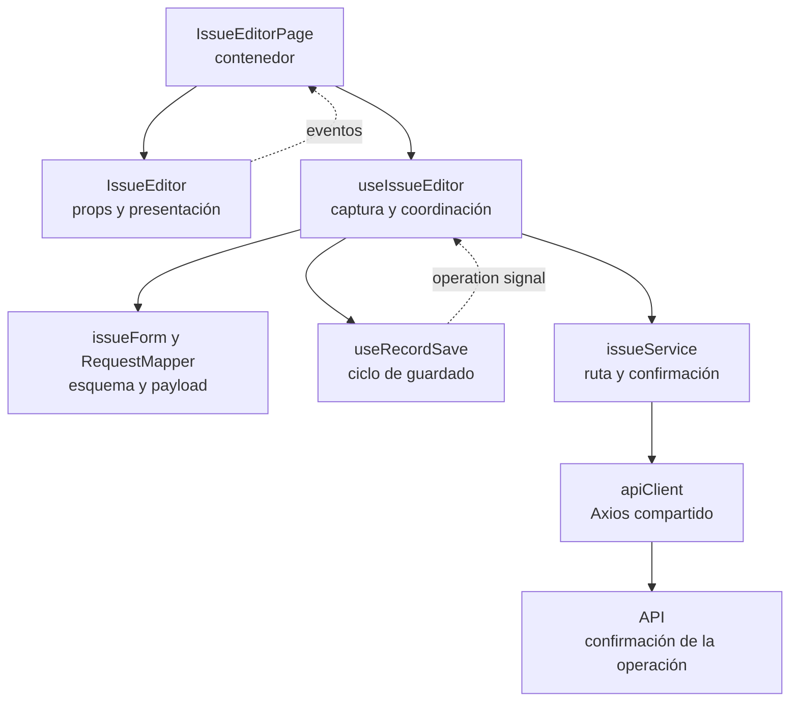
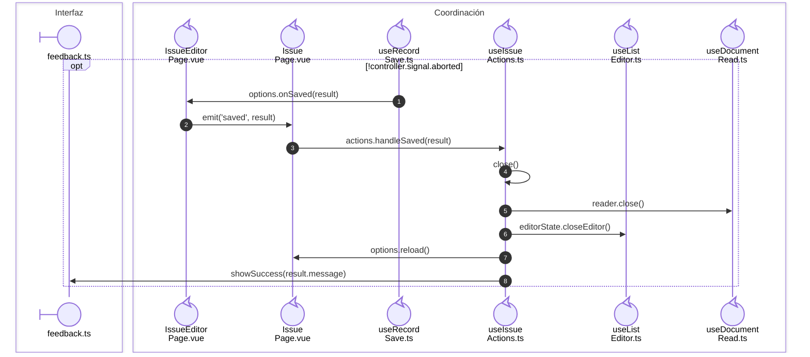

# 8. Composición de documentos de compra y salida

Este capítulo describe cómo se distribuyen contratos, captura, operaciones y transporte en Compras y Salidas.

Participan `modules/issues`, `modules/purchases`, sus contenedores de `app` y
los colaboradores de `shared`. El [catálogo de patrones](01-applicability-and-principles.md)
conserva la definición general; aquí se localiza su aplicación.

## Propietarios del código

| Archivo o capa | Contenido y uso |
| --- | --- |
| `issue.ts` / `purchase.ts` | Tipos de documento, captura, consulta y operaciones. No contienen valores de configuración ni reglas ejecutables. |
| `issueConfig.ts` / `purchaseConfig.ts` | Descriptores de recursos, etiquetas, rutas Vue y permisos de presentación. Salidas también mantiene aquí los descriptores estáticos de sus filtros. |
| `issueRules.ts` / `purchaseRules.ts` | Decidir qué modo admite el estado leído. Salidas conserva además el saldo visible de devolución y la distinción entre destinos de lectura y escritura. No autorizan ni reemplazan transacciones del backend. |
| `issueForm.ts` / `purchaseForm.ts` | Crear valores iniciales y adaptar las reglas públicas al esquema de VeeValidate. La validación consulta la captura vigente mediante `getValues`; no conserva un payload anterior. |
| `issueDetails.ts` / `purchaseDetails.ts` | Crear borradores con identificador local. Salidas también acumula por artículo/proveedor, actualiza la selección de surtido y obtiene los detalles nuevos seleccionados. El ID local no se persiste como ID del documento. |
| `purchaseCalculations.ts` | Calcular totales visibles y el escenario de corrección. El servidor conserva el cálculo que persiste. |
| `mappers/*RequestMapper.ts` | Seleccionar y normalizar campos del request por operación. No envían HTTP, no conocen componentes ni deciden rutas de endpoints. |
| `mappers/*ResponseMapper.ts` | Comprobar respuestas y adaptar registros/opciones a los modelos de lectura. Los lectores internos de decimales, relaciones y detalles permanecen privados. |
| `services` | Resolver endpoints, verbos HTTP, código de éxito esperado, archivos y adaptación de respuestas mediante Axios compartido. |
| `composables` | Coordinar el estado reactivo y el ciclo de una interacción: captura, guardado, filtros, selección dependiente o acciones del editor. Componen capacidades sin implementar todo el módulo en un único composable. |
| `pages` | Conectar sesión/permisos, composables y eventos de presentación. Incluye contenedores de diálogo; no toda página tiene que ser una ruta independiente. |
| `components` | Presentar props y emitir intenciones. Un `Editor` presenta el formulario modal conforme a la convención existente; su nombre no implica que conozca la API. |
| `app/pages/*Workspace` | Componer las altas rápidas entre dominios mediante callbacks, sin importar las páginas de Directorio o Inventario desde Salidas/Compras. |

`useIssueHeaderSelection` coordina la selección del encabezado: opciones iniciales,
dependencias cliente/asesor y área/solicitante, y sugerencia de proyecto. El editor
utiliza esos valores al guardar. Los constructores de `*Details` asignan identidad
local a la captura; los mappers de respuesta leen la identidad persistida que
devuelve la API.

## Patrones y principios aplicados

| Mecanismo | Aplicación |
| --- | --- |
| Contenedor/presentación | Páginas coordinan; formularios, tablas y filtros usan props/eventos. ESLint protege imports. |
| Composición por callbacks | Lectura, guardado, selección y reportes tienen contratos propios; `useDocumentRead`/`useRecordSave` reciben operaciones del dominio. |
| Adaptadores | Request, respuesta y transporte conservan propietarios distintos. |
| Fábrica de esquemas | `createIssueValidationSchema`/`createPurchaseValidationSchema` adaptan reglas públicas al modo de captura. |
| Uniones discriminadas | Exigen documento cuando corresponde y separan consulta, escritura, corrección y cancelación. |

La [evaluación SOLID](01-applicability-and-principles.md) describe cohesión y dependencias.
La API conserva las reglas definitivas de permiso, estado y stock.

## Composición del editor y adaptadores

**Identificador:** `DIA-VUE-DOC-001`. **Pregunta:** ¿qué cambia al modificar la vista,
las reglas o el contrato HTTP? **Alcance:** dependencias del editor de Salidas;
Compras aplica el mismo corte con sus propios módulos. Flechas continuas = consumo
o composición; discontinuas = eventos o ejecución de una operación configurada.
Es un diagrama de colaboración funcional, no un diagrama UML de clases.

**Lectura visual:** [líneas de vida, números y mensajes](../../diagram-reading.md#secuencias); [formas, límites y flechas del mapa](../../diagram-reading.md#mapas-y-actividades).

El callback que ejecuta `useRecordSave` está definido en `useIssueEditor`: construye
el payload con `mapIssueFormToRequest` y llama al servicio. El núcleo compartido
no importa el servicio de Salidas. La página pasa props y conecta eventos; el
componente visual no conoce Axios. La figura omite selectores y lectura para
centrarse en esa frontera, sin atribuir sus tareas al editor visual.

| Frontera / mecanismo | Fuente en Salidas | Consumidor equivalente en Compras |
| --- | --- | --- |
| Contenedor/presentación | [IssueEditorPage](../../../../../src/modules/issues/pages/IssueEditorPage.vue) y [IssueEditor](../../../../../src/modules/issues/components/IssueEditor.vue). | [PurchaseEditorPage](../../../../../src/modules/purchases/pages/PurchaseEditorPage.vue) y [PurchaseEditor](../../../../../src/modules/purchases/components/PurchaseEditor.vue). |
| Composición del formulario | [useIssueEditor](../../../../../src/modules/issues/composables/useIssueEditor.ts). | [usePurchaseEditor](../../../../../src/modules/purchases/composables/usePurchaseEditor.ts). |
| Fábrica de esquemas | [createIssueValidationSchema](../../../../../src/modules/issues/issueForm.ts). | [createPurchaseValidationSchema](../../../../../src/modules/purchases/purchaseForm.ts). |
| Adaptación de request | [mapIssueFormToRequest](../../../../../src/modules/issues/mappers/issueRequestMapper.ts). | [mapPurchaseFormToRequest](../../../../../src/modules/purchases/mappers/purchaseRequestMapper.ts). |
| Adaptación de respuesta | [issueResponseMapper](../../../../../src/modules/issues/mappers/issueResponseMapper.ts), consumido por [issueService](../../../../../src/modules/issues/services/issueService.ts). | [purchaseResponseMapper](../../../../../src/modules/purchases/mappers/purchaseResponseMapper.ts), consumido por [purchaseService](../../../../../src/modules/purchases/services/purchaseService.ts). |
| Lectura por callback | [useIssueActions](../../../../../src/modules/issues/composables/useIssueActions.ts) configura [useDocumentRead](../../../../../src/shared/composables/useDocumentRead.ts) con `issueService.get`. | [usePurchaseActions](../../../../../src/modules/purchases/composables/usePurchaseActions.ts) configura el mismo lector con `purchaseService.get`. |
| Guardado por callback | Ambos editores configuran [useRecordSave](../../../../../src/shared/composables/useRecordSave.ts). | El mismo contrato conserva `AbortSignal`, errores y confirmación sin conocer el dominio. |

Los [contratos de Salidas](../../logical/class-and-type-models/08-issues.md#modos-y-contrato-de-escritura)
y [Compras](../../logical/class-and-type-models/07-purchases.md#datos-y-modos) comparan
los modos, datos exigidos y cuerpos admitidos. Las variantes son contratos de interacción;
los [estados](../../logical/states/index.md) desarrollan sus transiciones.

## Secuencia de guardado confirmado

**Identificador:** `DIA-VUE-DOC-002`. **Pregunta:** ¿qué evidencia permite cerrar el
editor y actualizar el listado? **Fuente:** `useIssueEditor`, `useRecordSave`,
`issueService.save`, `confirmMutation` y `useIssueActions.handleSaved`.
Secuencia UML del camino válido; los participantes son módulos funcionales.
El [guardado](../../processes/07-issues/01-issue-open-save.md) y su
[transporte](../../processes/07-issues/07-issue-save-transport.md) confirman la operación.
Esta figura desarrolla la entrega del callback y los eventos entre contenedores.

Las altas de clientes, proveedores y artículos se componen en los Workspaces.
El [patrón de alta contextual](09-contextual-creation.md) desarrolla sus contratos,
apertura y retorno en cada consumidor.

## Verificación

Las pruebas de ambos módulos observan contratos, payloads, filtros, totales,
conflictos, cancelación al desmontar y recorridos de navegador. Comprueban que
consulta/devolución no escriban el documento y que el
surtido no altere detalles ya persistidos o cancelados ni el documento leído.
Los diseños de [Compras](../../../../testing/design/05-purchases.md) y
[Salidas](../../../../testing/design/06-issues.md) identifican sus condiciones y evidencia.

## Fuentes de los participantes

[IssueEditorPage.vue](../../../../../src/modules/issues/pages/IssueEditorPage.vue),
[IssuePage.vue](../../../../../src/modules/issues/pages/IssuePage.vue),
[useRecordSave.ts](../../../../../src/shared/composables/useRecordSave.ts),
[useIssueActions.ts](../../../../../src/modules/issues/composables/useIssueActions.ts),
[useListEditor.ts](../../../../../src/shared/composables/useListEditor.ts),
[useDocumentRead.ts](../../../../../src/shared/composables/useDocumentRead.ts),
[feedback.ts](../../../../../src/shared/ui/feedback.ts).
