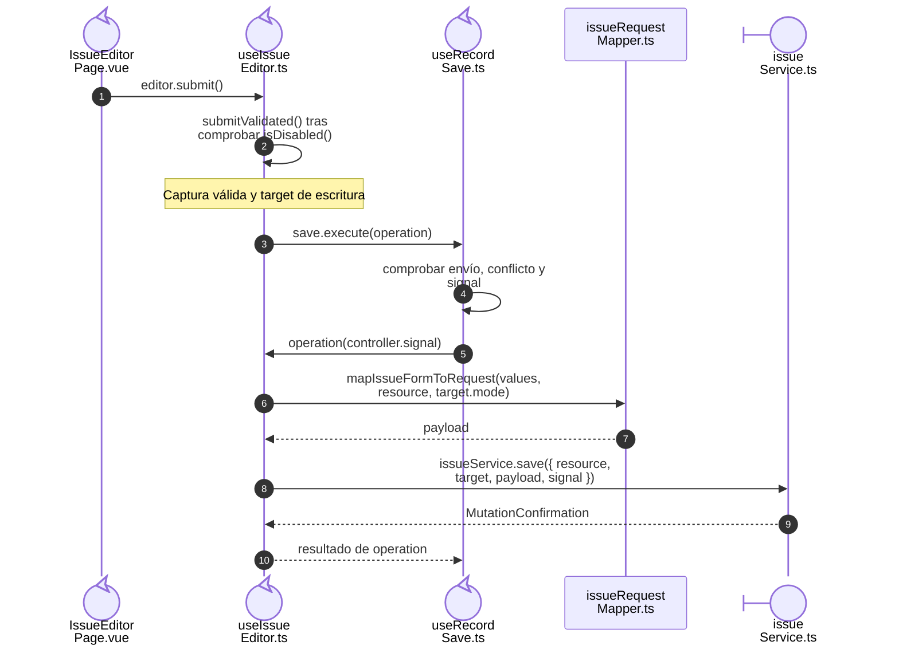
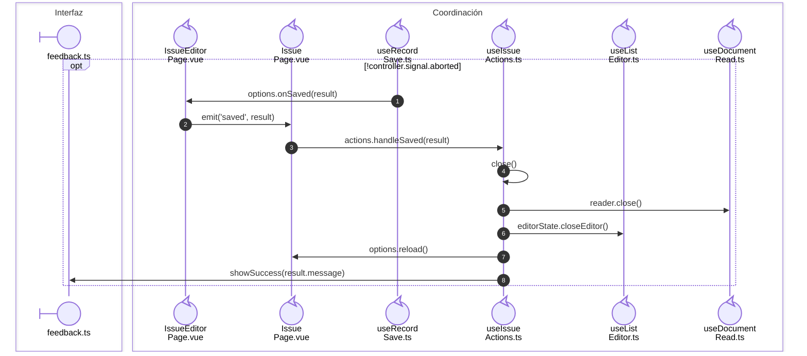

# 8. Composición de documentos de compra y salida

Compras y Salidas separan los datos, las reglas, la captura y el transporte.
La [estructura del código](../code-structure.md) define las responsabilidades de
páginas, componentes y composables.

## Propietarios del código

| Fuente | Contenido |
| --- | --- |
| `issue.ts` / `purchase.ts` | Tipos de documento, captura, consulta y operaciones. |
| `*Config.ts` | Recursos, etiquetas, rutas y permisos de presentación; Salidas incluye descriptores de filtros. |
| `*Rules.ts` | Modo permitido por el estado; Salidas añade saldos de devolución y destinos de lectura/escritura. |
| `*Form.ts` | Valores iniciales y esquemas que consultan la captura vigente. |
| `*Details.ts` | Borradores con ID local; Salidas acumula artículos/proveedores y prepara el surtido. |
| `purchaseCalculations.ts` | Totales visibles y escenario de corrección. |
| `*RequestMapper.ts` / `*ResponseMapper.ts` | Campos enviados y adaptación/comprobación de datos recibidos. |
| `services` | Endpoints, métodos, confirmaciones y archivos. |

`useIssueHeaderSelection` conserva las selecciones dependientes del encabezado.
Los IDs locales identifican borradores; los persistidos proceden de la API.

## Composición del editor y adaptadores

**Identificador:** `DIA-VUE-DOC-001`. **Pregunta:** ¿cómo se ejecuta la escritura
configurada en el guardado compartido? **Fuente:** `IssueEditorPage`, `useIssueEditor`,
`useRecordSave`, `mapIssueFormToRequest` e `issueService`. Secuencia del camino válido
de Salidas, desde el envío hasta que el callback devuelve la confirmación. El
transporte interno del servicio tiene su [secuencia propia](../../processes/07-issues/07-issue-save-transport.md).

**Lectura visual:** [líneas de vida, números y mensajes](../../diagram-reading.md#secuencias).

El [contrato de callbacks](../../../contracts/form-and-event-contracts.md#callbacks-de-composición)
define los argumentos y resultados del guardado compartido.

| Frontera / mecanismo | Fuente en Salidas | Consumidor equivalente en Compras |
| --- | --- | --- |
| Contenedor/presentación | [IssueEditorPage](../../../../../src/modules/issues/pages/IssueEditorPage.vue) y [IssueEditor](../../../../../src/modules/issues/components/IssueEditor.vue). | [PurchaseEditorPage](../../../../../src/modules/purchases/pages/PurchaseEditorPage.vue) y [PurchaseEditor](../../../../../src/modules/purchases/components/PurchaseEditor.vue). |
| Composición del formulario | [useIssueEditor](../../../../../src/modules/issues/composables/useIssueEditor.ts). | [usePurchaseEditor](../../../../../src/modules/purchases/composables/usePurchaseEditor.ts). |
| Fábrica de esquemas | [createIssueValidationSchema](../../../../../src/modules/issues/issueForm.ts). | [createPurchaseValidationSchema](../../../../../src/modules/purchases/purchaseForm.ts). |
| Adaptación de request | [mapIssueFormToRequest](../../../../../src/modules/issues/mappers/issueRequestMapper.ts). | [mapPurchaseFormToRequest](../../../../../src/modules/purchases/mappers/purchaseRequestMapper.ts). |
| Adaptación de respuesta | [issueResponseMapper](../../../../../src/modules/issues/mappers/issueResponseMapper.ts), consumido por [issueService](../../../../../src/modules/issues/services/issueService.ts). | [purchaseResponseMapper](../../../../../src/modules/purchases/mappers/purchaseResponseMapper.ts), consumido por [purchaseService](../../../../../src/modules/purchases/services/purchaseService.ts). |
| Lectura por callback | [useIssueActions](../../../../../src/modules/issues/composables/useIssueActions.ts) configura [useDocumentRead](../../../../../src/shared/composables/useDocumentRead.ts) con `issueService.get`. | [usePurchaseActions](../../../../../src/modules/purchases/composables/usePurchaseActions.ts) configura el mismo lector con `purchaseService.get`. |
| Guardado por callback | Ambos editores configuran [useRecordSave](../../../../../src/shared/composables/useRecordSave.ts). | El mismo contrato conserva `AbortSignal`, errores y confirmación sin conocer el dominio. |

Los contratos de [Salidas](../../logical/class-and-type-models/08-issues.md#modos-y-contrato-de-escritura)
y [Compras](../../logical/class-and-type-models/07-purchases.md#datos-y-modos)
precisan los datos admitidos por modo.

## Secuencia de guardado confirmado

**Identificador:** `DIA-VUE-DOC-002`. **Pregunta:** ¿qué evidencia permite cerrar el
editor y actualizar el listado? **Fuente:** `useIssueEditor`, `useRecordSave`,
`issueService.save`, `confirmMutation` y `useIssueActions.handleSaved`.
Secuencia UML del camino válido; los participantes son módulos funcionales.
El [guardado](../../processes/07-issues/01-issue-open-save.md) y su
[transporte](../../processes/07-issues/07-issue-save-transport.md) confirman la operación.
Esta figura desarrolla la entrega del callback y los eventos entre contenedores.

Las altas de clientes, proveedores y artículos se componen en los Workspaces.
El [patrón de alta contextual](09-contextual-creation.md) desarrolla sus contratos,
apertura y retorno en cada consumidor.

## Verificación

Los diseños de [Compras](../../../../testing/design/05-purchases.md) y
[Salidas](../../../../testing/design/06-issues.md) reúnen las condiciones y las
pruebas de estos contratos.

## Fuentes de los participantes

[IssueEditorPage.vue](../../../../../src/modules/issues/pages/IssueEditorPage.vue),
[IssuePage.vue](../../../../../src/modules/issues/pages/IssuePage.vue),
[useRecordSave.ts](../../../../../src/shared/composables/useRecordSave.ts),
[useIssueActions.ts](../../../../../src/modules/issues/composables/useIssueActions.ts),
[useListEditor.ts](../../../../../src/shared/composables/useListEditor.ts),
[useDocumentRead.ts](../../../../../src/shared/composables/useDocumentRead.ts),
[feedback.ts](../../../../../src/shared/ui/feedback.ts).
