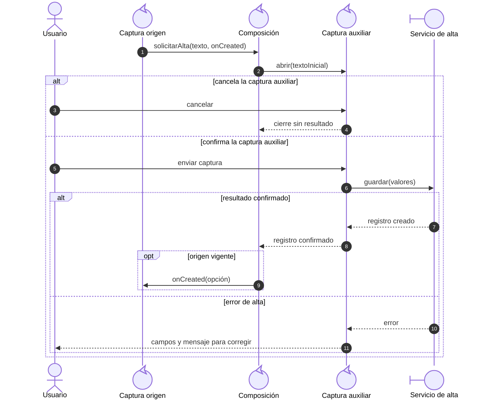
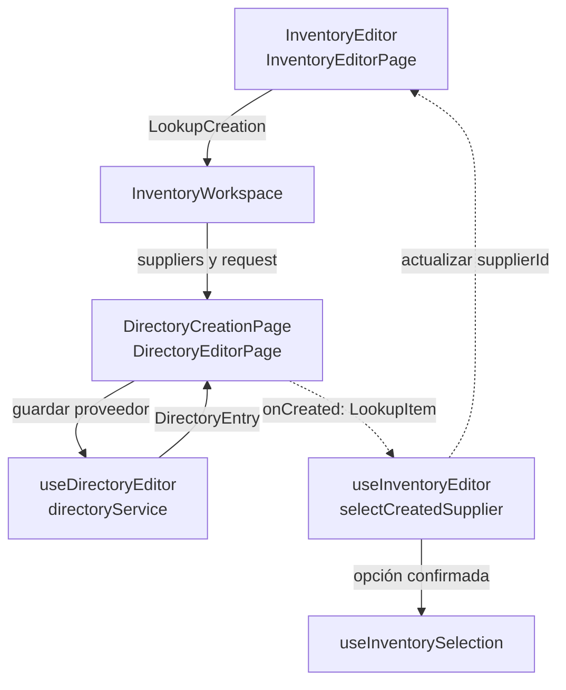
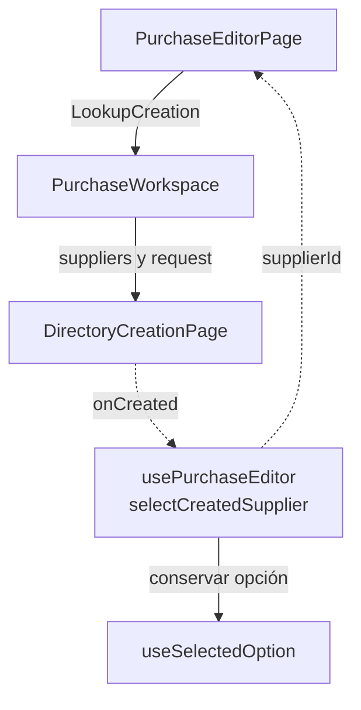
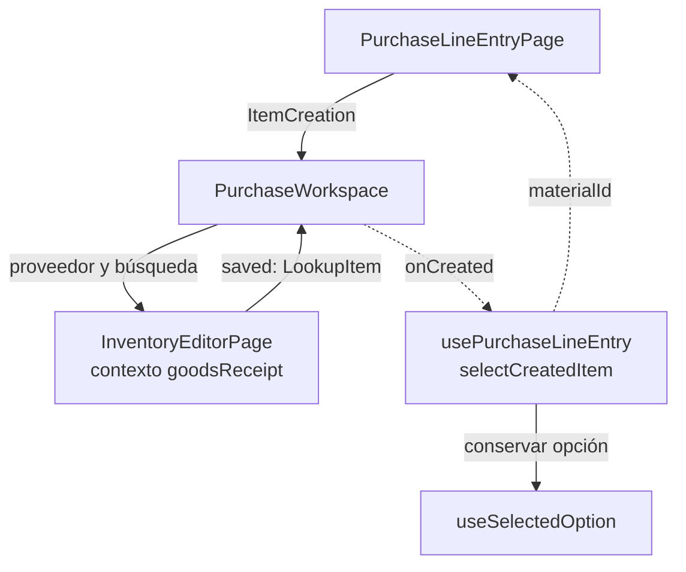
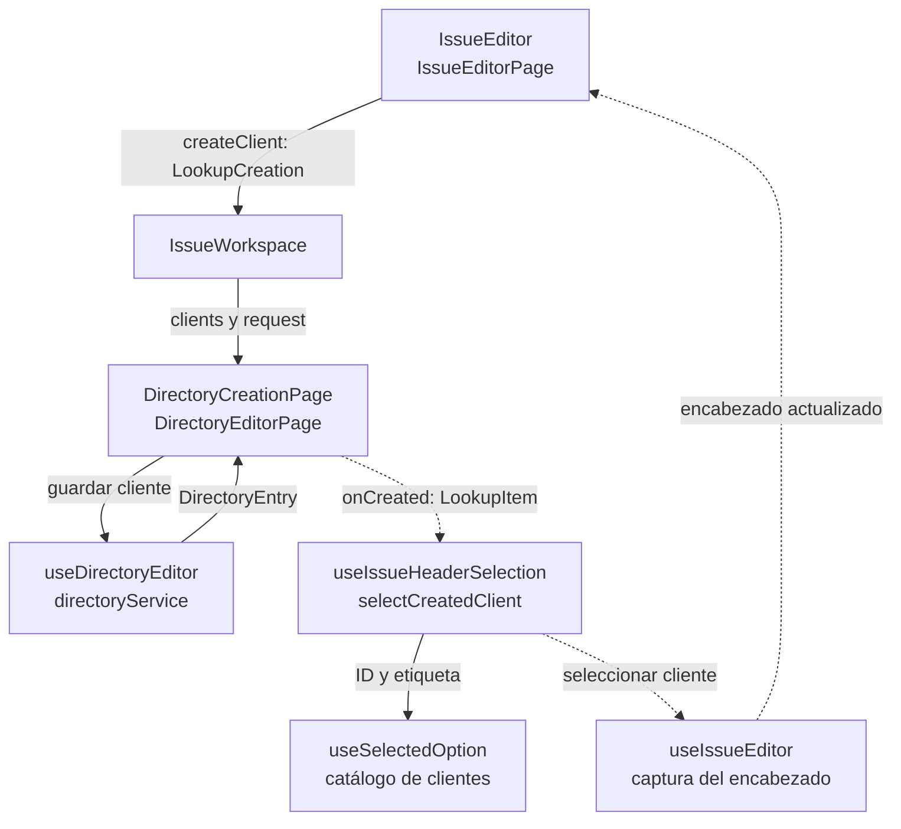

# 9. Composición de altas contextuales: modelo y casos Vue

## Propósito y funcionamiento

Un formulario puede necesitar un proveedor, artículo o cliente que todavía no existe. Debe abrir su captura completa, conservar el origen y seleccionar sólo el resultado confirmado. Una etiqueta de combobox no representa por sí misma un registro persistido.

La colaboración combina contenedor/presentación, eventos/callbacks y adaptación de datos. `RemoteSelect` usa el `VAutocomplete` instalado; emite texto de búsqueda y no conoce entidades, API o páginas de otro módulo. Los Workspaces de `app/pages` componen módulos mediante contratos explícitos. Cada formulario conserva la responsabilidad de aceptar la nueva opción según modo, disponibilidad y estado.

## Modelo general

**Identificador:** `DIA-VUE-GEN-007`. **Pregunta:** ¿cómo coordinar una captura auxiliar conservando el propietario del formulario origen? **Alcance:** apertura, cancelación, confirmación y retorno. **Fuente:** composición aplicada por los Workspaces. **Notación:** secuencia UML de roles genéricos; las llamadas y retornos muestran cuándo se invoca el callback.

**Lectura visual:** [líneas de vida, llamadas y retornos](../../diagram-reading.md#secuencias).

El [contrato de composición](../../../contracts/form-and-event-contracts.md#callbacks-de-composición)
define `LookupCreation`, `ItemCreation` y la adaptación a `LookupItem`.

## Caso 1: proveedor desde Inventario

**Identificador:** `DIA-VUE-APL-007`. **Pregunta:** ¿qué código conserva el artículo y aplica el proveedor nuevo? **Fuente:** `InventoryEditor`, `InventoryEditorPage`, `InventoryWorkspace`, `DirectoryCreationPage`, `DirectoryEditorPage`, `useInventoryEditor` y `useInventorySelection`. Flujo de composición del alta de Materiales/Consumibles; Mermas mantiene sólo consulta de proveedor.

## Caso 2: proveedor o artículo desde Compras

### Proveedor desde el encabezado

**Identificador:** `DIA-VUE-APL-008`. **Pregunta:** ¿cómo vuelve el proveedor al encabezado sin acoplar Compras a las páginas privadas de Directorio? **Fuente:** `PurchaseEditorPage`, `PurchaseWorkspace`, `DirectoryCreationPage` y `usePurchaseEditor`. Flechas continuas = evento/composición; discontinuas = resultado confirmado y captura actualizada.

### Artículo desde un detalle

**Identificador:** `DIA-VUE-APL-010`. **Pregunta:** ¿qué código fija el contexto del artículo y devuelve el ID al detalle? **Fuente:** `PurchaseLineEntryPage`, `PurchaseWorkspace`, `InventoryEditorPage`, `useInventoryEditor`, `inventoryService` y `usePurchaseLineEntry`. Alcance: composición y retorno; la escritura interna del editor usa el servicio de Inventario.

`PurchaseWorkspace` discrimina `kind=supplier` y `kind=item`; el segundo incluye
el proveedor fijado para el artículo.

## Caso 3: cliente desde Salidas

**Identificador:** `DIA-VUE-APL-009`. **Pregunta:** ¿cómo vuelve el cliente confirmado y qué componente resuelve sus dependencias? **Fuente:** `IssueEditor`, `IssueEditorPage`, `IssueWorkspace`, `DirectoryCreationPage`, `useIssueHeaderSelection` y `useSelectedOption`. Aplica a Materiales, Consumibles y Mermas; no ofrece crear asesor/solicitante desde esos selectores.

## Condiciones y excepciones

| Caso o condición | Regla de aplicación |
| --- | --- |
| Proveedor desde Inventario | Sólo alta de Materiales/Consumibles, con lectura y alta de proveedor. No aplica a Merma, proveedor fijado, envío o captura pendiente ni instancia desmontada. El texto buscado precarga el nombre comercial; la razón social se captura aparte. |
| Proveedor desde Compras | Sólo compra nueva editable y con permisos de lectura/alta. La edición conserva el proveedor original. |
| Artículo desde Compras | Requiere lectura/escritura de artículos y lectura de Presentación/Unidad. Usa el proveedor de la compra y `creationContext=goodsReceipt`; no captura stock ni costo inicial. |
| Cliente desde Salidas | Requiere encabezado editable y permisos de lectura/alta de cliente. Cambiarlo actualiza sus selecciones dependientes de asesor y proyecto. No permite crear asesor o solicitante. |
| Registro creado como inactivo | El alta permanece guardada, pero el origen no selecciona ese registro para la operación. |
| Opción aún fuera de la página remota | `useSelectedOption` conserva su ID y etiqueta; no necesita esperar a encontrarla en una página del selector. |
| Guardado auxiliar confirmado | Selecciona el registro; no guarda el documento principal ni agrega su detalle automáticamente. |
| Origen cerrado o incompatible al regresar | El consumidor comprueba vigencia, modo y disponibilidad antes de aplicar el resultado. La captura principal conserva sus datos ante cancelación o fallo del auxiliar. |
| Nombre sin coincidencia visible | No acredita unicidad; la API valida la identidad y autoriza el alta. |

El [ciclo de vida](../../logical/states/04-state-ownership-and-save.md#ciclo-de-guardado)
explica el límite de abortar una escritura ya confirmada por la API.

## Pruebas relacionadas

- [Altas desde selectores](../../../../../tests/e2e/selectCreation.spec.ts).
- [Inventario](../../../../../tests/unit/modules/warehouse/inventoryFormTest.ts), [Compras](../../../../../tests/unit/modules/purchases/purchaseTest.ts) y [Salidas](../../../../../tests/unit/modules/issues/issueTest.ts).
- [Opción seleccionada](../../../../../tests/unit/shared/composables/selectedOptionTest.ts).
