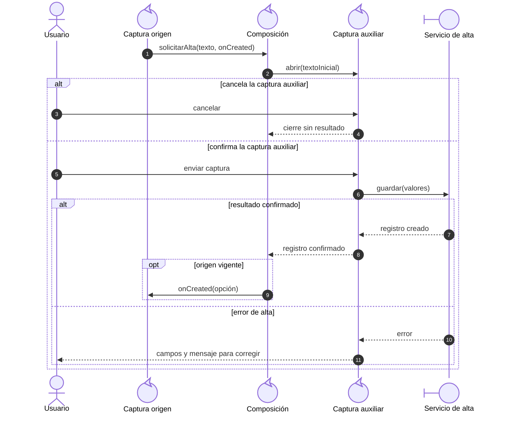
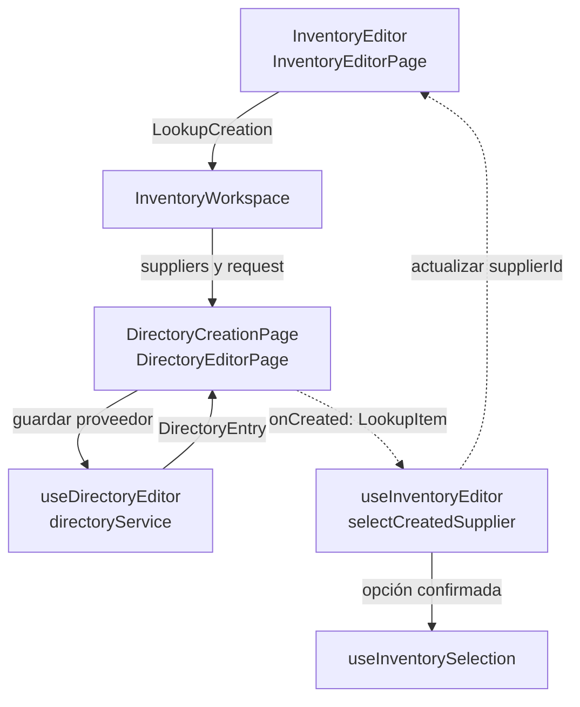
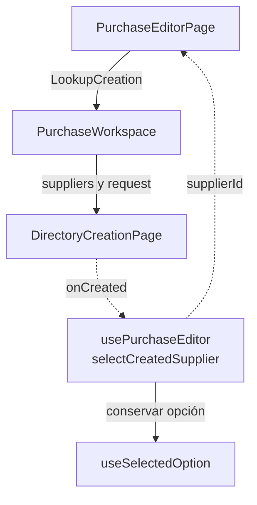
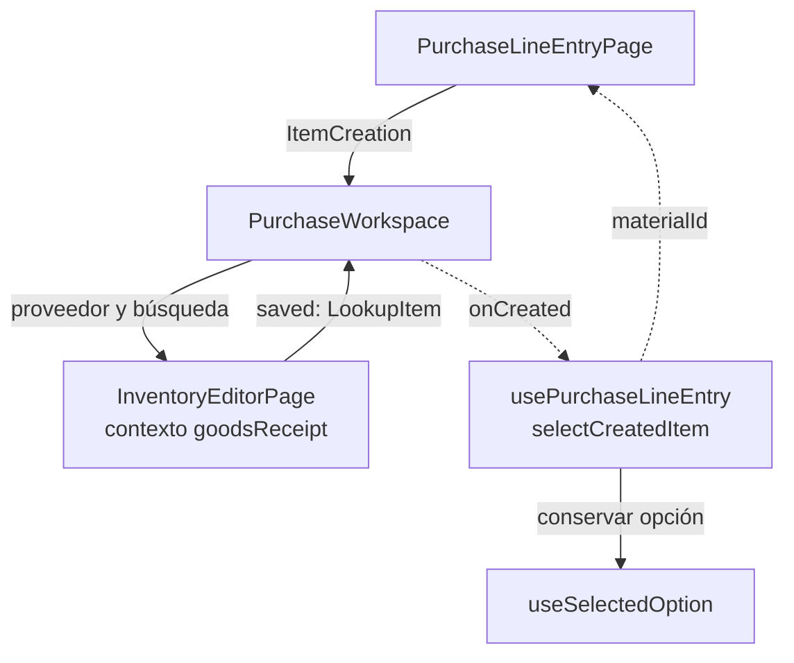
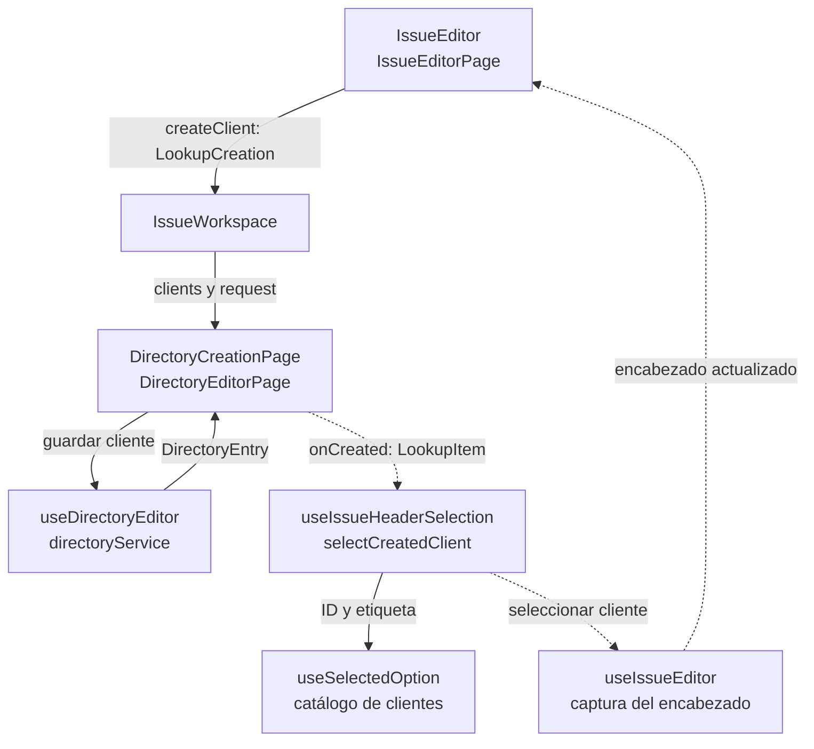

# 9. Composición de altas contextuales: modelo y casos Vue

## Propósito y funcionamiento

Un formulario puede necesitar un proveedor, artículo o cliente que todavía no existe. Debe abrir su captura completa, conservar el origen y seleccionar sólo el resultado confirmado. Una etiqueta de combobox no representa por sí misma un registro persistido.

La colaboración combina contenedor/presentación, eventos/callbacks y adaptación de datos. `RemoteSelect` usa el `VAutocomplete` instalado; emite texto de búsqueda y no conoce entidades, API o páginas de otro módulo. Los Workspaces de `app/pages` componen módulos mediante contratos explícitos. Cada formulario conserva la responsabilidad de aceptar la nueva opción según modo, disponibilidad y estado.

## Modelo general

**Identificador:** `DIA-VUE-GEN-007`. **Pregunta:** ¿cómo coordinar una captura auxiliar conservando el propietario del formulario origen? **Alcance:** apertura, cancelación, confirmación y retorno. **Fuente:** composición aplicada por los Workspaces. **Notación:** secuencia UML de roles genéricos; las llamadas y retornos muestran cuándo se invoca el callback.

**Lectura visual:** [líneas de vida, llamadas y retornos](../../diagram-reading.md#secuencias).

El callback viaja en la solicitud tipada; no necesita persistirse en un store. Cancelar no lo invoca. Confirmar el auxiliar no guarda también el documento principal. El cliente sólo selecciona un ID devuelto por el servidor y descarta callbacks cuando ya no está disponible la captura.

## Caso 1: proveedor desde Inventario

**Identificador:** `DIA-VUE-APL-007`. **Pregunta:** ¿qué código conserva el artículo y aplica el proveedor nuevo? **Fuente:** `InventoryEditor`, `InventoryEditorPage`, `InventoryWorkspace`, `DirectoryCreationPage`, `DirectoryEditorPage`, `useInventoryEditor` y `useInventorySelection`. Flujo de composición del alta de Materiales/Consumibles; Mermas mantiene sólo consulta de proveedor.

La solicitud tiene `search` y `onCreated`. `initialName` precarga nombre comercial; razón social se captura en el formulario propio de Proveedores. El editor de Inventario conserva nombre, cantidad y demás datos del artículo. `selectCreatedSupplier` rechaza modo incompatible, proveedor fijo, envío/captura pendiente, desmontaje y proveedor inactivo. La selección sobrevive aunque la página remota todavía no incluya el registro.

La apertura requiere lectura/alta de proveedor y que el origen sea Materiales o Consumibles. Los campos Presentación/Unidad/Motivo no reciben esta capacidad por compartir el control. `InventoryWorkspace` sólo compone; las escrituras permanecen en Directorio y el resultado se adapta en `DirectoryCreationPage`.

## Caso 2: proveedor o artículo desde Compras

### Proveedor desde el encabezado

**Identificador:** `DIA-VUE-APL-008`. **Pregunta:** ¿cómo vuelve el proveedor al encabezado sin acoplar Compras a las páginas privadas de Directorio? **Fuente:** `PurchaseEditorPage`, `PurchaseWorkspace`, `DirectoryCreationPage` y `usePurchaseEditor`. Flechas continuas = evento/composición; discontinuas = resultado confirmado y captura actualizada.

### Artículo desde un detalle

**Identificador:** `DIA-VUE-APL-010`. **Pregunta:** ¿qué código fija el contexto del artículo y devuelve el ID al detalle? **Fuente:** `PurchaseLineEntryPage`, `PurchaseWorkspace`, `InventoryEditorPage`, `useInventoryEditor`, `inventoryService` y `usePurchaseLineEntry`. Alcance: composición y retorno; la escritura interna del editor usa el servicio de Inventario.

`PurchaseWorkspace` conserva una unión discriminada: `kind=supplier` o `kind=item`. El segundo caso añade `supplier` a la búsqueda y callback. No se intenta representar ambos con una bandera ambigua o un formulario universal.

Proveedor reutiliza Directorio y su adaptación a `LookupItem`. Artículo reutiliza Inventario en modo de compra: nombre precargado, proveedor fijado y `creationContext=goodsReceipt`, sin stock/costo inicial capturado. Su `saved` pasa por el Workspace para invocar el callback del detalle. Una opción inactiva no se admite como detalle operativo.

Los composables de Compras actualizan sus IDs y renuevan catálogos; el selector conserva etiqueta. La compra no se guarda al crear un proveedor o artículo. Cancelar o fallar el auxiliar mantiene observaciones y las demás capturas del origen. Agregar un detalle al documento sigue siendo otra intención del formulario.

## Caso 3: cliente desde Salidas

**Identificador:** `DIA-VUE-APL-009`. **Pregunta:** ¿cómo vuelve el cliente confirmado y qué componente resuelve sus dependencias? **Fuente:** `IssueEditor`, `IssueEditorPage`, `IssueWorkspace`, `DirectoryCreationPage`, `useIssueHeaderSelection` y `useSelectedOption`. Aplica a Materiales, Consumibles y Mermas; no ofrece crear asesor/solicitante desde esos selectores.

Se requiere que el encabezado sea editable y que el usuario pueda leer/crear clientes.
El nombre buscado precarga el cliente; `DirectoryCreationPage.saved` adapta la
respuesta de Directorio a `LookupItem` e invoca `request.onCreated`.
[useIssueHeaderSelection.selectCreatedClient](../../../../../src/modules/issues/composables/useIssueHeaderSelection.ts)
comprueba disponibilidad e inactividad antes de seleccionar. El cambio de cliente
limpia asesor/proyecto según la coordinación existente y conserva el resto de la
salida. No se guarda la salida como efecto secundario del auxiliar.

## Propietarios, contratos y límites

| Pieza | Responsabilidad concreta |
| --- | --- |
| [RemoteSelect](../../../../../src/shared/components/RemoteSelect.vue) | Mostrar búsqueda/opciones/acción y emitir `create(search)`; teclado y presentación de carga/error. |
| [LookupCreation](../../../../../src/shared/lookup.ts) | Texto y callback de retorno con `LookupItem`; no incluye cliente HTTP ni estado de sesión. |
| [DirectoryCreationPage](../../../../../src/app/pages/DirectoryCreationPage.vue) | Componer alta de Directorio, comprobar permisos y adaptar `DirectoryEntry` a opción. |
| [InventoryWorkspace](../../../../../src/app/pages/InventoryWorkspace.vue) | Abrir/cerrar el proveedor desde Inventario. |
| [PurchaseWorkspace](../../../../../src/app/pages/PurchaseWorkspace.vue) | Distinguir proveedor/artículo y configurar el editor compatible. |
| [IssueWorkspace](../../../../../src/app/pages/IssueWorkspace.vue) | Abrir/cerrar el cliente desde Salidas. |
| Composable del formulario origen | Aceptar el resultado, actualizar el ID y mantener sus reglas/dependencias. |
| [useSelectedOption](../../../../../src/shared/composables/useSelectedOption.ts) | Conservar la opción por ID, incorporar precarga/datos remotos y descartar una selección ajena al nuevo ID. |

La API autoriza y valida cada alta, aunque el Workspace ya haya comprobado permisos. La ausencia de coincidencia visible no demuestra unicidad en la base. Abortar una solicitud o cerrar el modal no revierte una escritura que el servidor ya confirmó.

## Evidencia

`selectCreation.spec.ts` prueba los tres consumidores, nombres precargados, cancelación, error/reintento, selección fuera de página, permisos y teclado. `inventoryFormTest.ts`, `purchaseTest.ts`, `issueTest.ts` y `selectedOptionTest.ts` comprueban contratos y estado. Los casos de navegador usan API simulada; no acreditan persistencia.
