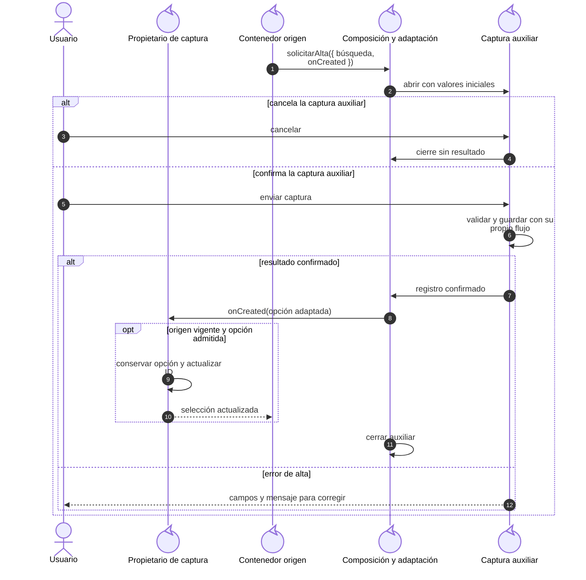
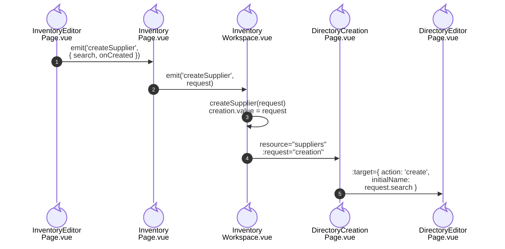
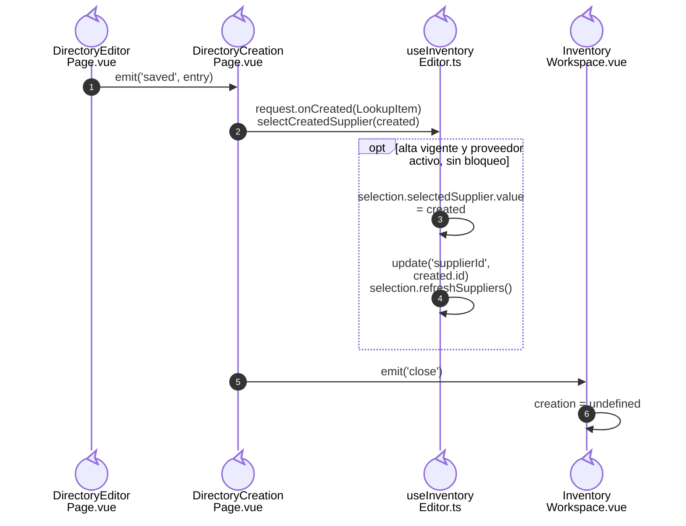
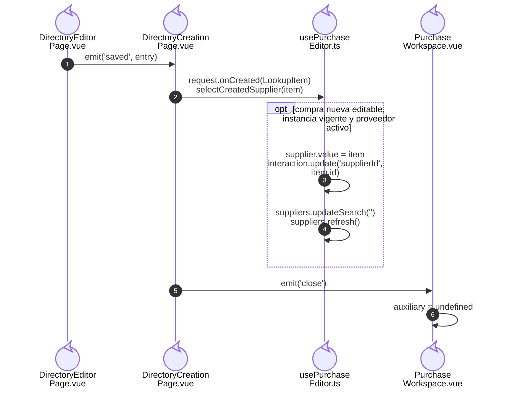
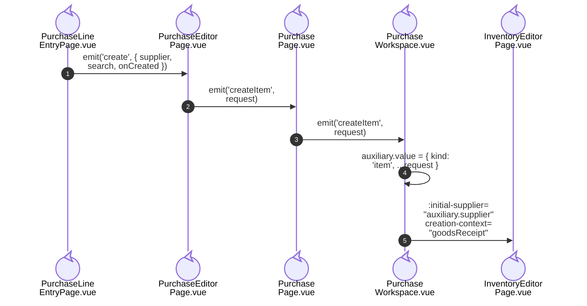
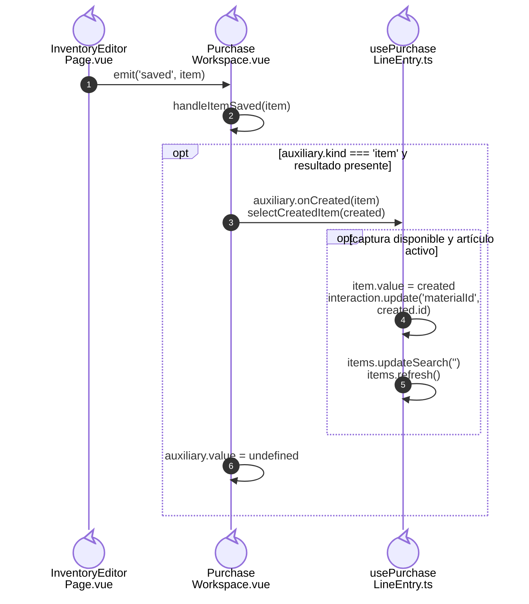
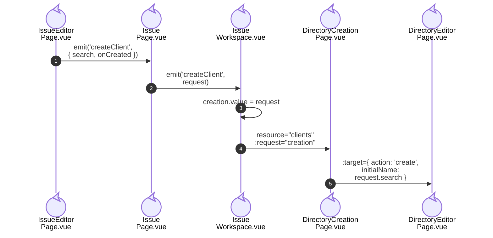
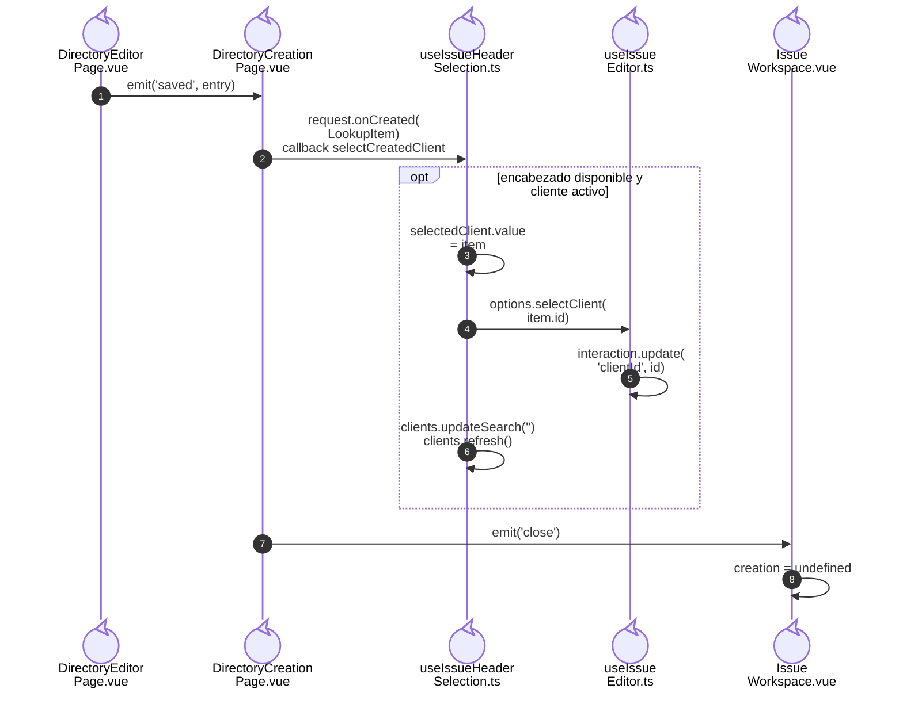

# 9. Composición de altas contextuales: modelo y casos Vue

## Propósito y funcionamiento

El formulario conserva su captura mientras otro modal crea un proveedor,
artículo o cliente. El Workspace compone los módulos y devuelve el registro
confirmado mediante un callback. `RemoteSelect` emite la búsqueda; el formulario
de origen decide si puede seleccionar el resultado.

## Modelo general

**Identificador:** `DIA-VUE-GEN-007`. **Pregunta:** ¿cómo coordinar una captura auxiliar conservando el propietario del formulario origen? **Alcance:** apertura, cancelación, confirmación y retorno. **Fuente:** composición aplicada por los Workspaces. Secuencia de roles; la composición incluye el adaptador que recibe el resultado del auxiliar.

**Lectura visual:** [líneas de vida, llamadas y retornos](../../diagram-reading.md#secuencias).

El [contrato de composición](../../../contracts/form-and-event-contracts.md#callbacks-de-composición)
define `LookupCreation`, `ItemCreation` y la adaptación a `LookupItem`.

## Caso 1: proveedor desde Inventario

**Identificador:** `DIA-VUE-APL-007`. **Pregunta:** ¿cómo llega la solicitud de proveedor al auxiliar? **Fuente:** `InventoryEditorPage`, `InventoryPage`, `InventoryWorkspace`, `DirectoryCreationPage` y `DirectoryEditorPage`. Apertura autorizada en Materiales/Consumibles; el retorno continúa en `DIA-VUE-APL-013`.

### Retorno del proveedor a Inventario

**Identificador:** `DIA-VUE-APL-013`. **Pregunta:** ¿quién aplica el proveedor y cierra el auxiliar? **Fuente:** `DirectoryEditorPage`, `DirectoryCreationPage`, `useInventoryEditor` e `InventoryWorkspace`. Retorno de un `entry` confirmado mientras `DirectoryCreationPage` conserva permiso de alta y lectura; el guardado interno de Directorio queda fuera del corte.

## Caso 2: proveedor o artículo desde Compras

### Proveedor desde el encabezado

**Identificador:** `DIA-VUE-APL-008`. **Pregunta:** ¿cómo se abre el alta desde el encabezado de compra? **Fuente:** `PurchaseEditorPage`, `PurchasePage`, `PurchaseWorkspace`, `DirectoryCreationPage` y `DirectoryEditorPage`. Apertura autorizada; el retorno continúa en `DIA-VUE-APL-014`.

### Retorno del proveedor a Compras

**Identificador:** `DIA-VUE-APL-014`. **Pregunta:** ¿qué callback selecciona el proveedor en la compra? **Fuente:** `DirectoryEditorPage`, `DirectoryCreationPage`, `usePurchaseEditor` y `PurchaseWorkspace`. Retorno confirmado con permiso de alta/lectura vigente en el adaptador de Directorio.

### Artículo desde un detalle

**Identificador:** `DIA-VUE-APL-010`. **Pregunta:** ¿cómo se abre el artículo con el proveedor de la compra? **Fuente:** `PurchaseLineEntryPage`, `PurchaseEditorPage`, `PurchasePage`, `PurchaseWorkspace` e `InventoryEditorPage`. Apertura autorizada; el retorno continúa en `DIA-VUE-APL-015`.

### Retorno del artículo al detalle

**Identificador:** `DIA-VUE-APL-015`. **Pregunta:** ¿qué resultado selecciona el artículo sin agregar el detalle? **Fuente:** `InventoryEditorPage`, `PurchaseWorkspace` y `usePurchaseLineEntry`. El editor de Inventario ya confirmó su escritura antes de emitir `saved`.

`PurchaseWorkspace` discrimina `kind=supplier` y `kind=item`; el segundo incluye
el proveedor fijado para el artículo.

## Caso 3: cliente desde Salidas

**Identificador:** `DIA-VUE-APL-009`. **Pregunta:** ¿cómo se abre el cliente desde el encabezado de salida? **Fuente:** `IssueEditorPage`, `IssuePage`, `IssueWorkspace`, `DirectoryCreationPage` y `DirectoryEditorPage`. Apertura autorizada en Materiales, Consumibles y Mermas; el retorno continúa en `DIA-VUE-APL-016`.

### Retorno del cliente a Salidas

**Identificador:** `DIA-VUE-APL-016`. **Pregunta:** ¿quién selecciona el cliente y actualiza el encabezado? **Fuente:** `DirectoryEditorPage`, `DirectoryCreationPage`, `useIssueHeaderSelection`, `useIssueEditor` e `IssueWorkspace`. Retorno confirmado con permiso de alta/lectura vigente en el adaptador de Directorio.

## Condiciones y excepciones

| Caso o condición | Regla de aplicación |
| --- | --- |
| Proveedor desde Inventario | Sólo alta de Materiales/Consumibles, con lectura y alta de proveedor. No aplica a Merma, proveedor fijado, envío o captura pendiente ni instancia desmontada. El texto buscado precarga el nombre comercial; la razón social se captura aparte. |
| Proveedor desde Compras | Sólo compra nueva editable y con permisos de lectura/alta. La edición conserva el proveedor original. |
| Artículo desde Compras | Requiere lectura/escritura de artículos y lectura de Presentación/Unidad. Usa el proveedor de la compra y `creationContext=goodsReceipt`; no captura stock ni costo inicial. |
| Cliente desde Salidas | Requiere encabezado editable y permisos de lectura/alta de cliente. Cambiarlo actualiza sus selecciones dependientes de asesor y proyecto. No permite crear asesor o solicitante. |
| Registro creado como inactivo | El alta permanece guardada, pero el origen no selecciona ese registro para la operación. |
| Opción aún fuera de la página remota | `useSelectedOption` conserva su ID y etiqueta; no necesita esperar a encontrarla en una página del selector. |
| Guardado auxiliar confirmado | Selecciona el registro; no guarda el documento principal ni agrega su detalle automáticamente. |
| Origen cerrado o incompatible al regresar | El consumidor comprueba vigencia, modo y disponibilidad antes de aplicar el resultado. La captura principal conserva sus datos ante cancelación o fallo del auxiliar. |
| Nombre sin coincidencia visible | No acredita unicidad; la API valida la identidad y autoriza el alta. |

El [ciclo de vida](../../logical/states/04-state-ownership-and-save.md#ciclo-de-guardado)
explica el límite de abortar una escritura ya confirmada por la API.

## Pruebas relacionadas

- [Altas desde selectores](../../../../../tests/e2e/selectCreation.spec.ts).
- [Inventario](../../../../../tests/unit/modules/warehouse/inventoryFormTest.ts), [Compras](../../../../../tests/unit/modules/purchases/purchaseTest.ts) y [Salidas](../../../../../tests/unit/modules/issues/issueTest.ts).
- [Opción seleccionada](../../../../../tests/unit/shared/composables/selectedOptionTest.ts).
