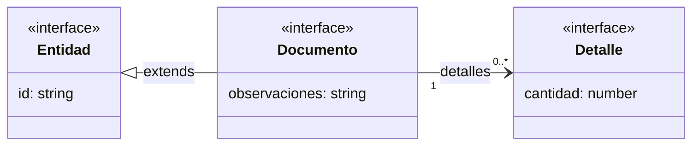
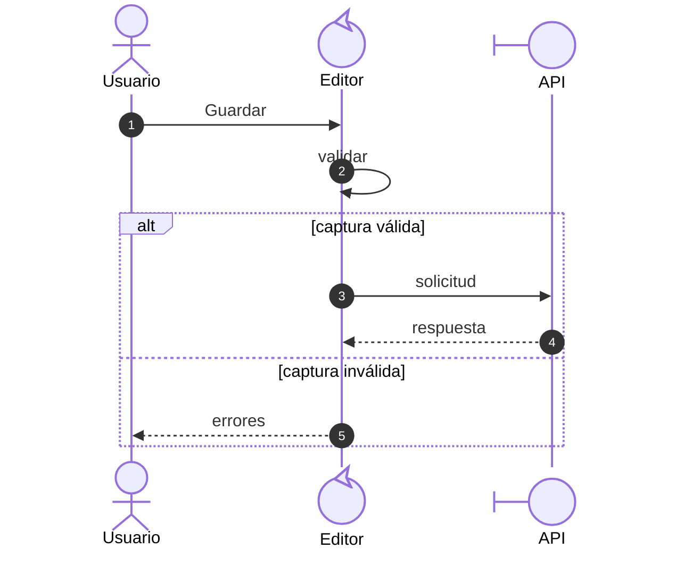
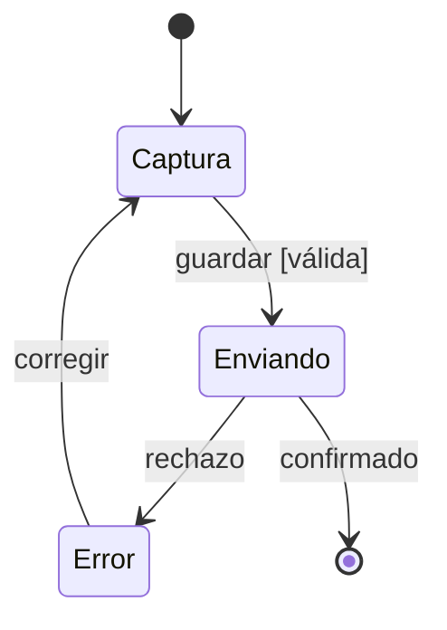
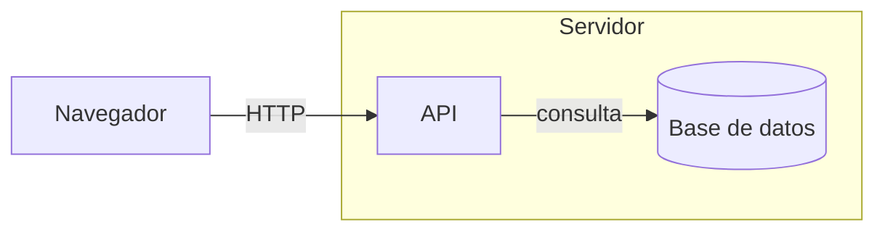

# Cómo leer los diagramas

Esta guía explica los elementos visuales usados en la documentación Vue. Los ejemplos
`DIA-VUE-LEG-*` enseñan la notación; los modelos de la aplicación conservan sus propios
identificadores, fuentes y leyendas locales.

| Para entender… | Consultar |
| --- | --- |
| Conceptos, campos y relaciones | [Clases y dominio](#clases-y-dominio). |
| Orden de llamadas y respuestas | [Secuencias](#secuencias). |
| Modos y transiciones | [Estados](#estados). |
| Objetivos y participación del usuario | [Casos de uso](#casos-de-uso). |
| Dependencias, comunicación o decisiones | [Mapas y actividades](#mapas-y-actividades). |

## Clases y dominio

**Ejemplo:** `DIA-VUE-LEG-001`. Interfaces ficticias para leer estructura y relaciones.



| Elemento visible | Lectura |
| --- | --- |
| Rectángulo con compartimentos | Arriba: nombre; después: atributos y, si aparecen, operaciones. `campo: tipo` describe un dato; `nombre()` una operación. Un compartimento vacío no declara ausencia de comportamiento. |
| `«interface»`, `«type»`, `«abstract»` | Interfaz TypeScript, alias de tipo o concepto abstracto, respectivamente. Son etiquetas de clasificación. |
| `«reference»` | Referencia a un contrato propio cuya definición se consulta en su ficha local. |
| `«SFC_contract»`, `«inferred_return»`, `«inferred_object»` o `«evaluated_alias»` | Contrato de componente o estructura obtenida del código TypeScript; no implica una clase instanciada. La fuente y la firma completa identifican su origen. |
| Tipo de biblioteca dentro de una firma, como `Ref<number>` | Anotación de un dato del contrato. No representa una entidad propia ni requiere un nodo de clase separado. |
| Nombre con parámetro, como `PageResult<T>` | Tipo genérico: `T` identifica el tipo de sus filas, por ejemplo `LookupItem`. |
| Atributo con `?`, tipo con `null` o `T[]` | Propiedad opcional, valor nulo admitido o colección de elementos, respectivamente. Una abreviación de la figura se desarrolla junto al contrato. |
| Línea continua sin punta | Asociación: los elementos están vinculados. Su texto nombra el vínculo o un rol. |
| Línea continua con flecha abierta | Referencia navegable: el origen contiene o conoce el destino. No indica una llamada temporal. |
| Triángulo hueco | Generalización; apunta al elemento general. En modelos TypeScript corresponde al `extends` declarado. |
| Rombo sólido `◆` | Composición; está junto al todo. En el dominio, Compra contiene sus Detalles. |
| Línea discontinua con flecha abierta | Dependencia: usa el tipo o concepto de destino, sin afirmar que lo almacena como propiedad. |
| Nota conectada con línea discontinua | Aclaración o restricción. Esa conexión no es una asociación del negocio. |

### Cómo leer las multiplicidades

| Marca junto a un extremo | Cantidad admitida en ese extremo por cada elemento del extremo opuesto |
| --- | --- |
| `1` | Exactamente uno. |
| `0..1` | Ninguno o uno. |
| `0..*` o `*` | Ninguno, uno o varios. |
| `1..*` | Uno o varios. |

En el ejemplo, un Documento referencia cero o más Detalles. En el dominio, una compra
registrada requiere al menos uno: la cardinalidad del documento válido y la del array
temporal responden preguntas distintas. Una restricción como «oferta o merma» precisa
que dos asociaciones opcionales son alternativas exclusivas.

## Secuencias

**Ejemplo:** `DIA-VUE-LEG-002`. Orden de mensajes de una operación genérica.



| Elemento visible | Lectura |
| --- | --- |
| Figura humana | Actor externo que participa en la interacción. |
| Símbolo `boundary`: círculo con trazo lateral | Frontera de interacción: vista, control visual, adaptador HTTP, API o entorno del navegador. |
| Símbolo `control`: círculo con flecha curva | Coordinación, decisión o cálculo: composable, Router, mapper o esquema. |
| Nombre junto al símbolo | Colaborador representado; puede ser una función o módulo, sin una clase instanciada. |
| Línea vertical bajo la cabecera | Línea de vida del participante. Se lee de arriba abajo. |
| Flecha continua / discontinua | Llamada o solicitud / resultado, callback o actualización reactiva según su etiqueta y alcance. |
| Flecha que vuelve al mismo participante | Paso interno de ese colaborador. |
| Círculo oscuro con número | Orden del mensaje, generado por `autonumber`; no es un código HTTP ni prioridad. |
| Marco `alt` / `opt` | Alternativas mutuamente excluyentes / recorrido opcional. La etiqueta expresa la condición. |
| Caja de nota | Explicación del tramo señalado. Su fondo no representa un error. |

El orden muestra coordinación; la distancia vertical entre mensajes no mide duración.
Una flecha a la API representa su frontera, sin detallar la transacción del servidor.
La [lectura de procesos](processes/00-reading-and-roles.md) distingue el callback
ejecutado por un coordinador del import o la llamada HTTP de su consumidor.

## Estados

Una **guarda** es la condición que debe cumplirse para tomar una transición; se
escribe entre corchetes, como `[válida]`. El **efecto de transición** es el resultado
de ejecutarla, como publicar una lectura o confirmar una captura. Estado, condición,
acción y resultado se distinguen mediante la etiqueta y la leyenda local.

**Ejemplo:** `DIA-VUE-LEG-003`. Ciclo ilustrativo de una interacción.



| Elemento visible | Lectura |
| --- | --- |
| Punto negro `●` | Inicio de la máquina representada. |
| Rectángulo redondeado | Estado en el que puede permanecer la interacción. |
| Flecha | Transición; la etiqueta indica evento y, cuando existen, `[guarda]` o `/ efecto`. La guarda es una condición necesaria. |
| Punto rodeado por un círculo `◉` | Final de esa máquina. Un error recuperable conserva una salida hacia la recuperación. |

Los estados de UI describen captura, lectura o envío. Los campos `status` recibidos de
la API conservan su significado de negocio en los contratos de cada documento.

## Casos de uso

Un **actor de caso de uso** es el papel externo que interactúa con Nexus para
alcanzar un objetivo. Puede especializar a otro actor; no representa una entidad
de datos, una cuenta concreta ni una pantalla.

**Ejemplo:** `DIA-VUE-LEG-004`. Vista resumida de consulta y operaciones, con un caso
propio de un actor especializado. Los enlaces consulta–operación son la convención
de acceso del documento; no representan relaciones UML entre casos.

```mermaid
usecase-beta
direction LR
    actor general("Actor general")
    actor specialized("Actor especializado")
    specialized --|> general
    systemBoundary example["Sistema de ejemplo"]
        main("Consultar registros")
        common("Operar registro")
        specific("Operación específica")
    end
    general -- main
    specialized -- specific
    main -- common
    main -- specific
```

El actor especializado hereda la asociación con la consulta y conserva la asociación
propia con Operación específica. Esta operación sigue conectada con la consulta:
la generalización entre actores no sustituye el enlace de acceso. La vista omite las
asociaciones repetidas del actor general con las operaciones; sus fichas mantienen
todos los actores que pueden iniciarlas. Dos actores pueden participar en el mismo
caso sin tener generalización entre sí. En esta vista resumida, los actores que
comparten operaciones se conectan sólo a la consulta. La asociación directa adicional
identifica una operación exclusiva, justificada por los permisos y su ficha.

**Ejemplo:** `DIA-VUE-LEG-007`. Inclusión y extensión de comportamiento. Es un
ejemplo de notación, sin atribuir nuevos casos a Nexus.

```mermaid
usecase-beta
direction LR
    actor participant("Actor autorizado")
    systemBoundary behaviorExample["Sistema de ejemplo"]
        base("Completar objetivo")
        required("Comportamiento requerido")
        optional("Resolver situación opcional")
    end
    participant -- base
    base ..>:include required
    optional ..>:extend base
```

Completar objetivo incorpora el comportamiento requerido al alcanzar el punto de
inclusión de su flujo. Resolver situación opcional se inserta en el punto de extensión
previsto cuando se cumple su condición; el objetivo base puede completarse sin esa
situación. Los dos ejemplos separan el acceso desde una consulta de la incorporación
de comportamiento.

| Elemento visible | Lectura |
| --- | --- |
| Figura humana con nombre | Actor: una función externa que participa, no una cuenta concreta. |
| Óvalo | Objetivo del actor, identificado por `CU-*` en los modelos de Nexus. |
| Rectángulo que agrupa óvalos | Límite del sistema o corte funcional; los actores quedan fuera. |
| Línea continua actor–óvalo, sin punta | Asociación normal: participación del actor en el objetivo, incluida la consulta. No indica orden de ejecución ni concesión automática de permisos. |
| Línea continua consulta–operación, sin punta ni etiqueta | Enlace de acceso de la vista resumida, como convención del documento. No es una asociación UML entre casos ni implica `include`, `extend` o autorización. |
| Triángulo hueco entre actores | Generalización; apunta al actor general. El especializado hereda sus asociaciones y conserva las propias. |
| Flecha discontinua `«extend»` | Del caso que agrega comportamiento al caso base. Requiere un punto de extensión y una condición documentados; la base conserva sentido completo sin la extensión. |
| Flecha discontinua `«include»` | De la base al comportamiento requerido al alcanzar su punto de inclusión. No expresa cronología de pantallas ni permisos. |

En Nexus, las altas contextuales desde selectores justifican `«extend»` por su
inserción y retorno a una captura; las fichas identifican condición y punto concretos.
El segundo ejemplo explica la inclusión sin atribuir un `include` a los casos del sistema.
La [guía del modelo](../../requirements/use-case-model/index.md#asociaciones-y-relaciones-entre-casos)
concentra la aplicación de estas relaciones y la representación de restricciones.
La navegación entre pantallas se documenta en su [catálogo](scenarios/navigation-and-screens.md).

## Mapas y actividades

**Ejemplo:** `DIA-VUE-LEG-005`. Mapa de comunicación, con flechas etiquetadas.



**Ejemplo:** `DIA-VUE-LEG-006`. Actividad representada mediante un flujo Mermaid.


| Elemento visible | Lectura |
| --- | --- |
| Rectángulo | Colaborador, artefacto o acción, según el alcance del mapa. El texto lo identifica. |
| Cilindro | Almacenamiento, como PostgreSQL. |
| Caja que contiene otras cajas | Agrupación o límite de responsabilidad/ejecución; su rótulo explica cuál. |
| Rombo con pregunta | Decisión; las salidas llevan condiciones como Sí/No. |
| Cápsula | Inicio/fin de una actividad cuando así se rotula. |
| Flecha etiquetada | Comunicación, dependencia o flujo de control según la leyenda local. |

En los patrones, una flecha discontinua puede representar evento/callback; en el mapa
de construcción identifica una exclusión. La leyenda local fija ese significado. Los
cortes C4 y las actividades son aproximaciones con cajas Mermaid, con su alcance indicado.

## Color y énfasis

El color depende del tema del visor o exportador. En estos diagramas no codifica rol,
permiso, prioridad ni estado del negocio. El significado lo dan forma, texto, extremos
y tipo de línea. Los nombres resaltados son títulos; las cajas oscuras de notas y los
círculos de numeración son ayudas de lectura. La apariencia de la aplicación Vue se
describe por separado en [interfaz y tema](logical/ui-and-http.md#tema-estilos-y-controles).

Referencias de notación: [UML](https://www.omg.org/spec/UML/2.5.1) y
[sintaxis de Mermaid](https://mermaid.js.org/intro/syntax-reference.html).
