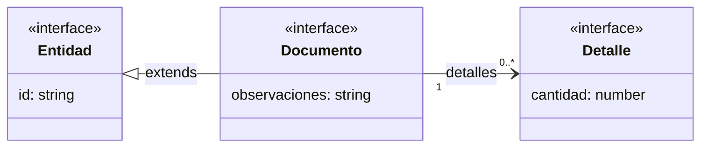
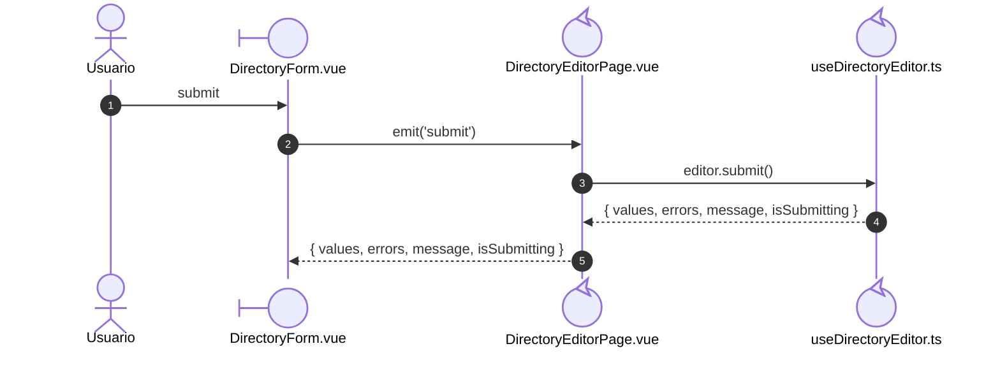
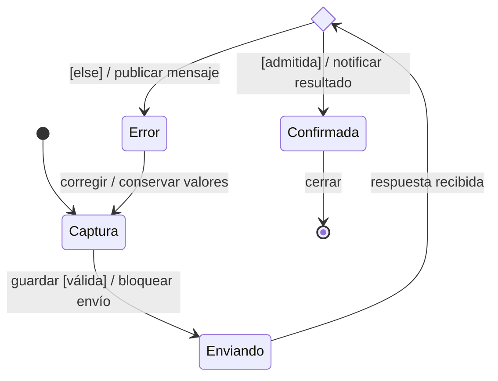
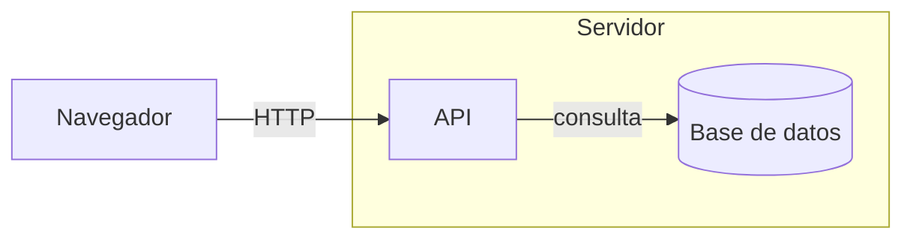
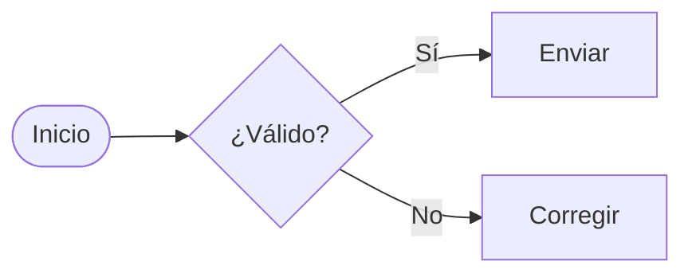

# Cómo leer los diagramas

Esta guía explica los elementos visuales usados en la documentación Vue. Los ejemplos
`DIA-VUE-LEG-*` enseñan la notación; los modelos de la aplicación conservan sus propios
identificadores, fuentes y leyendas locales.

| Para entender… | Consultar |
| --- | --- |
| Conceptos, campos y relaciones | [Clases y dominio](#clases-y-dominio). |
| Orden de llamadas y respuestas | [Secuencias](#secuencias). |
| Modos y transiciones | [Estados](#estados). |
| Objetivos y participación del usuario | [Casos de uso](#casos-de-uso). |
| Componentes y dependencias | [Mapas de componentes](#componentes-y-dependencias). |
| Comunicación o decisiones | [Mapas y actividades](#mapas-y-actividades). |

## Reglas de elaboración

Se usa Mermaid. Cada figura indica identificador, pregunta, alcance, fuente y
significado de sus flechas. El modelo general explica el mecanismo; la aplicación
nombra componentes, composables, servicios o contratos que existen en Vue.
Los diagramas de flujo no se presentan como UML de clases. Actores, mensajes y
límites se usan cuando corresponde, sin inventar relaciones ni concurrencia.
Los diagramas curados explican decisiones; el generador sólo inventaría elementos
declarados en las fuentes. Ninguno demuestra por sí mismo calidad o SOLID.

| Familia | Comprobación visual y semántica |
| --- | --- |
| Secuencia | Actor humano; participantes `boundary`, `control` o simples según responsabilidad; mensajes numerados y extremos declarados. El callback conserva su propietario de código. |
| Clases/dominio | Estereotipos, atributos, asociaciones, multiplicidades y generalizaciones correspondientes al modelo. Los eventos tipados se describen como datos/contratos, no métodos inventados. |
| Casos de uso | Actor fuera del límite, objetivos en óvalos, participación y relaciones funcionales justificadas. |
| Estados/actividad | Inicio, estados/acciones, transiciones y decisiones del ciclo representado; los finales y alternativas conservan su significado. |
| Mapas/ejecución | Consumidor hacia colaborador y leyenda de relaciones; construcción, artefactos y procesos en ejecución tienen alcance explícito. |

El dominio se mantiene en `requirements/domain-model`; los contratos estáticos en
`architecture/views/logical/class-and-type-models`; los estados en `logical/states`.
Los procesos se agrupan por responsabilidad y conservan un índice por sección. Un
diagrama de dominio no reemplaza el de tipos y una secuencia no reemplaza el ciclo de
estados. El [índice de vistas](index.md) relaciona esos niveles.


## Clases y dominio

**Ejemplo:** `DIA-VUE-LEG-001`. Interfaces ficticias para leer estructura y relaciones.



| Elemento visible | Lectura |
| --- | --- |
| Rectángulo con compartimentos | Arriba: nombre; después: atributos y, si aparecen, operaciones. `campo: tipo` describe un dato; `nombre()` una operación. Un compartimento vacío no declara ausencia de comportamiento. |
| `«interface»`, `«type»`, `«abstract»` | Interfaz TypeScript, alias de tipo o concepto abstracto, respectivamente. Son etiquetas de clasificación. |
| Tipo de biblioteca dentro de una firma, como `Ref<number>` | Anotación de un dato del contrato. No representa una entidad propia ni requiere un nodo de clase separado. |
| Nombre con parámetro, como `PageResult<T>` | Tipo genérico: `T` identifica el tipo de sus filas, por ejemplo `LookupItem`. |
| Atributo con `?`, tipo con `null` o `T[]` | Propiedad opcional, valor nulo admitido o colección de elementos, respectivamente. Una abreviación de la figura se desarrolla junto al contrato. |
| Línea continua sin punta | Asociación: los elementos están vinculados. Su texto nombra el vínculo o un rol. |
| Línea continua con flecha abierta | Referencia navegable: el origen contiene o conoce el destino. No indica una llamada temporal. |
| Triángulo hueco y línea continua | Generalización; apunta al elemento general y corresponde al `extends` declarado. |
| Triángulo hueco y línea discontinua | Realización: una clase implementa la interfaz indicada por `implements`; no es herencia de implementación. |
| Rombo sólido `◆` | Composición; está junto al todo. En el dominio, Compra contiene sus Detalles. |
| Línea discontinua con flecha abierta | Dependencia: usa el tipo o concepto de destino, sin afirmar que lo almacena como propiedad. |
| Nota conectada con línea discontinua | Aclaración o restricción. Esa conexión no es una asociación del negocio. |

### Cómo leer las multiplicidades

| Marca junto a un extremo | Cantidad admitida en ese extremo por cada elemento del extremo opuesto |
| --- | --- |
| `1` | Exactamente uno. |
| `0..1` | Ninguno o uno. |
| `0..*` o `*` | Ninguno, uno o varios. |
| `1..*` | Uno o varios. |

Una multiplicidad omitida no se presume igual a `1`; requiere una restricción
explícita del modelo.

En el ejemplo, un Documento referencia cero o más Detalles. En el dominio, una compra
registrada requiere al menos uno: la cardinalidad del documento válido y la del array
temporal responden preguntas distintas. Una restricción como «oferta o merma» precisa
que dos asociaciones opcionales son alternativas exclusivas.

## Secuencias

**Ejemplo:** `DIA-VUE-LEG-002`. Eventos y props de Directorio.



| Elemento visible | Lectura |
| --- | --- |
| Figura humana | Actor externo que participa en la interacción. |
| Símbolo `boundary`: círculo con trazo lateral | Frontera de entrada/salida: formulario visual, menú, adaptador de avisos o HTTP y API. |
| Símbolo `control`: círculo con flecha curva | Coordinador de una interacción: página contenedora, composable, sesión o guarda de navegación propia. |
| Rectángulo de participante sin estereotipo | Módulo o función que interviene en llamadas: mapper, constructor de payload, validación pura o adaptación de errores. |
| Símbolo `entity`: círculo con línea inferior | Objeto del dominio que recibe mensajes. Los contratos de datos TypeScript que sólo viajan como valores se escriben en los retornos, sin inventar métodos o instancias. |
| Nombre junto al símbolo | Colaborador representado; puede ser una función o módulo, sin una clase instanciada. |
| Línea vertical bajo la cabecera | Línea de vida del participante. Se lee de arriba abajo. |
| Caja de grupo con título | Agrupa líneas de vida por responsabilidad, como Interfaz, Coordinación o Integración. No representa una clase, un objeto adicional ni un proceso independiente. |
| Flecha continua / discontinua | Llamada, evento o solicitud / resultado o valores expuestos, según la etiqueta. Los callbacks se muestran como llamadas a su propietario. |
| Flecha que vuelve al mismo participante | Paso interno de ese colaborador. |
| Círculo oscuro con número | Orden del mensaje, generado por `autonumber`; no es un código HTTP ni prioridad. |
| Marco `alt` / `opt` | Alternativas mutuamente excluyentes / recorrido opcional. La etiqueta expresa la condición. |
| Marco `loop` | Repite los mensajes encerrados según su etiqueta, por ejemplo por cada campo o elemento renderizado. No expresa concurrencia. |
| Marco `break` | Si se cumple la condición, el recorrido termina en ese punto; los mensajes posteriores no se ejecutan en esa rama. |
| Caja de nota | Explicación del tramo señalado. Su fondo no representa un error. |

El orden muestra coordinación; la distancia vertical entre mensajes no mide duración.
Una flecha a la API representa su frontera, sin detallar la transacción del servidor.
La [lectura de procesos](processes/00-reading-and-roles.md) distingue el callback
ejecutado por un coordinador del import o la llamada HTTP de su consumidor.

## Estados

Una transición se lee como `evento [guarda] / efecto`: el evento solicita o completa
el cambio, la guarda decide si puede ocurrir y el efecto se ejecuta al tomarlo.
El evento también puede ser la resolución o el rechazo de una promesa. No se usa
una conjunción en prosa para confundir estas tres funciones.

**Ejemplo:** `DIA-VUE-LEG-003`. Ciclo ilustrativo; los nombres no son funciones de Nexus.



| Elemento visible | Lectura |
| --- | --- |
| Punto negro `●` | Pseudoestado inicial; señala dónde comienza ese ciclo, sin representar una actividad. |
| Rectángulo redondeado | Estado: situación en la que puede permanecer el sujeto observado. Su nombre puede resumir flags reales; no crea otro enum. |
| Flecha de transición | Sale del estado origen hacia el destino. La etiqueta separa evento, `[guarda]` y `/ efecto`; no expresa dependencia entre archivos. |
| `[guarda]` | Condición booleana necesaria. Si es falsa no se toma esa salida; no obliga por sí sola a mostrar un error. |
| `/ efecto` | Acción relevante asociada al cambio; no es el nombre del estado destino ni una actividad permanente. |
| Rombo `«choice»` | Decisión inmediata. Sus salidas llevan guardas excluyentes; `[else]` completa la alternativa restante. No es un modo de UI. |
| Marco con nombre y estados internos | Estado compuesto: reúne subestados y permite una salida común. Sin regiones separadas no expresa paralelismo. |
| Texto dentro del estado `evento / efecto` | Reacción interna que no abandona ese estado; se distingue de una flecha que sale y vuelve a entrar. |
| Punto rodeado por un círculo `◉` | Estado final del ciclo representado; no implica apagar la aplicación, limpiar Storage o revertir una escritura. |

Una etiqueta sin guarda no añade una condición al evento. Una salida sin evento
explícito desde una decisión es inmediata al evaluar su guarda. Un estado sin
final puede participar en recorridos repetidos mientras su coordinador siga vivo.
La salida del pseudoestado inicial no espera un evento ni evalúa una guarda;
si necesita una acción inicial, se etiqueta sólo como `/ efecto`.
No es obligatorio usar historia, regiones paralelas o actividades `entry`/`exit`/`do`
si no corresponden al comportamiento representado.

Los [modelos de estado](logical/states/index.md) declaran sujeto, flags, guardas
abreviadas y límites del corte. Los campos `status` de la API conservan el significado
del negocio; no son automáticamente estados de la interfaz.

## Casos de uso

Un **actor de caso de uso** es el papel externo que interactúa con Nexus para
alcanzar un objetivo. Puede especializar a otro actor; no representa una entidad
de datos, una cuenta concreta ni una pantalla.

**Ejemplo:** `DIA-VUE-LEG-004`. Vista resumida de consulta y operaciones, con un caso
propio de un actor especializado. Los enlaces consulta–operación son la convención
de acceso del documento; no representan relaciones UML entre casos.

```mermaid
usecase-beta
direction LR
    actor general("Actor general")
    actor specialized("Actor especializado")
    specialized --|> general
    systemBoundary example["Sistema de ejemplo"]
        main("Consultar registros")
        common("Operar registro")
        specific("Operación específica")
    end
    general -- main
    specialized -- specific
    main -- common
    main -- specific
```

En esta vista resumida, los actores que comparten operaciones se conectan sólo
a la consulta. Las fichas identifican todos los participantes; una asociación
adicional señala una operación exclusiva.

**Ejemplo:** `DIA-VUE-LEG-007`. Inclusión y extensión de comportamiento.

```mermaid
usecase-beta
direction LR
    actor participant("Actor autorizado")
    systemBoundary behaviorExample["Sistema de ejemplo"]
        base("Completar objetivo")
        required("Comportamiento requerido")
        optional("Resolver situación opcional")
    end
    participant -- base
    base ..>:include required
    optional ..>:extend base
```

| Elemento visible | Lectura |
| --- | --- |
| Figura humana con nombre | Actor: una función externa que participa, no una cuenta concreta. |
| Óvalo | Objetivo del actor, identificado por `CU-*` en los modelos de Nexus. |
| Rectángulo que agrupa óvalos | Límite del sistema o corte funcional; los actores quedan fuera. |
| Línea continua actor–óvalo, sin punta | Asociación normal: participación del actor en el objetivo, incluida la consulta. No indica orden de ejecución ni concesión automática de permisos. |
| Línea continua consulta–operación, sin punta ni etiqueta | Enlace de acceso de la vista resumida, como convención del documento. No es una asociación UML entre casos ni implica `include`, `extend` o autorización. |
| Triángulo hueco entre actores | Generalización; apunta al actor general. El especializado hereda sus asociaciones y conserva las propias. |
| Flecha discontinua `«extend»` | Del caso que agrega comportamiento al caso base. Requiere un punto de extensión y una condición documentados; la base conserva sentido completo sin la extensión. |
| Flecha discontinua `«include»` | De la base al comportamiento requerido al alcanzar su punto de inclusión. No expresa cronología de pantallas ni permisos. |

Los actores y objetivos de Nexus se consultan en el
[modelo de casos de uso](../../requirements/use-case-model/index.md); los recorridos
entre pantallas, en el [catálogo de navegación](scenarios/navigation-and-screens.md).

## Componentes y dependencias

Los cortes `DIA-VUE-COMP-*` son mapas de componentes lógicos con notación de flujo
Mermaid. Explican organización y dependencias del cliente; no se presentan como
UML formal de componentes ni como C4 completo: no dibujan puertos, interfaces
provistas/requeridas o unidades de despliegue que el código no declara.

| Elemento visible | Lectura en estos cortes |
| --- | --- |
| Rectángulo con archivo o export propio | Componente, composable, módulo o adaptador de Nexus. El nombre distingue su función sin atribuirle una clase instanciada. |
| Flecha continua `A → B` | A importa o carga B directamente. La punta apunta al colaborador utilizado; no muestra que B emita un evento ni el orden de ejecución. |
| Marco con nombre | Agrupación por responsabilidad o alcance del corte; no añade un import ni un proceso independiente. |
| Nodo sin flecha a otra pieza visual | Puede recibirla por un slot o callback del consumidor. No se añade una dependencia sólo porque aparezcan juntos en pantalla. |
| Librería citada en texto | Tecnología utilizada en los archivos; sus clases externas no se convierten en entidades propias. |

Los cortes seleccionan colaboraciones relevantes: la lista completa de imports está
en la [referencia generada de código](development/code-reference.md). Props, eventos
y callbacks se precisan en [contratos](../contracts/form-and-event-contracts.md) y
[secuencias](processes/index.md), donde sus flechas tienen otro significado.

## Mapas y actividades

**Ejemplo:** `DIA-VUE-LEG-005`. Mapa de comunicación, con flechas etiquetadas.



**Ejemplo:** `DIA-VUE-LEG-006`. Actividad representada mediante un flujo Mermaid.



| Elemento visible | Lectura |
| --- | --- |
| Rectángulo | Colaborador, artefacto o acción, según el alcance del mapa. El texto lo identifica. |
| Cilindro | Almacenamiento, como PostgreSQL. |
| Paralelogramo | Entrada, producto o dato que se transforma en un flujo de datos. No es una función ejecutable. |
| Caja que contiene otras cajas | Agrupación o límite de responsabilidad/ejecución; su rótulo explica cuál. |
| Rombo con pregunta | Decisión; las salidas llevan condiciones como Sí/No. |
| Cápsula | Inicio/fin de una actividad cuando así se rotula. |
| Flecha etiquetada | Comunicación, dependencia o flujo de control según la leyenda local. |

En un árbol de slots, las regiones muestran lugares donde se inserta contenido,
no nuevas clases. Una actividad de fábrica muestra cómo se construye su producto;
la ejecución posterior del producto tiene otro alcance.

En los patrones, una flecha discontinua puede representar evento/callback; en el mapa
de construcción identifica una exclusión. La leyenda local fija ese significado. Los
cortes C4 y las actividades son aproximaciones con cajas Mermaid, con su alcance indicado.

## Color y énfasis

El color depende del tema del visor o exportador. En estos diagramas no codifica rol,
permiso, prioridad ni estado del negocio. El significado lo dan forma, texto, extremos
y tipo de línea. Los nombres resaltados son títulos; las cajas oscuras de notas y los
círculos de numeración son ayudas de lectura. La apariencia de la aplicación Vue se
describe por separado en [interfaz y tema](logical/components/08-shared-ui.md#tema-estilos-y-controles).

Referencias de notación: [UML](https://www.omg.org/spec/UML/2.5.1) y
[sintaxis de Mermaid](https://mermaid.js.org/intro/syntax-reference.html).
