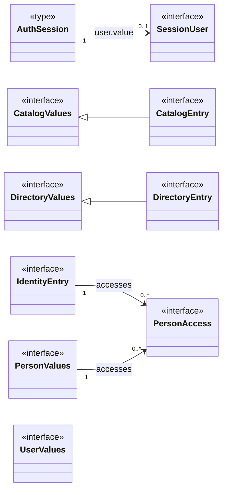
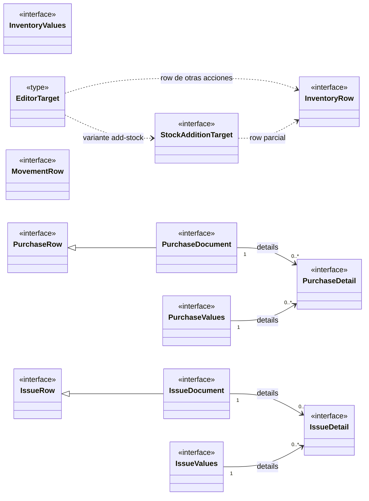
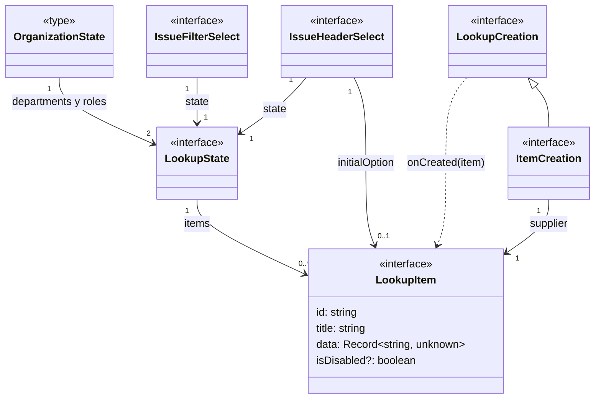

# Vista general de los modelos de datos

## Maestros y acceso

**Identificador:** `DIA-VUE-DAT-015`. **Pregunta:** ¿cómo se relacionan los modelos
de sesión, catálogos, directorio e identidad? **Fuentes:** `session.ts`, `catalog.ts`,
`directory.ts` e `identity.ts`, enlazados en el [índice de modelos](index.md).
**Notación:** clases UML aplicadas a interfaces
y aliases TypeScript, sin atributos en esta vista general.

Las líneas continuas representan propiedades tipadas; las discontinuas,
dependencias de aliases o proyecciones. El triángulo apunta a la interfaz extendida.
Los capítulos de cada módulo detallan campos, variantes y contratos de escritura.

## Inventario, documentos y captura

**Identificador:** `DIA-VUE-DAT-018`. **Pregunta:** ¿cómo se relacionan las filas,
documentos y capturas de las operaciones de almacén? **Fuentes:** `inventory.ts`,
`movement.ts`, `purchase.ts` e `issue.ts`, enlazados en el [índice de modelos](index.md).
**Notación:** la misma del mapa de maestros; una unión de tipos no implica herencia.

Los modelos se relacionan según sus propiedades: `supplierId`, `clientId`,
`departmentId`, `roleId` e IDs de artículo son strings. No contienen instancias de
`DirectoryEntry`, `CatalogEntry` o `InventoryRow`. Los mappers construyen las
proyecciones que necesita cada módulo.

## Conexiones entre módulos mediante selectores

**Identificador:** `DIA-VUE-DAT-019`. **Pregunta:** ¿qué tipos enlazan Compras,
Salidas e Identidad con los selectores compartidos? **Fuentes:**
[lookup.ts](../../../../../src/shared/lookup.ts),
[purchase.ts](../../../../../src/modules/purchases/purchase.ts) e
[issue.ts](../../../../../src/modules/issues/issue.ts).
**Notación:** asociaciones por propiedad, generalización y dependencia del callback.

## Conexiones compartidas y detalle

| Conexión | Modelo que la desarrolla |
| --- | --- |
| Página de resultados y opciones de selección | [Transporte y selectores](02-shared-contracts.md#páginas-y-opciones-remotas). |
| Base de las solicitudes a selectores de cuatro módulos | [Consultas tipadas](02-shared-contracts.md#consultas-tipadas-de-selectores). |
| Tabla, filtros de Compras/Salidas/Movimientos e Identidad | [Consultas reutilizadas](06-movements-and-queries.md#contratos-de-consulta-reutilizados). |
| Opciones de Área/Rol y selección del encabezado de Salidas | [Identidad](04-identity.md#opciones-de-área-y-rol) y [Salidas](08-issues.md#contratos-visuales-de-selección). |
| Datos, claves y setters de formularios | [Genéricos y reactividad](09-reactive-contracts.md). |
| Props y eventos de componentes | [Contratos de formularios](../../../contracts/form-and-event-contracts.md). |

La [referencia TypeScript](../type-reference/index.md) conserva todas las
declaraciones. Esta vista reúne los modelos principales; los contratos visuales,
consultas y tipos auxiliares se consultan por responsabilidad.
