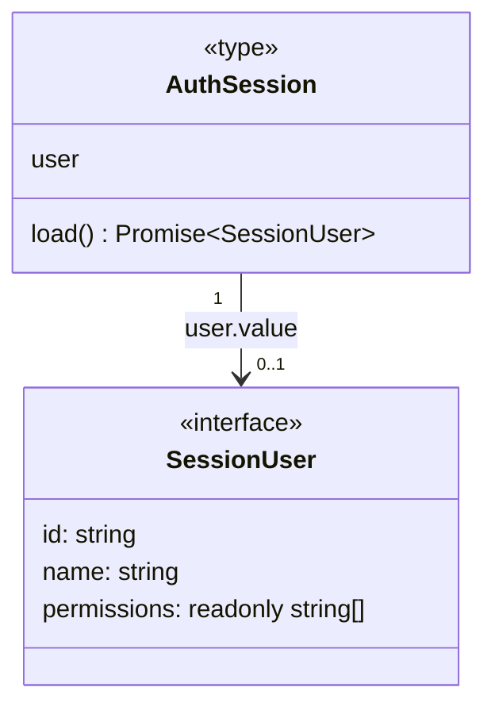
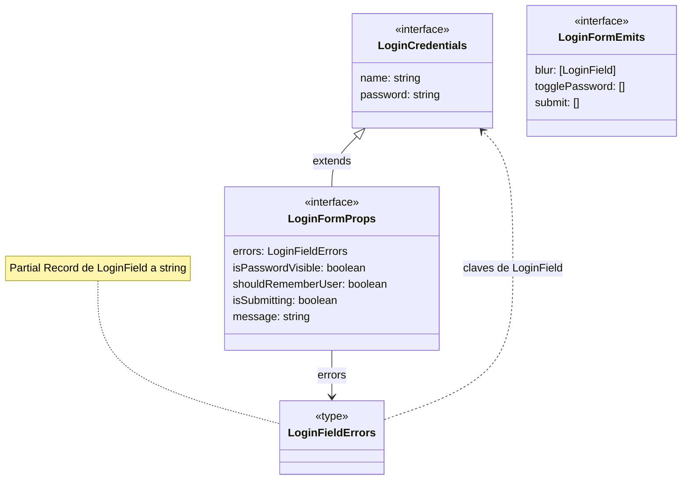

# Sesión y contratos de login

## Sesión compartida por inyección

**Identificador:** `DIA-VUE-DAT-003`. **Pregunta:** ¿Qué estado de identidad comparte
la aplicación y quién puede renovarlo? **Fuente:**
[session.ts](../../../../../src/modules/auth/session.ts).
**Notación:** interfaz y contrato de objeto derivado con asociación opcional.

**Lectura visual:** [cajas, flechas y multiplicidades](../../diagram-reading.md#clases-y-dominio).

`AuthSession` es `ReturnType<typeof createAuthSession>`, no una clase instanciada.
`createAuthSession` posee la referencia y la promesa de carga; `load` valida la forma
de `/api/auth/me`, publica sólo ID, nombre y permisos, y comparte la carga pendiente.
`useAuthSession` obtiene esa misma instancia con `authSessionKey`. Los consumidores
reciben una referencia de sólo lectura, sin copiar cookies o tokens a un store.

La renovación HTTP pertenece a `apiClient`; la
[secuencia de concurrencia](../../processes/01-session/04-concurrent-renewal.md)
distingue ambas promesas compartidas. Describir este contrato no implica incorporar Pinia.

## Props y eventos del formulario

**Identificador:** `DIA-VUE-DAT-004`. **Pregunta:** ¿Cómo se separan captura,
presentación y eventos sin que el componente haga HTTP? **Fuentes:**
[login.ts](../../../../../src/modules/auth/login.ts),
[LoginForm.vue](../../../../../src/modules/auth/components/LoginForm.vue),
[useLoginForm.ts](../../../../../src/modules/auth/composables/useLoginForm.ts).
**Notación:** interfaces, extensión TypeScript y dependencia de tipo.

`LoginFormEmits` declara propiedades cuyo tipo es una tupla de argumentos de evento.
En la figura se seleccionan tres; `[LoginField]` abrevia la tupla nombrada
`[field: LoginField]`. El contrato completo es:

| Evento | Argumentos |
| --- | --- |
| `update:name` | `[name: string]`. |
| `update:password` | `[password: string]`. |
| `update:shouldRememberUser` | `[shouldRememberUser: boolean]`. |
| `blur` | `[field: LoginField]`. |
| `togglePassword` / `submit` | `[]`. |

`LoginField = keyof LoginCredentials`. El componente recibe valores y emite intención;
el composable valida y llama al servicio. La
[secuencia de login](../../processes/01-session/02-login.md) explica orden y rechazos.
