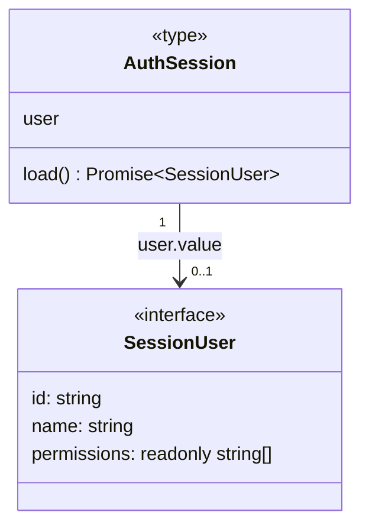
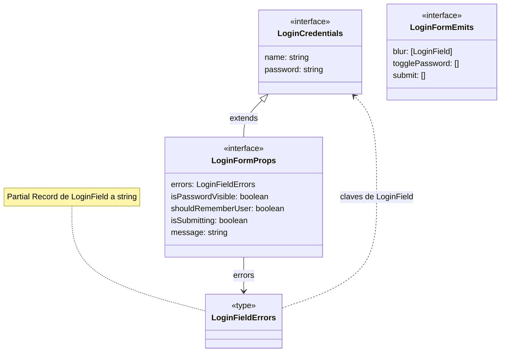

# Sesión y contratos de login

## Sesión compartida por inyección

**Identificador:** `DIA-VUE-DAT-003`. **Pregunta:** ¿Qué estado de identidad comparte
la aplicación y quién puede renovarlo? **Fuente:**
[session.ts](../../../../../src/modules/auth/session.ts).
**Notación:** interfaz y contrato de objeto derivado con asociación opcional.

**Lectura visual:** [cajas, flechas y multiplicidades](../../diagram-reading.md#clases-y-dominio).

`AuthSession` es `ReturnType<typeof createAuthSession>`. Sus consumidores reciben
la referencia readonly de la instancia proporcionada por `authSessionKey`.

La [secuencia de renovación](../../processes/01-session/04-concurrent-renewal.md)
distingue la carga compartida de sesión del refresh HTTP.

## Props y eventos del formulario

**Identificador:** `DIA-VUE-DAT-004`. **Pregunta:** ¿Cómo se separan captura,
presentación y eventos sin que el componente haga HTTP? **Fuentes:**
[login.ts](../../../../../src/modules/auth/login.ts),
[LoginForm.vue](../../../../../src/modules/auth/components/LoginForm.vue),
[useLoginForm.ts](../../../../../src/modules/auth/composables/useLoginForm.ts).
**Notación:** interfaces, extensión TypeScript y dependencia de tipo.

`LoginFormEmits` declara tuplas de argumentos. `[LoginField]` abrevia
`[field: LoginField]`, con `LoginField = keyof LoginCredentials`.
Los [eventos completos del login](../../../contracts/form-and-event-contracts.md#eventos-del-login)
se definen junto a los demás intercambios de componentes.
