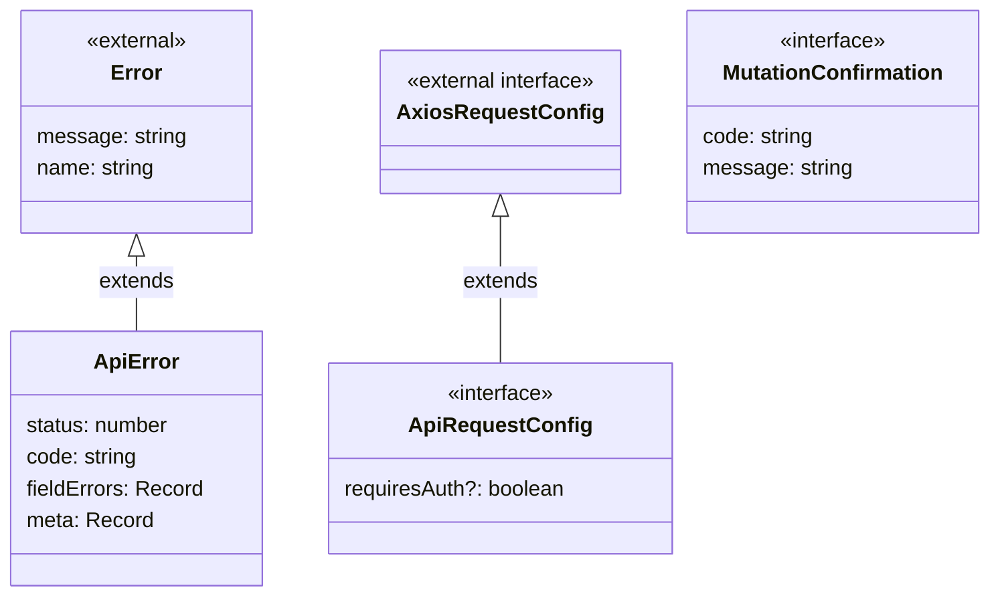
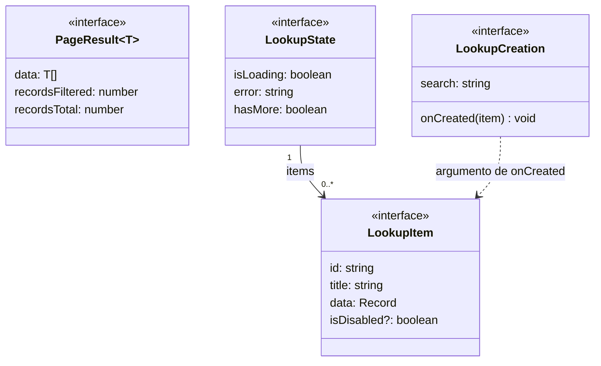

# Transporte, resultados y selectores

## Configuración y errores

**Identificador:** `DIA-VUE-DAT-005`. **Pregunta:** ¿Qué contrato permite distinguir
cancelación, error HTTP y rechazo de una mutación? **Fuentes:**
[apiClient.ts](../../../../../src/shared/http/apiClient.ts),
[apiError.ts](../../../../../src/shared/http/apiError.ts),
[recordContract.ts](../../../../../src/shared/http/recordContract.ts).
**Notación:** clase real, interfaces y extensiones declaradas; Axios y Error son externos.

**Lectura visual:** [cajas, flechas y multiplicidades](../../diagram-reading.md#clases-y-dominio).

`normalizeApiError` produce `ApiError`; una cancelación Axios se propaga como
cancelación y no como fallo de negocio. El código interno `RetriableRequest` añade
`hasRetried` a la configuración interceptada para limitar el reintento autenticado.
`confirmMutation(value, expected)` sólo devuelve `MutationConfirmation` si el código
recibido coincide con el esperado. `message` procede del catálogo público de mensajes,
no de inventar un código exitoso en el formulario. No hay asociación estructural entre
el error y la confirmación: son resultados alternativos de la operación.

## Páginas y opciones remotas

**Identificador:** `DIA-VUE-DAT-006`. **Pregunta:** ¿Qué comparten una tabla remota,
un selector y el alta contextual? **Fuentes:**
[pageRequest.ts](../../../../../src/shared/http/pageRequest.ts),
[lookup.ts](../../../../../src/shared/lookup.ts),
[useRemoteLookup.ts](../../../../../src/shared/composables/useRemoteLookup.ts).
**Notación:** interfaces, parámetro genérico y asociación de colección.

`PageResult<T>` expresa filas y conteos; en el selector se liga `T = LookupItem`.
`requestPage` comprueba arrays de objetos y conteos enteros no negativos; el mapper
del recurso valida sus campos. `LookupState` es la fotografía que recibe la UI y no
expone controladores de aborto. `LookupCreation` entrega búsqueda y callback al editor
contextual; no es un registro persistido.

`useRemoteLookup` conserva secuencia, página, debounce y aborto. `useSelectedOption`
conserva la etiqueta de la selección aunque no esté en la página actual. La
[secuencia del selector](../../processes/02-shared-runtime/03-remote-lookup.md)
y el [patrón de alta contextual](../../development/design-and-construction-patterns/09-contextual-creation.md)
describen esas colaboraciones sin duplicar sus contratos.
