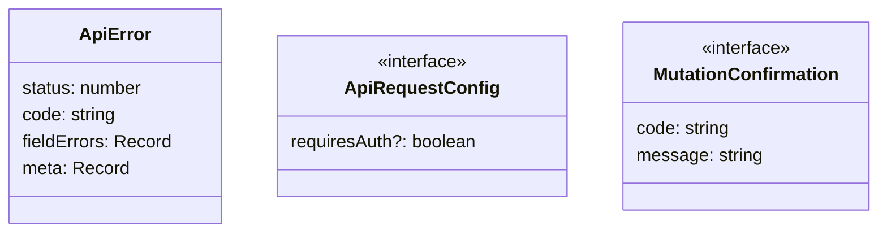
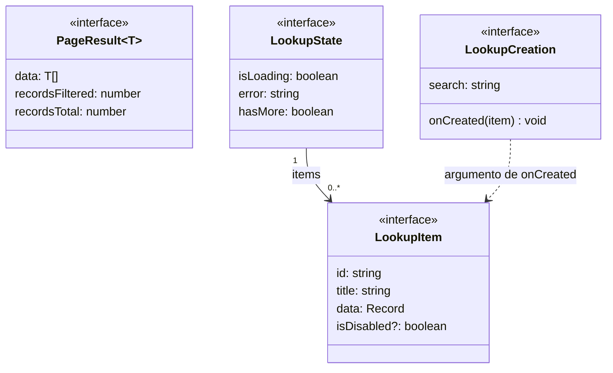

# Transporte, resultados y selectores

## Configuración y errores

**Identificador:** `DIA-VUE-DAT-005`. **Pregunta:** ¿Qué contrato permite distinguir
cancelación, error HTTP y rechazo de una mutación? **Fuentes:**
[apiClient.ts](../../../../../src/shared/http/apiClient.ts),
[apiError.ts](../../../../../src/shared/http/apiError.ts),
[recordContract.ts](../../../../../src/shared/http/recordContract.ts).
**Notación:** clase e interfaces del cliente; las bases externas se indican en el texto del contrato.

**Lectura visual:** [cajas, flechas y multiplicidades](../../diagram-reading.md#clases-y-dominio).

`ApiError` extiende `Error` del lenguaje. `ApiRequestConfig` extiende
`AxiosRequestConfig` y añade `requiresAuth`; ambas bases se conservan en las
declaraciones TypeScript enlazadas.

`RetriableRequest` es la configuración interna que añade `hasRetried` a la solicitud.
`ApiError` y `MutationConfirmation` representan resultados alternativos; no hay una
asociación estructural entre ambos. El [contrato HTTP](../../../contracts/client-contracts.md)
define su aceptación, códigos y tratamiento de errores.

## Páginas y opciones remotas

**Identificador:** `DIA-VUE-DAT-006`. **Pregunta:** ¿Qué comparten una tabla remota,
un selector y el alta contextual? **Fuentes:**
[pageRequest.ts](../../../../../src/shared/http/pageRequest.ts),
[lookup.ts](../../../../../src/shared/lookup.ts),
[useRemoteLookup.ts](../../../../../src/shared/composables/useRemoteLookup.ts).
**Notación:** interfaces, parámetro genérico y asociación de colección.

`PageResult<LookupItem>` es la página del selector. `LookupCreation` transporta
búsqueda y callback; no representa el registro persistido. La validación de filas
y conteos pertenece al [contrato paginado](../../../contracts/client-contracts.md#página-de-datos-y-selección-remota).

La [secuencia del selector](../../processes/02-shared-runtime/03-remote-lookup.md)
muestra la búsqueda y selección; el [alta contextual](../../development/design-and-construction-patterns/09-contextual-creation.md),
el retorno de un registro nuevo.
