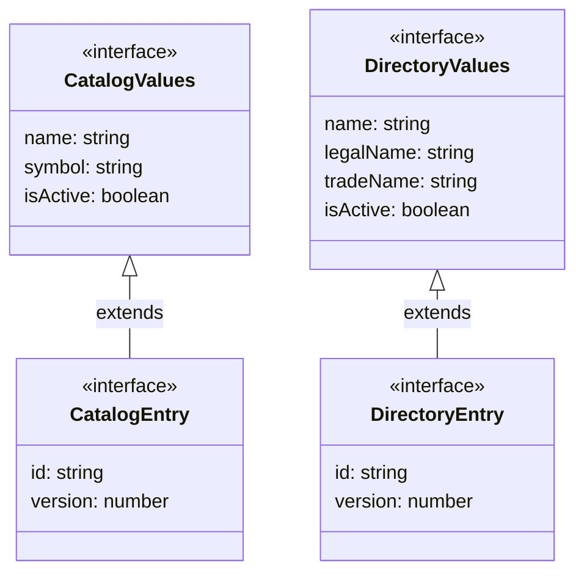

# Catálogos y directorio

**Identificador:** `DIA-VUE-DAT-007`. **Pregunta:** ¿Cómo se distingue una captura
del registro leído y de la acción elegida? **Fuentes:**
[catalog.ts](../../../../../src/modules/catalogs/catalog.ts),
[directory.ts](../../../../../src/modules/directory/directory.ts).
**Notación:** interfaces y generalización de `extends` reales. No hay herencia entre módulos.

**Lectura visual:** [cajas, flechas y multiplicidades](../../diagram-reading.md#clases-y-dominio).

## Destinos y cuerpos de escritura

| Tipo/función | Variantes o transformación |
| --- | --- |
| `CatalogTarget` | `create` sin fila; `edit` con `row: CatalogEntry`. |
| `DirectoryTarget` | `create` con `initialName?`; `edit` con `row: DirectoryEntry`. |
| `CatalogName` | Claves de `PUBLIC_CATALOGS`; selecciona definición y endpoint admitidos. |
| `DirectoryResource` | `clients` o `suppliers`; se mantiene una captura común con campos aplicables por recurso. |
| `buildCatalogPayload` | Recorta nombre; incluye símbolo sólo en unidad de medida; envía estado y `expectedVersion` sólo en edición. |
| `directoryPayload` | Cliente envía `name`; proveedor envía `legalName` y `tradeName`; ambos envían estado y versión sólo en edición. |

La unión discriminada evita exigir un ID ficticio al alta. `version` es dato de lectura;
`expectedVersion` es el nombre de escritura para comprobar la lectura utilizada.
El ID localiza el registro, pero no demuestra que la captura siga vigente. Un conflicto
conserva la captura y pide actualizar; no sustituye automáticamente su versión.

Los campos comunes de `DirectoryValues` facilitan reutilizar editor y flujo; no implica
enviar todos los campos para ambos recursos. Tampoco existe un DTO universal compartido
con identidad o inventario. Las [secuencias](../../processes/03-catalogs-and-directory/index.md)
concretan guardado, confirmación y recuperación; las pruebas se localizan desde la
[matriz por CU](../../../../testing/04-use-case-coverage.md).
