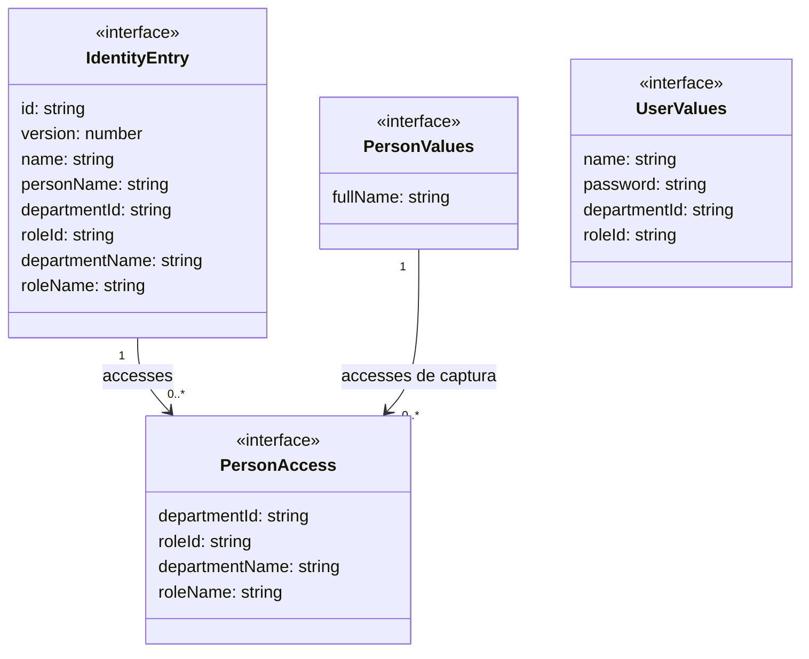
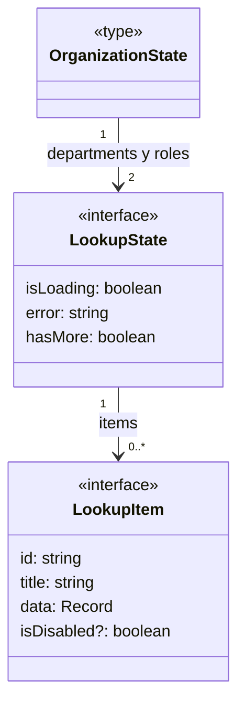

# Personas, usuarios y responsabilidades

**Identificador:** `DIA-VUE-DAT-008`. **Pregunta:** ¿Por qué una fila de identidad
no es directamente el cuerpo que envía cada formulario? **Fuente:**
[identity.ts](../../../../../src/modules/identity/identity.ts).
**Notación:** interfaces y asociaciones de arrays; no se presenta Persona como subclase de Usuario.

**Lectura visual:** [cajas, flechas y multiplicidades](../../diagram-reading.md#clases-y-dominio).

## Proyecciones y acciones

`IdentityEntry` es la proyección normalizada que reutilizan tablas y editores de
`persons`/`users`. Sus etiquetas sirven para consulta y precarga; no se envían como
fuente de verdad en una escritura. `PersonAccess` describe las responsabilidades de
personas en este contrato. `identityService` llena `accesses` al normalizar `persons`
y devuelve un array vacío para `users`; en esa proyección de usuario, área y rol se
conservan en los campos escalares de la fila. Ese nombre técnico no convierte una
responsabilidad de persona en autorización de usuario.

| Acción | Cuerpo construido |
| --- | --- |
| Persona: crear | `fullName` recortado y array de pares `departmentId`/`roleId`. |
| Persona: editar | Los anteriores más `expectedVersion` de la fila leída. |
| Usuario: crear | Nombre recortado, contraseña, área y rol. |
| Usuario: editar | Nombre, área, rol y `expectedVersion`; no envía contraseña. |
| Usuario: cambiar contraseña | Sólo contraseña y `expectedVersion`. |

`PersonTarget` discrimina crear/editar; `IdentityTarget` añade `password` con fila.
`personPayload` elimina etiquetas de las responsabilidades y `userPayload` selecciona
los campos por acción. Ninguno deduce permisos desde los valores editados.
Las [secuencias](../../processes/04-identity/index.md) muestran validación, contrato y
confirmación; el [dominio](../../../../requirements/domain-model/01-identity-and-organization.md)
explica su significado organizacional.

## Opciones de Área y Rol

**Identificador:** `DIA-VUE-DAT-014`. **Pregunta:** ¿Qué tipos conservan las opciones
organizacionales y cómo se relacionan con los valores seleccionados? **Fuentes:**
[lookup.ts](../../../../../src/shared/lookup.ts) y
[useOrganizationOptions.ts](../../../../../src/shared/composables/useOrganizationOptions.ts).
**Notación:** alias TypeScript, interfaces y asociaciones de referencia. Atributos
seleccionados; `items` se representa mediante la asociación.

`OrganizationResource = 'departments' | 'roles'`: las dos claves explican la
multiplicidad de la figura. `useOrganizationOptions` obtiene cada estado de un
`useRemoteLookup` independiente y publica ambos mediante `computed`. `data` es
`Record<string, unknown>`; su abreviación no implica una clase `Record` de dominio.

| Concepto de negocio | Representación concreta en Vue |
| --- | --- |
| Persona | `IdentityEntry` normalizada desde `persons`; captura `PersonValues`. |
| Responsabilidad de persona | Elemento `PersonAccess` de `PersonValues.accesses` o de la fila de persona. |
| Usuario y acceso capturado | `IdentityEntry` de `users` y `UserValues`; `departmentId` y `roleId` son strings, no objetos Área/Rol embebidos. |
| Área y Rol como opciones | Dos estados de `OrganizationState` con elementos `LookupItem`. La selección conserva su `id`; `title` permite mostrar la etiqueta. |
| Usuario autenticado | `SessionUser` conserva ID, nombre y permisos. No es `IdentityEntry` ni contiene las responsabilidades editadas. |

El [modelo de sesión](01-session-and-login.md) describe `SessionUser`. Los catálogos
administrables utilizan [CatalogEntry](03-catalogs-and-directory.md). La selección
de un ID no concede permisos; el cliente recibe la autorización del servidor.
