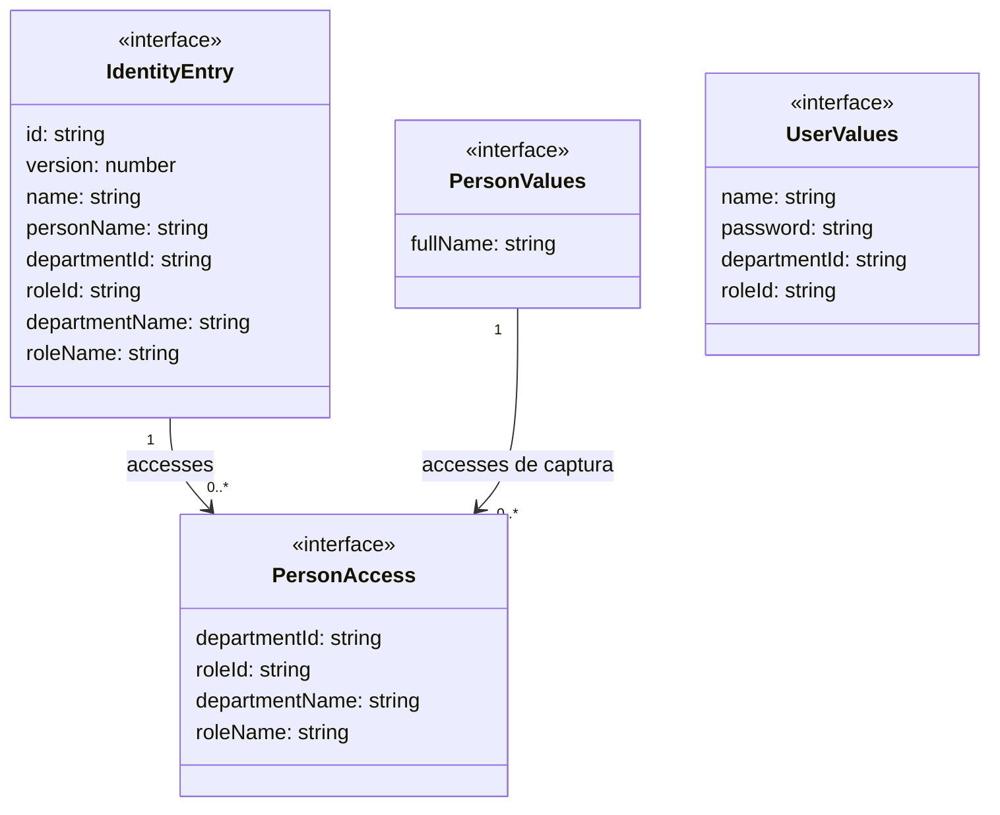

# Personas, usuarios y responsabilidades

**Identificador:** `DIA-VUE-DAT-008`. **Pregunta:** ¿Por qué una fila de identidad
no es directamente el cuerpo que envía cada formulario? **Fuente:**
[identity.ts](../../../../../src/modules/identity/identity.ts).
**Notación:** interfaces y asociaciones de arrays; no se presenta Persona como subclase de Usuario.

**Lectura visual:** [cajas, flechas y multiplicidades](../../diagram-reading.md#clases-y-dominio).

## Proyecciones y acciones

`IdentityEntry` es la proyección normalizada que reutilizan tablas y editores de
`persons`/`users`. Sus etiquetas sirven para consulta y precarga; no se envían como
fuente de verdad en una escritura. `PersonAccess` es el nombre técnico reutilizado
para las asignaciones mostradas; su uso no elimina la diferencia de negocio entre
responsabilidad de persona y acceso de usuario.

| Acción | Cuerpo construido |
| --- | --- |
| Persona: crear | `fullName` recortado y array de pares `departmentId`/`roleId`. |
| Persona: editar | Los anteriores más `expectedVersion` de la fila leída. |
| Usuario: crear | Nombre recortado, contraseña, área y rol. |
| Usuario: editar | Nombre, área, rol y `expectedVersion`; no envía contraseña. |
| Usuario: cambiar contraseña | Sólo contraseña y `expectedVersion`. |

`PersonTarget` discrimina crear/editar; `IdentityTarget` añade `password` con fila.
`personPayload` elimina etiquetas de las responsabilidades y `userPayload` selecciona
los campos por acción. Ninguno deduce permisos desde los valores editados.
Las [secuencias](../../processes/04-identity/index.md) muestran validación, contrato y
confirmación; el [dominio](../../../../requirements/domain-model/01-identity-and-organization.md)
explica su significado organizacional.
