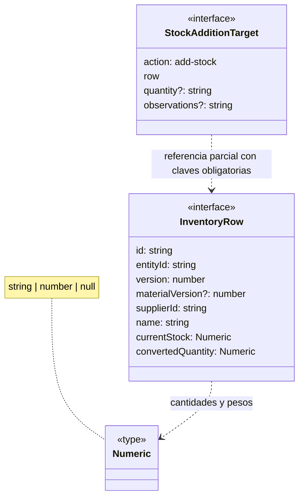

# Inventario, cantidades y destinos

**Identificador:** `DIA-VUE-DAT-009`. **Pregunta:** ¿Qué identidad utiliza una fila
y qué cambia entre editar datos, ajustar stock y agregar merma? **Fuentes:**
[inventory.ts](../../../../../src/modules/warehouse/inventory.ts),
[inventoryMapper.ts](../../../../../src/modules/warehouse/mappers/inventoryMapper.ts),
[useInventoryEditor.ts](../../../../../src/modules/warehouse/composables/useInventoryEditor.ts).
**Notación:** interfaz, aliases y dependencias de tipo. Los atributos de fila son seleccionados.

**Lectura visual:** [cajas, flechas y multiplicidades](../../diagram-reading.md#clases-y-dominio).

## Identidades y campos por responsabilidad

| Grupo | Datos y significado |
| --- | --- |
| Identidad | `id` identifica la fila/oferta operable; `entityId`, el artículo base en materiales/consumibles. No son intercambiables. En merma se sigue el mapper de ese recurso. |
| Concurrencia | `version` y, cuando aplica, `materialVersion` conservan la lectura de las partes editables. |
| Clasificación | `presentationId`, `unitMeasureId` y sus etiquetas; dimensiones de material/merma. |
| Existencias | `currentStock`, `convertedQuantity`, `minStock`, `maxUnitCost?`; el permiso determina lo visible. |
| Pesos | `coneWeightKg`, `totalWeightKg`, `weightKg`, `referenceRollTotalWeightKg`, `sampleLengthM`, `sampleNetWeightKg`. Se mantienen las diferencias entre referencia y peso utilizado. |
| Captura | `InventoryValues` usa campos de formulario: incluye, entre otros, `newStock`, `initialQuantity`, `quantity`, `reasonId` y observaciones. No es una copia de la fila. |

`Numeric = string | number | null` admite cantidades serializadas y ausencia de dato;
un `null` no equivale por sí mismo a cero. La presentación y los mappers tratan cada campo.
`InventoryPayload` es un diccionario de escalares admitidos, construido por acción.

## Unión de destinos

`EditorTarget` reúne una rama con `action` create/edit/stock/delete y `row?`, y otra
`StockAdditionTarget` para `add-stock`. Esta última exige en su fila parcial
`id`, `entityId`, `name`, `supplierName` y `currentStock`, permitiendo abrir la entrada
desde la recuperación de un duplicado sin fabricar una fila completa.

`InventoryPermissions` expone `canRead`, `canWrite`, `canAdjust`, `canAdd`, `canReadCosts`,
`canReadState` y `canExport`; son capacidades de presentación, con comprobación
definitiva en la API. La [familia de procesos](../../processes/05-warehouse/index.md)
separa selección, entrada idempotente, ajuste, baja y vista previa.
