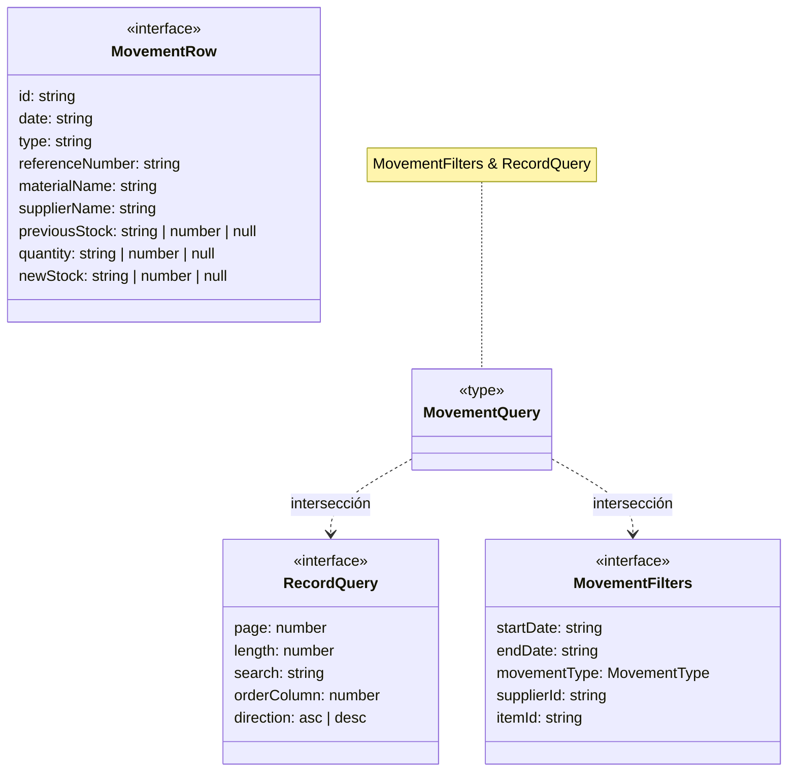

# Movimientos, consultas y reportes

**Identificador:** `DIA-VUE-DAT-010`. **Pregunta:** ¿Cómo se combina la consulta
de tabla con filtros operativos sin confundir historial y estado actual? **Fuentes:**
[movement.ts](../../../../../src/modules/movements/movement.ts),
[list.ts](../../../../../src/shared/list.ts),
[report.ts](../../../../../src/shared/report.ts).
**Notación:** interfaces, alias de intersección y dependencias. No hay `extends` en `MovementQuery`.

**Lectura visual:** [cajas, flechas y multiplicidades](../../diagram-reading.md#clases-y-dominio).

`MovementType` admite vacío para Todos y ENTRY/ISSUE/ADJUSTMENT/RETURN.
`MovementRow` también incluye dimensiones `materialBase`/`materialHeight`. Sus saldos
describen el efecto histórico; no se usan para sustituir el stock actual del editor.
`MovementResource` mantiene materiales, consumibles y mermas como consultas separadas.

La forma TypeScript admite cantidades numéricas serializadas y campos nulos; el
normalizador aplica una condición más estricta a la respuesta: `quantity` debe existir,
mientras que los saldos anterior/nuevo pueden ser nulos. Una referencia ausente se
presenta como «—». El tipo estático no elimina estas comprobaciones de ejecución.

## Contratos de consulta reutilizados

| Dominio | Declaración y filtros adicionales |
| --- | --- |
| Compras | `PurchaseQuery = RecordQuery & PurchaseFilters`: fechas, proveedor y persona receptora. |
| Salidas | `IssueQuery = RecordQuery & IssueFilters`: fechas, cliente, área, persona, estado de cumplimiento y búsqueda en observaciones. |
| Identidad | `IdentityQuery extends RecordQuery`: área y rol. Aquí sí existe extensión declarada. |
| Inventario | `InventoryQuery` declara sus campos propios: búsqueda, proveedor, página, longitud, dirección y columna opcional. No hereda de `RecordQuery`. |

`ReportScope` tiene `mode: filtered | current-month | specific-month` y `month: string`.
Los servicios de documentos validan el alcance y eliminan paginación al exportar;
`specific-month` exige un mes válido. Compartir consulta no exige compartir un endpoint.
La [secuencia de reportes](../../processes/08-movements-and-reports/02-reports.md)
explica Blob, nombre de archivo, errores y descarga; las
[pruebas](../../../../testing/04-use-case-coverage.md) conservan los límites del contrato observado.
