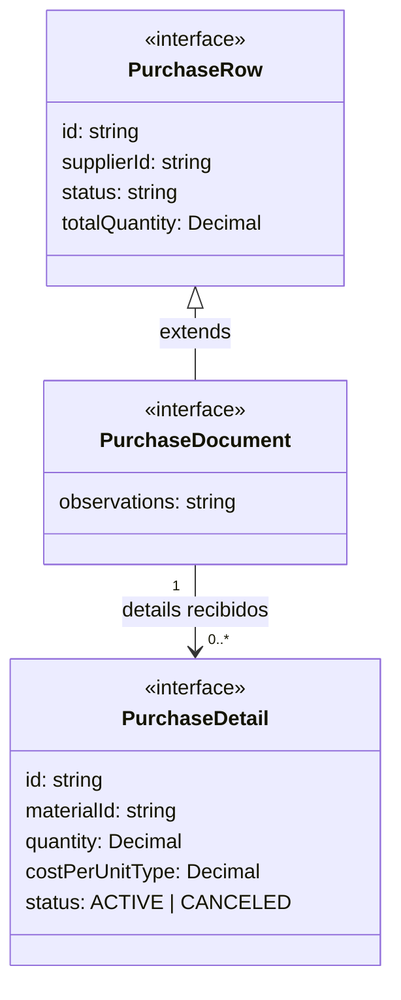
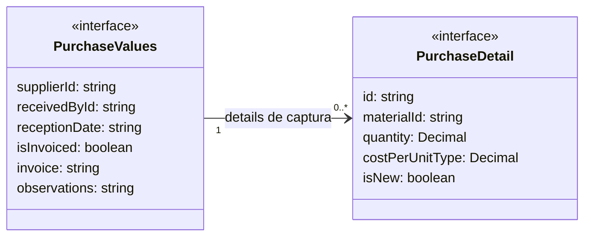

# Compras: fila, documento y captura

**Identificador:** `DIA-VUE-DAT-001`. **Pregunta:** ¿Qué se consulta, qué se captura
y qué detalles se pueden enviar en una edición? **Fuentes:**
[purchase.ts](../../../../../src/modules/purchases/purchase.ts),
[purchaseRequestMapper.ts](../../../../../src/modules/purchases/mappers/purchaseRequestMapper.ts),
[usePurchaseEditor.ts](../../../../../src/modules/purchases/composables/usePurchaseEditor.ts).
**Notación:** interfaces, extensión real y asociaciones de arrays; no hay composición de objetos.

**Lectura visual:** [cajas, flechas y multiplicidades](../../diagram-reading.md#clases-y-dominio).

## Captura y detalles nuevos

**Identificador:** `DIA-VUE-DAT-011`. **Pregunta:** ¿Qué relación utiliza el editor
antes de construir la escritura? **Fuente:** `PurchaseValues` y `PurchaseDetail` en
`purchase.ts`. **Notación:** asociación de array entre interfaces; atributos seleccionados.

La fila añade referencia, recepción, factura, etiquetas e importes neto/bruto.
El detalle añade cantidad convertida, costo por unidad convertida e importes neto/bruto.
La separación de figuras conserva el mismo tipo `PurchaseDetail`: no hay una copia
estructural distinta del detalle por cada figura.

## Datos y modos

`Decimal = string | number`; es un alias del cliente, no una instancia Decimal de Prisma.
El detalle incluye además nombre, dimensiones opcionales, presentación y unidad. La fila
incluye etiquetas de proveedor y receptor. El documento siempre incluye observaciones.

| Tipo | Variantes y garantías de captura |
| --- | --- |
| `PurchaseResource` | `materials` o `consumables`; fija contexto, lookup y endpoint. |
| `PurchaseTarget` | `create` sin documento; `edit` y `view` con documento completo. |
| `PurchaseWriteTarget` | Excluye la variante `view` del contrato de escritura. |
| `PurchaseDetailChange` | `correct` con cantidad y costo numéricos, o `cancel` sin valores de corrección. |
| `ItemCreation` | Extiende `LookupCreation` con `supplier: LookupItem` para el alta contextual del artículo. |

## Transformación de escritura

`mapPurchaseFormToRequest` conserva el proveedor leído en edición; toma receptor,
fecha, factura y observaciones de la captura. Recorta observaciones y normaliza factura
a mayúsculas sólo cuando está facturada. Convierte la fecha a UTC mediante la regla
compartida. Selecciona sólo detalles `isNew`; envía `materialId`, `Number(quantity)` y
`Number(costPerUnitType)`. En edición sin detalles nuevos omite `details`.

No envía totales, importes derivados, `status` ni una copia completa de `PurchaseRow`.
La corrección y cancelación usan `changeDetail` con IDs de documento y detalle.
La [secuencia de guardado](../../processes/06-purchases/02-purchase-save.md) y los
[estados](../states/01-purchases.md) explican cuándo se admite cada operación.
