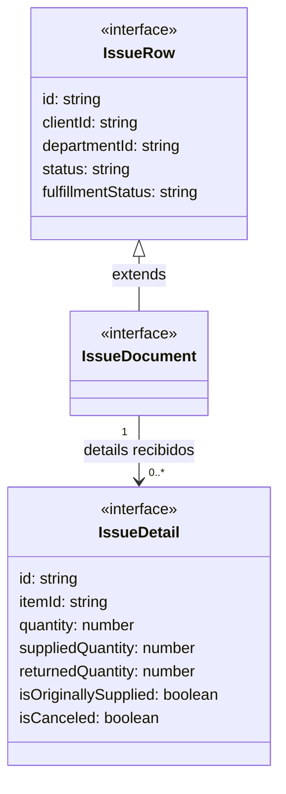
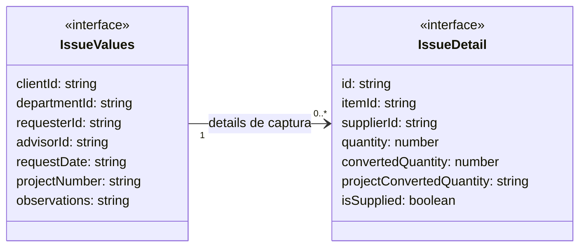

# Salidas: documentos, saldos y modos

**Identificador:** `DIA-VUE-DAT-002`. **Pregunta:** ¿Qué se conserva para consultar,
editar encabezado, surtir y devolver? **Fuentes:**
[issue.ts](../../../../../src/modules/issues/issue.ts),
[issueRequestMapper.ts](../../../../../src/modules/issues/mappers/issueRequestMapper.ts),
[useIssueEditor.ts](../../../../../src/modules/issues/composables/useIssueEditor.ts).
**Notación:** interfaces, extensión real y asociaciones de colección.

**Lectura visual:** [cajas, flechas y multiplicidades](../../diagram-reading.md#clases-y-dominio).

El detalle añade nombre, dimensiones, presentación, unidad y costo máximo opcional;
la fila conserva las etiquetas del cliente, área y personas para consulta/precarga.
`IssueResource` fija materiales, consumibles o mermas. Un solo tipo de proyección
permite compartir componentes sin mezclar esos contextos en la misma solicitud.

## Captura de encabezado y detalles

**Identificador:** `DIA-VUE-DAT-012`. **Pregunta:** ¿Qué cambia en la captura sin
sobrescribir los saldos del documento? **Fuente:** `IssueValues` y `IssueDetail`.
**Notación:** asociación de array de interfaces, sin composición ni herencia adicional.

El documento conserva fecha, personas, proyecto y observaciones del encabezado, además
de las etiquetas. `IssueDetail` es el mismo tipo en ambas figuras; se seleccionan
atributos distintos para explicar saldos leídos e interacción de surtido.

## Modos y contrato de escritura

| Variante de `IssueTarget` | Documento | Operación y payload |
| --- | --- | --- |
| `create` | No admite documento. | Encabezado y detalles con identidad de recurso y cantidad. |
| `edit` | Obligatorio. | Encabezado y detalles conforme al estado leído. |
| `header` | Obligatorio. | Sólo encabezado; no incluye `details`. |
| `supply` | Obligatorio. | Sólo detalles elegidos: `id`, `isSupplied: true`, `projectConvertedQuantity` numérico. |
| `view` | Obligatorio. | Lectura, excluida de `IssueWriteTarget`. |
| `return` | Obligatorio. | No usa `save` del editor general; tiene flujo de devolución separado. |

`IssueWriteTarget` reúne las primeras cuatro variantes. `IssueOpenMode` distingue las
acciones que requieren lectura previa: edit/view/supply/return. Las uniones no son
subclases. `resolveIssueEditMode` decide edición completa o encabezado después de leer;
los campos de formulario y las capacidades del modo restringen la interacción.

Para create/edit, un detalle de merma envía `wasteId` y cantidad; un detalle de artículo
envía `materialId`, `supplierId` y cantidad. No se envían saldos ni costos como autoridad.
Las [secuencias](../../processes/07-issues/index.md) y los
[estados](../states/02-issues.md) separan escritura general, surtido y devolución.

## Contratos visuales de selección

`IssueHeaderSelect` identifica `field`, `kind`, etiqueta, `LookupState`, opción inicial,
`isDisabled` e indicación `hint`. `IssueFilterSelect` presenta el mismo propósito para
los campos de filtro. El estado de opciones pertenece al lookup; el ID seleccionado,
a los valores del formulario/filtro. El [contrato compartido](02-shared-contracts.md)
explica la estructura y la [secuencia de área](../../processes/07-issues/04-department-scope.md)
explica selección inicial, bloqueo y limpieza sin inventar permisos locales.
