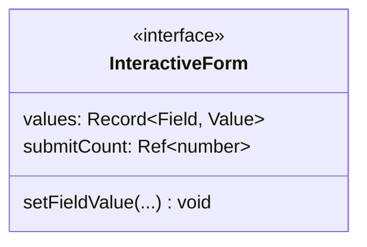

# Tipos genéricos y estado reactivo

## Interfaz y referencia reactiva

El diagrama de clases representa interfaces, atributos, operaciones y referencias
TypeScript. El propietario del estado y el flujo explican su uso durante la interacción.

**Identificador:** `DIA-VUE-DAT-013`. **Pregunta:** ¿Cómo se combinan valores de captura
y referencias reactivas tipadas? **Fuentes:** la interfaz interna
`InteractiveForm<Field extends string, Value>` de
[useFormInteraction.ts](../../../../../src/shared/composables/useFormInteraction.ts).
La figura muestra el contrato propio; los tipos de biblioteca aparecen en sus atributos.

**Lectura visual:** [interfaces y genéricos](../../diagram-reading.md#clases-y-dominio).

| Construcción | Significado |
| --- | --- |
| `Field extends string` | Claves de los campos elegidos por el consumidor. |
| `Record<Field, Value>` | Relaciona claves con valores admitidos; cada propiedad no se convierte automáticamente en un `Ref`. |
| `submitCount: Ref<number>` | Contador reactivo que el helper lee mediante `.value`. |
| Setters y validación | Funciones que suministra el formulario; el helper actualiza/valida mediante ese contrato. |
| Compatibilidad estructural | VeeValidate satisface la forma requerida, sin heredar de una clase `InteractiveForm`. |

La figura abrevia los parámetros de `setFieldValue` con `...`; la declaración enlazada
conserva las firmas completas.

## Aplicación de los genéricos

| Consumidor | `Field` | `Value` |
| --- | --- | --- |
| `useLoginForm` | `LoginField`. | `string`. |
| `usePurchaseEditor` | `PurchaseField`. | `string`, `boolean` o `PurchaseDetail[]`. |
| `useIssueEditor` | `IssueField`. | `string` o `IssueDetail[]`. |

El [estándar de formularios](../../../interface-standards.md#formularios) define
cuándo se muestran los errores. Los tipos relacionan claves y valores; las reglas
validan su contenido.

El [inventario de estado](../states/04-state-ownership-and-save.md#inventario-de-propietarios)
identifica el contenedor reactivo y la vida útil de cada dato. En script, las refs
usan `.value`; Vue desempaqueta las de nivel superior del template.

La [comprobación de respuestas HTTP](../../../contracts/client-contracts.md#escrituras-y-confirmación)
es independiente de los tipos estáticos: una aserción `as` no valida los datos de red.
