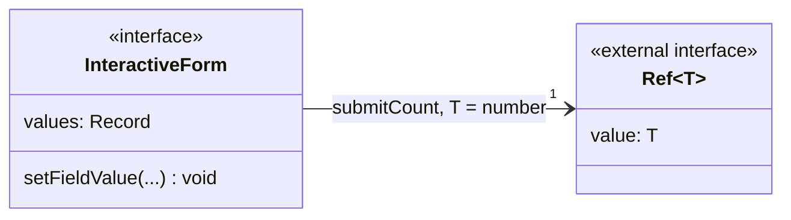

# Tipos genéricos y estado reactivo

## Interfaz y referencia reactiva

El diagrama de clases representa interfaces, atributos, operaciones y referencias
TypeScript. El propietario del estado y el flujo explican su uso durante la interacción.

**Identificador:** `DIA-VUE-DAT-013`. **Pregunta:** ¿Cómo se combinan valores de captura
y referencias reactivas tipadas? **Fuentes:** la interfaz interna
`InteractiveForm<Field extends string, Value>` de
[useFormInteraction.ts](../../../../../src/shared/composables/useFormInteraction.ts)
y `Ref<T>` de Vue. Atributos/operaciones seleccionados y asociación de propiedad.

**Lectura visual:** [interfaces y genéricos](../../diagram-reading.md#clases-y-dominio).

| Construcción | Significado |
| --- | --- |
| `Field extends string` | Claves de los campos elegidos por el consumidor. |
| `Record<Field, Value>` | Relaciona claves con valores admitidos; cada propiedad no se convierte automáticamente en un `Ref`. |
| `submitCount: Ref<number>` | Contador reactivo que el helper lee mediante `.value`. |
| Setters y validación | Funciones que suministra el formulario; el helper actualiza/valida mediante ese contrato. |
| Compatibilidad estructural | VeeValidate satisface la forma requerida, sin heredar de una clase `InteractiveForm`. |

La figura abrevia los parámetros de `setFieldValue` con `...`; la declaración enlazada
conserva las firmas completas.

## Aplicación de los genéricos

| Consumidor | `Field` | `Value` |
| --- | --- | --- |
| `useLoginForm` | `LoginField`. | `string`. |
| `usePurchaseEditor` | `PurchaseField`. | `string`, `boolean` o `PurchaseDetail[]`. |
| `useIssueEditor` | `IssueField`. | `string` o `IssueDetail[]`. |

El helper conserva los campos editados por instancia. Actualizar llama a
`setFieldValue(..., false)` y limpia su error; blur valida tras editar o intentar
el envío. Los tipos conectan claves/valores; las reglas validan su contenido.

## Dónde viven los datos

| Dato | Contenedor real | Actualización |
| --- | --- | --- |
| `SessionUser` | `shallowRef` expuesto readonly por `createAuthSession`. | `load` valida/publica; consumidores leen `.value`. |
| Documento leído | `shallowRef` de `useDocumentRead`. | Sólo la respuesta vigente sustituye el documento. |
| `PurchaseValues` / `IssueValues` | `form.values` reactivo de VeeValidate. | Setters del composable; presentación emite eventos. |
| Filas | `shallowRef<Row[]>` de `usePagedList<Query, Row>`. | Página vigente; conserva filas si el JSON recibido no cambió. |
| `LookupState` | Fotografía `computed` de `useRemoteLookup`. | Opciones/carga/error derivados; el ID pertenece a captura/filtro. |

Los modelos de [Compra](07-purchases.md) y [Salida](08-issues.md) describen sus estructuras.
El [recorrido tipado](../../processes/02-shared-runtime/06-typed-data-flow.md) muestra
lectura, props y payload; los [estados](../states/index.md), los modos.

En script se accede a una ref con `.value`; Vue desempaqueta las refs de nivel superior
del contexto del template. `form.values` conserva su contrato de objeto reactivo.

## Comprobación estática y JSON

`interface`, `type`, `keyof`, `Record`, uniones y genéricos describen contratos durante
desarrollo/compilación. Declarar una interfaz no crea una instancia. Escribir
`request<PurchaseDocument>` o convertir con `as` no comprueba los campos de la red:
servicios y mappers validan los datos desconocidos en ejecución.
