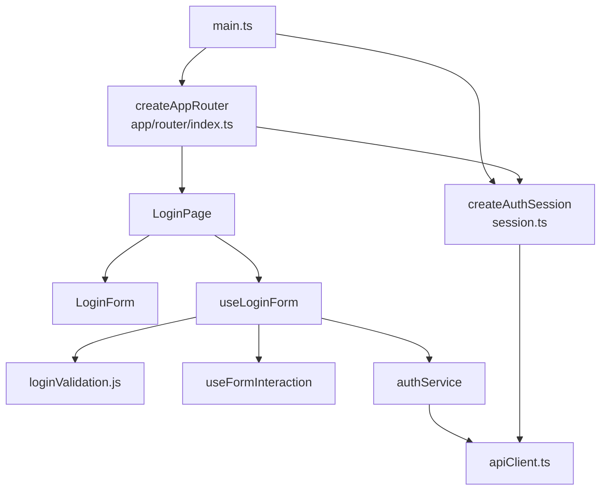

# Acceso y sesión: componentes

**Identificador:** `DIA-VUE-COMP-001`. **Pregunta:** ¿qué dependencias enlazan arranque, sesión y captura de login?
**Fuentes:** [main.ts](../../../../../src/main.ts), [index.ts](../../../../../src/app/router/index.ts), [authService.ts](../../../../../src/modules/auth/services/authService.ts), [apiClient.ts](../../../../../src/shared/http/apiClient.ts).
**Notación:** [mapa de dependencias](../../diagram-reading.md#componentes-y-dependencias).

Vue Router ejecuta la guarda; VeeValidate ejecuta la validación del formulario y Axios
transporta HTTP. Sus clases no forman parte del modelo. La [provisión de sesión](../../development/design-and-construction-patterns/06-session-provision.md)
explica la instancia compartida; el mapa representa imports, no el retorno tras autenticar.
