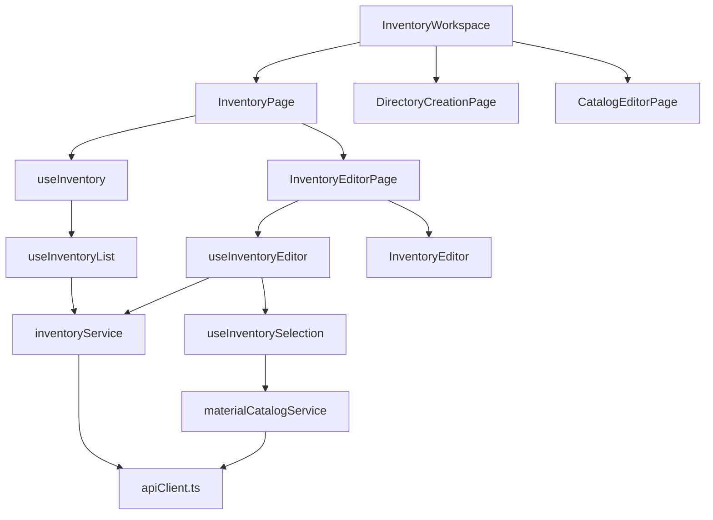
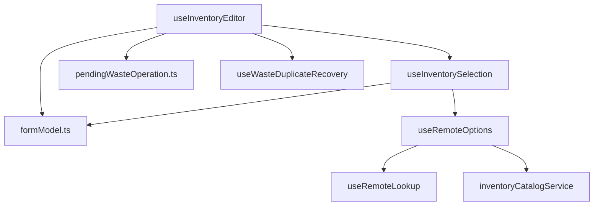

# Inventario y merma: componentes

**Identificador:** `DIA-VUE-COMP-002`. **Pregunta:** ¿quién compone listado, editor y altas auxiliares?
**Fuentes:** [InventoryWorkspace.vue](../../../../../src/app/pages/InventoryWorkspace.vue), [InventoryPage.vue](../../../../../src/modules/warehouse/pages/InventoryPage.vue), [inventoryService.ts](../../../../../src/modules/warehouse/services/inventoryService.ts), [apiClient.ts](../../../../../src/shared/http/apiClient.ts).
**Notación:** [mapa de dependencias](../../diagram-reading.md#componentes-y-dependencias).

**Identificador:** `DIA-VUE-COMP-010`. **Pregunta:** ¿qué colaboradores separan selección, captura recuperable y duplicados?
**Fuentes:** [useInventoryEditor.ts](../../../../../src/modules/warehouse/composables/useInventoryEditor.ts), [useInventorySelection.ts](../../../../../src/modules/warehouse/composables/useInventorySelection.ts), [useRemoteLookup.ts](../../../../../src/shared/composables/useRemoteLookup.ts), [inventoryCatalogService.ts](../../../../../src/modules/warehouse/services/inventoryCatalogService.ts).
**Notación:** [mapa de dependencias](../../diagram-reading.md#componentes-y-dependencias).

La tabla y los controles visuales usan Vuetify. Los [estados de merma](../states/03-waste-capture.md)
precisan la recuperación local; el [alta contextual](../../development/design-and-construction-patterns/09-contextual-creation.md)
precisa eventos y callbacks entre dominios.

## Presentación de tablas y campos

| Recurso | Encabezados y celdas |
| --- | --- |
| Materiales | Material, Medidas (Base/Altura), Stock actual, Stock Mínimo, Presentación y Conversión (Cantidad/Unidad). Costo/Activo según permiso. |
| Mermas | Merma y proveedor, Medidas, Presentación, Pesos por unidad (Cono/Total con cono/Neto), Existencias (Stock actual/Stock mínimo) y Conversión (Cantidad/Unidad). Costo, estado y acciones según permiso. |
| Consumibles | Consumible, Existencia, Stock Mínimo, Presentación y Unidad; costo/estado según permiso. |

`inventoryTable` declara las columnas y el orden admitido. `formFields` elige las
secciones de existencias, mermas o alta de artículo desde Compras.
`InventoryFormField` presenta los campos. La tabla usa paginación de servidor. El
[contrato HTTP](../../../contracts/client-contracts.md) conserva parámetros y aceptación.

Compras y Almacén consultan artículos mediante `shared/services/materialCatalogService`,
con búsqueda, paginación y señal de cancelación comunes. El contrato de selección vive en `shared/lookup.ts`; Compras conserva el contrato `ItemCreation` con proveedor fijado. Almacén registra artículos mediante `CatalogEditorPage` y `LookupCreation`, sin exigir proveedor.
