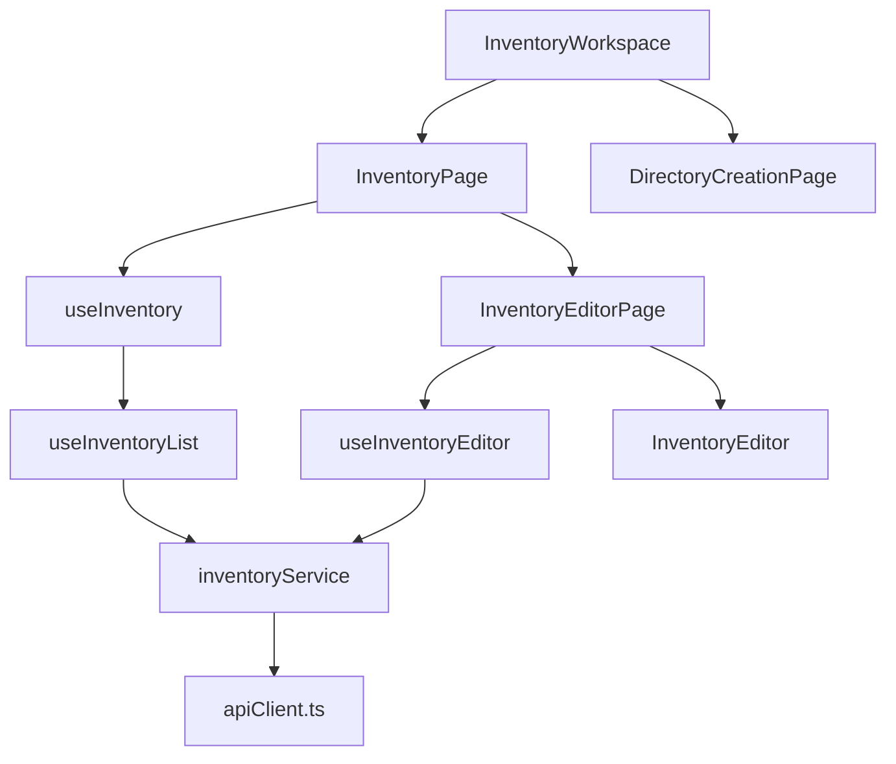
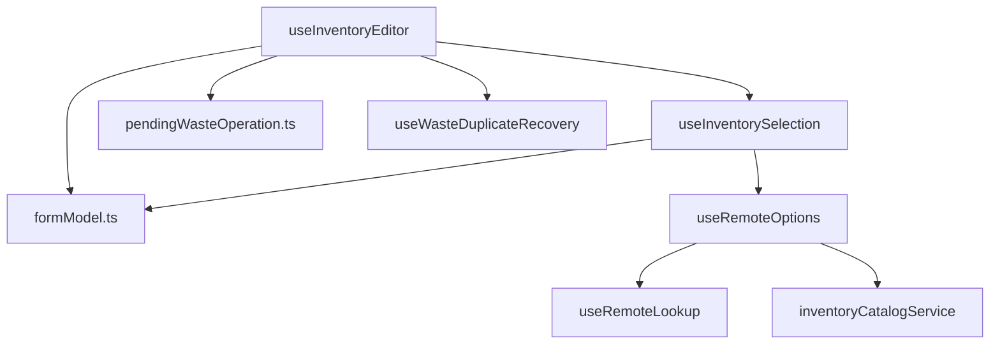

# Inventario y merma: componentes

**Identificador:** `DIA-VUE-COMP-002`. **Pregunta:** ¿quién compone listado, editor y alta auxiliar de proveedor?
**Fuentes:** [InventoryWorkspace.vue](../../../../../src/app/pages/InventoryWorkspace.vue), [InventoryPage.vue](../../../../../src/modules/warehouse/pages/InventoryPage.vue), [inventoryService.ts](../../../../../src/modules/warehouse/services/inventoryService.ts), [apiClient.ts](../../../../../src/shared/http/apiClient.ts).
**Notación:** [mapa de dependencias](../../diagram-reading.md#componentes-y-dependencias).

**Identificador:** `DIA-VUE-COMP-010`. **Pregunta:** ¿qué colaboradores separan selección, captura recuperable y duplicados?
**Fuentes:** [useInventoryEditor.ts](../../../../../src/modules/warehouse/composables/useInventoryEditor.ts), [useInventorySelection.ts](../../../../../src/modules/warehouse/composables/useInventorySelection.ts), [useRemoteLookup.ts](../../../../../src/shared/composables/useRemoteLookup.ts), [inventoryCatalogService.ts](../../../../../src/modules/warehouse/services/inventoryCatalogService.ts).
**Notación:** [mapa de dependencias](../../diagram-reading.md#componentes-y-dependencias).

La tabla y los controles visuales usan Vuetify. Los [estados de merma](../states/03-waste-capture.md)
precisan la recuperación local; el [alta contextual](../../development/design-and-construction-patterns/09-contextual-creation.md)
precisa eventos y callbacks entre dominios.

## Presentación de tablas y campos

| Recurso | Encabezados y celdas |
| --- | --- |
| Materiales | Material, Medidas (Base/Altura), Stock actual, Stock Mínimo, Presentación y Conversión (Cantidad/Unidad). Costo/Activo según permiso. |
| Mermas | La estructura de Materiales y Pesos por unidad (Cono/Total con cono/Neto); referencias históricas de consulta. |
| Consumibles | Consumible, Existencia, Stock Mínimo, Presentación y Unidad; costo/estado según permiso. |

`inventoryTable` declara columnas y orden admitido; `formFields` declara secciones y
campos que adapta `InventoryFormField`. La tabla usa paginación de servidor, sin
descargar el inventario para filtrarlo en memoria. El
[contrato HTTP](../../../contracts/client-contracts.md) conserva parámetros y aceptación.
