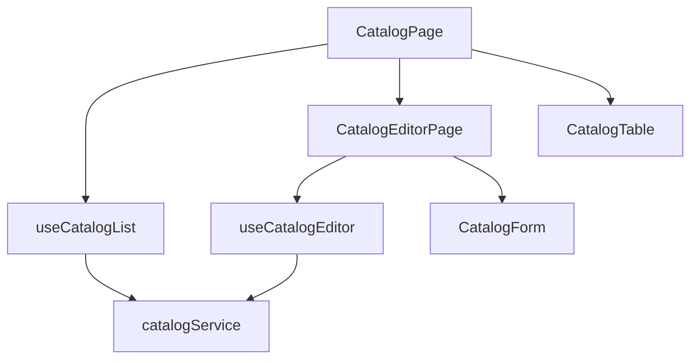

# Catálogos administrables: componentes

**Identificador:** `DIA-VUE-COMP-003`. **Pregunta:** ¿qué dependencias separan consulta, captura y guardado de catálogos?
**Fuentes:** [CatalogPage.vue](../../../../../src/modules/catalogs/pages/CatalogPage.vue), [useCatalogList.ts](../../../../../src/modules/catalogs/composables/useCatalogList.ts), [CatalogTable.vue](../../../../../src/modules/catalogs/components/CatalogTable.vue), [catalogService.ts](../../../../../src/modules/catalogs/services/catalogService.ts).
**Notación:** [mapa de dependencias](../../diagram-reading.md#componentes-y-dependencias).

VeeValidate se integra en el editor y Vuetify en los componentes visuales. La definición
`catalog.ts` es código propio de configuración. La [secuencia de guardado](../../processes/03-catalogs-and-directory/01-catalog-record-save.md)
muestra cómo el callback del editor permite reutilizar `useRecordSave` sin imports al dominio.
