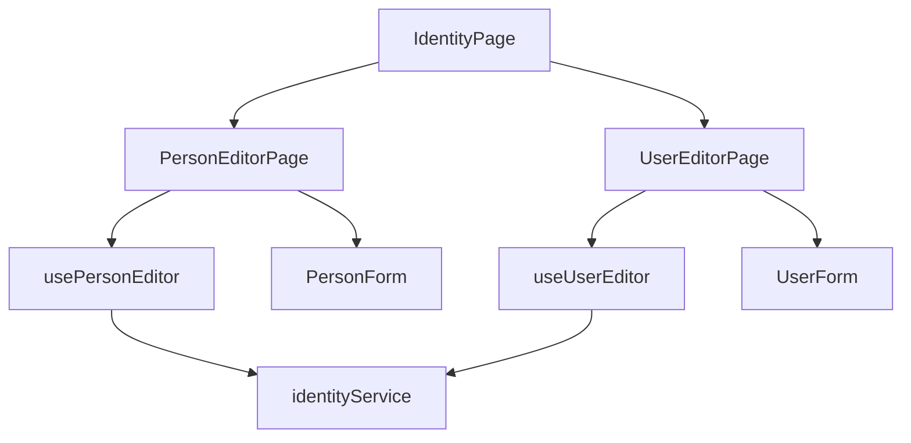
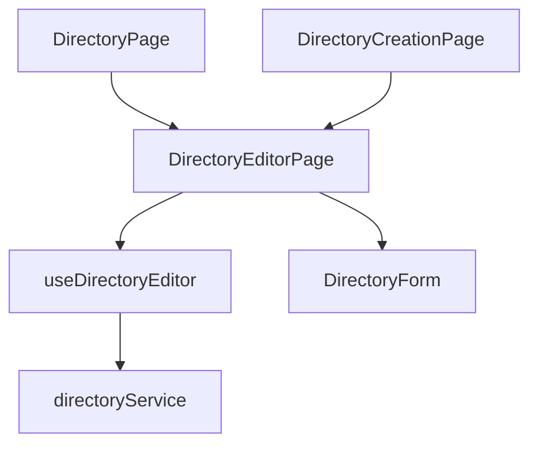

# Identidad y directorio: componentes

**Identificador:** `DIA-VUE-COMP-004`. **Pregunta:** ¿qué colaboradores separan personas, cuentas y responsabilidades organizacionales?
**Fuentes:** [IdentityPage.vue](../../../../../src/modules/identity/pages/IdentityPage.vue), [PersonEditorPage.vue](../../../../../src/modules/identity/pages/PersonEditorPage.vue), [UserForm.vue](../../../../../src/modules/identity/components/UserForm.vue), [identityService.ts](../../../../../src/modules/identity/services/identityService.ts).
**Notación:** [mapa de dependencias](../../diagram-reading.md#componentes-y-dependencias).

**Identificador:** `DIA-VUE-COMP-008`. **Pregunta:** ¿cómo reutilizan el editor de directorio la página independiente y el alta contextual?
**Fuentes:** [DirectoryPage.vue](../../../../../src/modules/directory/pages/DirectoryPage.vue), [DirectoryCreationPage.vue](../../../../../src/app/pages/DirectoryCreationPage.vue), [DirectoryForm.vue](../../../../../src/modules/directory/components/DirectoryForm.vue), [directoryService.ts](../../../../../src/modules/directory/services/directoryService.ts).
**Notación:** [mapa de dependencias](../../diagram-reading.md#componentes-y-dependencias).

Los formularios usan VeeValidate y controles Vuetify. Persona, cuenta y entidad comercial
conservan contratos distintos; compartir guardado no los convierte en una misma entidad.
Los [contratos de formularios](../../../contracts/form-and-event-contracts.md) precisan qué
editor emite una entidad creada y cuál sólo notifica finalización.
