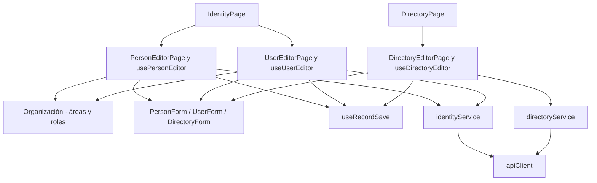

# Identidad y directorio: componentes

**Identificador:** `DIA-VUE-COMP-004`. **Pregunta:** ¿Qué colaboradores tienen responsabilidad propia y qué contratos los conectan?

**Fuente:** IdentityPage, DirectoryPage, usePersonEditor, useUserEditor, useDirectoryEditor y servicios respectivos. **Notación y alcance:** Las flechas indican dependencia o consumo; no orden temporal ni herencia.

**Lectura visual:** [formas, límites y flechas del mapa](../../diagram-reading.md#mapas-y-actividades).

