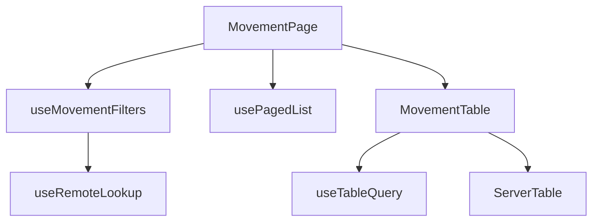
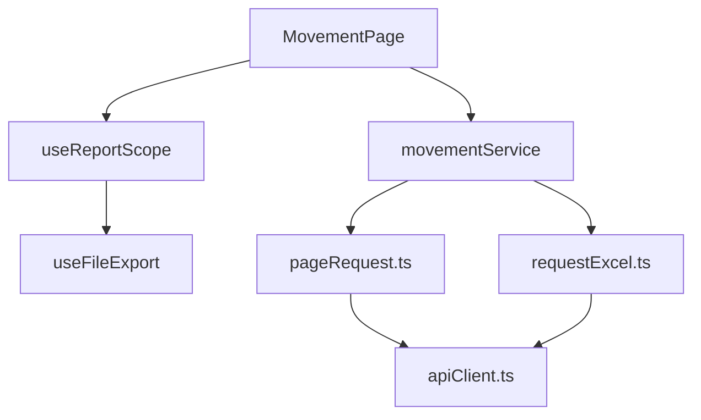

# Historiales y reportes: componentes

**Identificador:** `DIA-VUE-COMP-005`. **Pregunta:** ¿quién coordina filtros, consulta paginada y tabla?
**Fuentes:** [MovementPage.vue](../../../../../src/modules/movements/pages/MovementPage.vue), [useMovementFilters.ts](../../../../../src/modules/movements/composables/useMovementFilters.ts), [ServerTable.vue](../../../../../src/shared/components/ServerTable.vue), [useRemoteLookup.ts](../../../../../src/shared/composables/useRemoteLookup.ts).
**Notación:** [mapa de dependencias](../../diagram-reading.md#componentes-y-dependencias).

**Identificador:** `DIA-VUE-COMP-013`. **Pregunta:** ¿qué dependencias separan la coordinación del reporte y su transporte?
**Fuentes:** [MovementPage.vue](../../../../../src/modules/movements/pages/MovementPage.vue), [useReportScope.ts](../../../../../src/shared/composables/useReportScope.ts), [requestExcel.ts](../../../../../src/shared/http/requestExcel.ts), [apiClient.ts](../../../../../src/shared/http/apiClient.ts).
**Notación:** [mapa de dependencias](../../diagram-reading.md#componentes-y-dependencias).

Vuetify presenta la tabla y Axios realiza el transporte. `usePagedList` y `useFileExport`
reciben funciones por configuración; no importan `movementService`. Las
[secuencias de filtros y reportes](../../processes/08-movements-and-reports/index.md)
muestran esas llamadas en ejecución.
