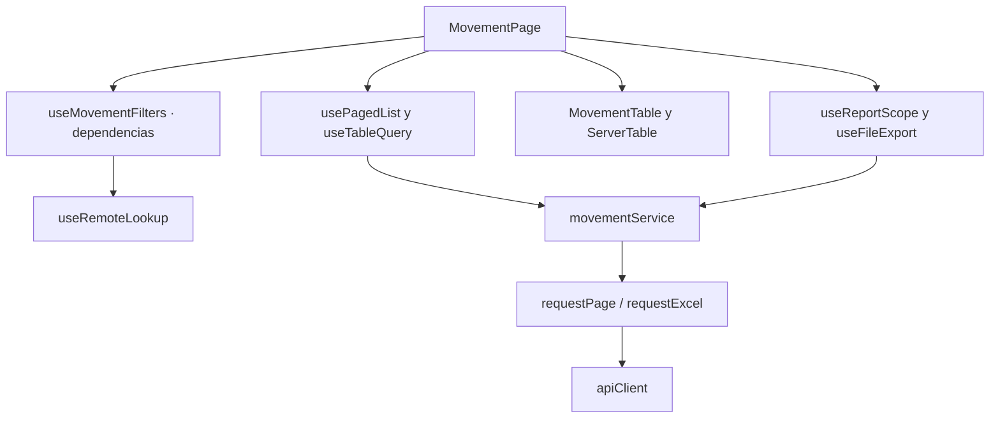

# Historiales y reportes: componentes

**Identificador:** `DIA-VUE-COMP-005`. **Pregunta:** ¿Qué colaboradores tienen responsabilidad propia y qué contratos los conectan?

**Fuente:** MovementPage, useMovementFilters, movementService, useReportScope y MovementTable. **Notación y alcance:** Las flechas indican dependencia o consumo; no orden temporal ni herencia.

El corte representa elementos del cliente, no clases ni procesos desplegados. La [vista de procesos](../../processes/index.md) detalla orden, validación, rechazo y recuperación. Los contratos de props/eventos se localizan en la [referencia generada](../../development/code-reference.md).
