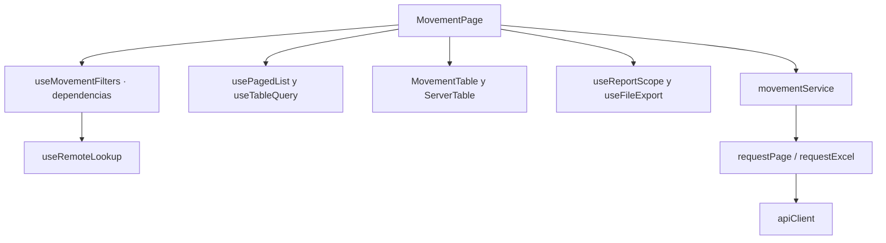

# Historiales y reportes: componentes

**Identificador:** `DIA-VUE-COMP-005`. **Pregunta:** ¿Qué colaboradores tienen responsabilidad propia y qué contratos los conectan?

**Fuente:** MovementPage, useMovementFilters, movementService, useReportScope y MovementTable. **Notación y alcance:** Las flechas indican dependencia o consumo; no orden temporal ni herencia.

**Lectura visual:** [formas, límites y flechas del mapa](../../diagram-reading.md#mapas-y-actividades).

