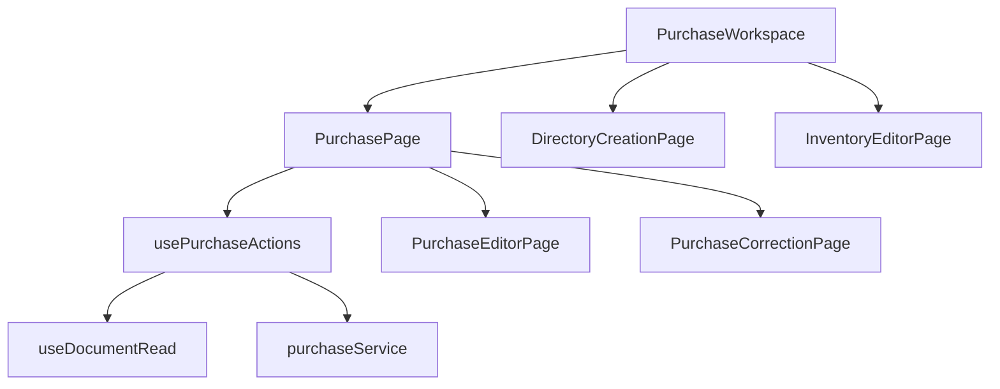
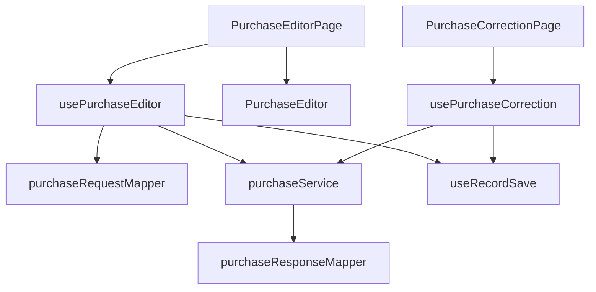
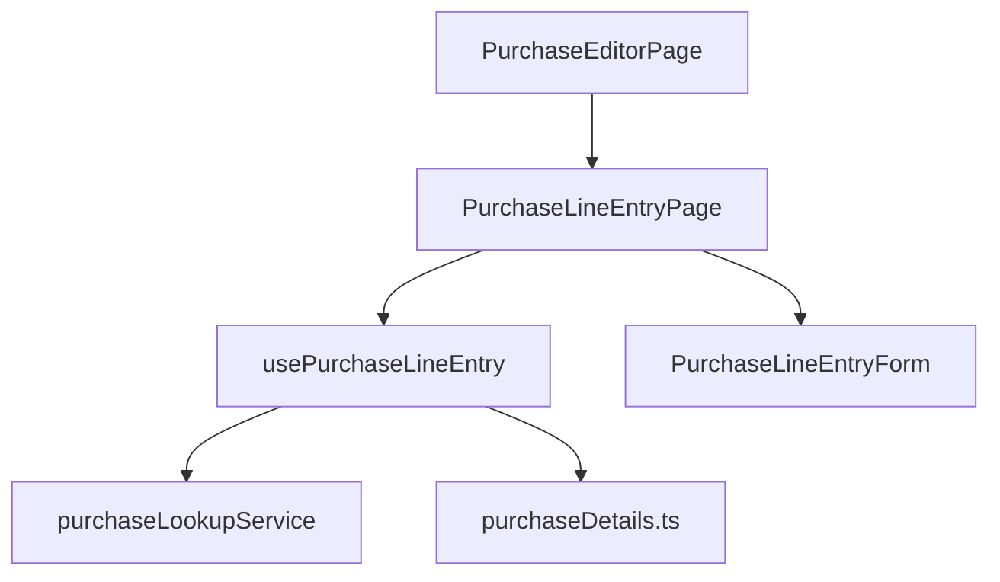

# Compras y correcciones: componentes

**Identificador:** `DIA-VUE-COMP-006`. **Pregunta:** ¿qué colaboradores componen el documento y sus altas auxiliares?
**Fuentes:** [PurchaseWorkspace.vue](../../../../../src/app/pages/PurchaseWorkspace.vue), [PurchasePage.vue](../../../../../src/modules/purchases/pages/PurchasePage.vue), [PurchaseCorrectionPage.vue](../../../../../src/modules/purchases/pages/PurchaseCorrectionPage.vue), [purchaseService.ts](../../../../../src/modules/purchases/services/purchaseService.ts).
**Notación:** [mapa de dependencias](../../diagram-reading.md#componentes-y-dependencias).

**Identificador:** `DIA-VUE-COMP-011`. **Pregunta:** ¿cómo se dividen captura, corrección y adaptación de la escritura?
**Fuentes:** [PurchaseEditorPage.vue](../../../../../src/modules/purchases/pages/PurchaseEditorPage.vue), [usePurchaseEditor.ts](../../../../../src/modules/purchases/composables/usePurchaseEditor.ts), [purchaseResponseMapper.ts](../../../../../src/modules/purchases/mappers/purchaseResponseMapper.ts), [useRecordSave.ts](../../../../../src/shared/composables/useRecordSave.ts).
**Notación:** [mapa de dependencias](../../diagram-reading.md#componentes-y-dependencias).

**Identificador:** `DIA-VUE-COMP-014`. **Pregunta:** ¿qué dependencias componen la captura de un detalle nuevo?
**Fuentes:** [PurchaseEditorPage.vue](../../../../../src/modules/purchases/pages/PurchaseEditorPage.vue), [PurchaseLineEntryPage.vue](../../../../../src/modules/purchases/pages/PurchaseLineEntryPage.vue), [purchaseLookupService.ts](../../../../../src/modules/purchases/services/purchaseLookupService.ts), [purchaseDetails.ts](../../../../../src/modules/purchases/purchaseDetails.ts).
**Notación:** [mapa de dependencias](../../diagram-reading.md#componentes-y-dependencias).

Los controles son Vuetify y los avisos de confirmación usan SweetAlert2. El mapa de imports
no describe el callback de un alta ni el orden de la relectura: los
[procesos](../../processes/06-purchases/index.md) y los [estados](../states/01-purchases.md)
explican esas colaboraciones.
