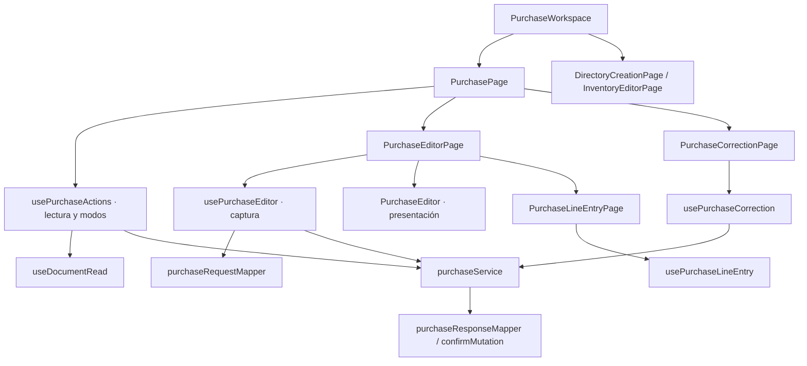

# Compras y correcciones: componentes

**Identificador:** `DIA-VUE-COMP-006`. **Pregunta:** ¿Qué colaboradores tienen responsabilidad propia y qué contratos los conectan?

**Fuente:** PurchaseWorkspace, PurchasePage, usePurchaseActions, usePurchaseEditor, usePurchaseLineEntry, usePurchaseCorrection y mappers. **Notación y alcance:** Las flechas indican dependencia o consumo; no orden temporal ni herencia.

**Lectura visual:** [formas, límites y flechas del mapa](../../diagram-reading.md#mapas-y-actividades).

El corte representa elementos del cliente, no clases ni procesos desplegados. La [vista de procesos](../../processes/index.md) detalla orden, validación, rechazo y recuperación. Los contratos de props/eventos se localizan en la [referencia generada](../../development/code-reference.md).
